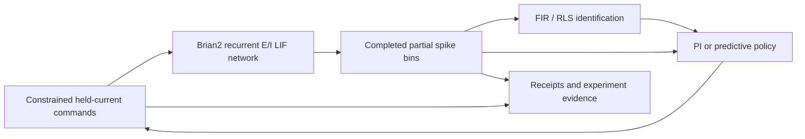

> **Unpublished V1 release candidate:** original V1 plus the M008/M009 reliability correction. Optional personal-style and V1.1 performance work remains HOLD and is excluded. Exact reviewed-revision checks and final maintainer authorization are required. See the [M011 isolation audit](reports/engineering/M011_RELEASE_ISOLATION.md).

# NEUROMANCER — in silico neural-control research

NEUROMANCER investigates whether constrained stimulation and partial spike recordings can support identification, prediction and regulation of a noisy neural population. V1 is a **simulation research candidate**, not a biological computer or a validated hardware system.

The platform includes a 1,000-cell recurrent Brian2 E/I leaky-integrate-and-fire substrate, causal stimulation/observation interfaces, FIR/ARX identification, online RLS and residual-shift experiments, PI and finite-bank predictive controllers, deterministic replay contracts and bounded POSIX process supervision.

## Main research result

The frozen M005B development experiment compared ten network identities with two noise replicates each. All 20 primary trials/260 branches and three separate fault trials/24 branches completed.

| Controller | Mean cumulative post-loss error (Hz·s) |
|---|---:|
| Frozen PI, Kp=10, Ki=5 |11.46875|
| RLS-adaptive predictive control |13.12922|
| Fixed-model predictive control |18.97781|

RLS improved on fixed predictive control but lost to PI on every development network. **Adaptive superiority FAILS.** Lower current expenditure and better final-window MAE do not replace the preregistered primary endpoint. New controller validation networks 10–14 and locked networks 100–119 were not evaluated; M006 remains HOLD.

These results concern the tested simulated task. They do not demonstrate neural plasticity, biological learning, living-neuron control, hardware-safe stimulation, hard real-time CL1 compatibility or general adaptive-control superiority.

## Install and run a minimal example

Use Python **3.12**, a POSIX host and a fresh environment. Native macOS qualification is documented; hosted Linux/macOS audit status is reported separately. Keep all scientific dependencies pinned:

```sh
python3.12 -m venv .venv
.venv/bin/python -m pip install -r requirements-v1.txt
.venv/bin/python -m pip wheel --no-build-isolation --no-deps . --wheel-dir dist
.venv/bin/python -m pip install --no-deps dist/neuromancer-1.0.0-py3-none-any.whl
.venv/bin/python -m pip check
.venv/bin/neuromancer-diagnostic --mode smoke --output runs/my-smoke
```

The smoke example simulates 200 ms on development network 0 with ten legal commands and writes observations, receipts, provenance and a completion marker. It is an integration example, not a controller-efficacy result. Use a new output directory for each run. Package metadata is **1.0.0**, with the MIT license. No Git tag or GitHub release has been published.

The complete research stack includes plotting/test/verification tools. Minimal package runtime dependencies are Brian2 and NumPy; the diagnostic CLI and plotting require the declared diagnostic extra or the full pinned research stack. The scientific acquisition launcher is macOS-specific (`caffeinate`); Linux regression support is not a claim that the full acquisition launcher is portable.

## Inspect and reproduce existing evidence

Run from the repository root with the installed wheel:

```sh
VECLIB_MAXIMUM_THREADS=1 OPENBLAS_NUM_THREADS=1 OMP_NUM_THREADS=1 \
  .venv/bin/python -m pytest -q
.venv/bin/python scripts/reproduce_v1_evidence.py --output runs/my-evidence-reproduction
```

The second command reads committed trajectories, reconstructs model states/planner scores and regenerates tables/figures. **It does not acquire new neural trajectories or open validation/locked networks.** Tables must be byte-identical; figure byte identity is reported separately because OS/font differences can affect rendering. Seeds, windows, bootstrap rules and scientific gates remain those in [protocol011](docs/research/011_M005B_CONTROL_PROTOCOL.md).

See [reproducibility instructions](docs/V1_REPRODUCIBILITY.md) for exact outputs, clocks, resource limits and the distinction between evidence reproduction and fresh acquisition.

## Architecture and model



Neural integration is 100 µs, public stimulation/observation bins are 20 ms, and M005B aggregation/planning is 1 s. Four stimulation channels and twenty virtual recording channels have disjoint memberships. M005B uses C02 currents `(q,0,q,0)`: 0–120 pA per active channel, 240 pA total and 30 pA/channel/tick slew. These are model-injected currents, not electrode µA or hardware charge-density limits. Controllers consume completed observations and confirmed deliveries, never true efficacy or hidden neural state.

## Scientific record and limitations

- Original V0.1/V0.2 feasibility failures remain failures.
- M003.1/M003.2 did not establish added observation-state value for their specified intervention-response tasks.
- M004 prediction/residual-shift results are distinct from later realized-control results; causal-effect validation and uncertainty calibration remained limited.
- M005A.7's extended PI recovery does not revise M005A.5's shorter-horizon failure.
- M005B adaptive superiority failed against a competitive PI reference.

Read the [V1 research report](reports/NEUROMANCER_V1_RESEARCH_REPORT.md), [M007 release audit](reports/M007_FINAL_RELEASE_AUDIT.md), [scientific limitations](docs/V1_SCIENTIFIC_LIMITATIONS.md), [negative-result index](docs/V1_NEGATIVE_RESULT_INDEX.md) and [proposed release notes](docs/V1_RELEASE_NOTES.md). Historical reports and numerical archives are preserved.

## Release and roadmap

This is the isolated V1 review candidate, based on `86ad99f6956c76a5bb6d169e21544684f57c9270`, with only release-status documentation added by M011. MIT licensing, version 1.0.0 and the original scientific implementation/evidence are preserved. No optional style, M010 fixture, V1.1 optimization or new scientific experiment is included. All mandatory checks must pass on the exact reviewed candidate revision; earlier checks do not substitute for it. Final maintainer authorization to merge, tag and publish remains required. No tag or GitHub release is created by the audit. Future independent network confirmation or biological integration requires separately satisfied scientific gates, documented hardware APIs and approved experimental access. No locked evaluation or biological experiment is automatically authorized.
