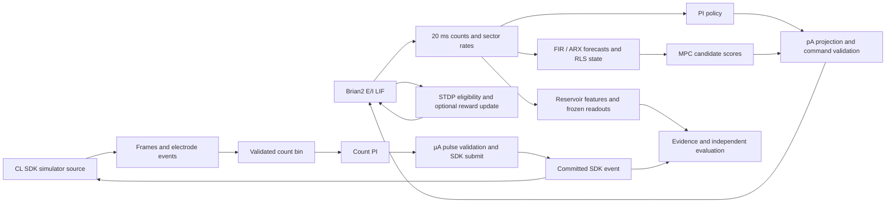

# V2 architecture

The candidate descends through M012, M013, M014, M015 and M016. The
Brian2 and CL SDK paths share causal concepts while retaining distinct
unit systems and receipt contracts.

| Boundary | Implementation and dependencies |
|---|---|
| V1 plant | `substrate`, `_brian`, `observation` use Brian2 and NumPy. Controllers receive observations and receipts. |
| V1 inference and control | `identify`, `online_identify`, `control`, `predictive`, `predictive_planner` use numeric histories, frozen calibration and feasible commands. |
| M013 | `plasticity` attaches eligibility traces to the original E/E pathways. `functional_learning` supplies stimuli and fit/validation/test readouts. |
| M014 | `reservoir` resets neural state and assigns independent OU streams. Recording features use completed bins. |
| M015 | `causal_memory` uses SciPy sparse traversal to audit feedforward graphs. The scalar comparison uses a separate event queue. Retention requires a cue gate. |
| M016 | `neural_io` types frames and receipts. `cl_adapter` loads the SDK lazily and requires simulator identity. `cl_response_source` is imported in its subprocess. |
| Execution | `supervisor` uses the qualified suspend-inclusive `clocks` contract. The SDK watcher tracks detached descendants. |
| Reproduction | Independent archive verifiers reconstruct scientific tables, predictions, counts, receipts and source provenance. |

The Brian path uses simulation microseconds and injected pA. The MEA
path uses session-relative 25 kHz frame indices and electrode µA.
Host deadlines use monotonic nanoseconds. No conversion between the two
actuator units is defined. Optional SDK dependencies live separately.

## Qualification budget frozen before implementation

Use the pinned V1 environment for core tests and the existing isolated
1.0.0 SDK environment for SDK execution. Full tests per tree 180 s,
numerical and performance probe per tree 240 s, archive reproduction
240 s, SDK matrix 120 s plus its existing outer watcher. Core smoke
network 0 only, fixed seeds, 50 ticks maximum per probe run and a 2 GiB
worker peak RSS ceiling. Expect about 1.3 GiB for Brian2 noise and replay
buffers, and under 400 MiB observed tree RSS for SDK. Historical M013/M014
and V1 outcomes are reproduced from archives. Forecast under 12 minutes
local work plus hosted workflows, with stage cleanup within existing
supervisor bounds. No scientific confirmation acquisition.

Freeze the pre-style package and integration gates first. Style changes
stay on a separate branch until qualification. Compare named deterministic
arrays by dtype, shape and bytes and JSON records exactly. Require AST
equality for formatting, with explicitly reviewed local-name or staged
control-flow changes separately verified. Protect M002 source-hash paths.
Use the earlier style performance thresholds, paired median no more than
10% slower, p95 no more than 20% slower, and peak process RSS no more than
10% higher. Capture nine samples per measured kernel with no exclusions.
An unfavorable result remains a failure and keeps the style branch isolated.
