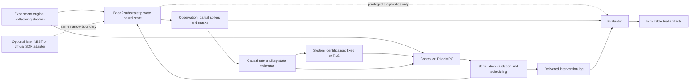
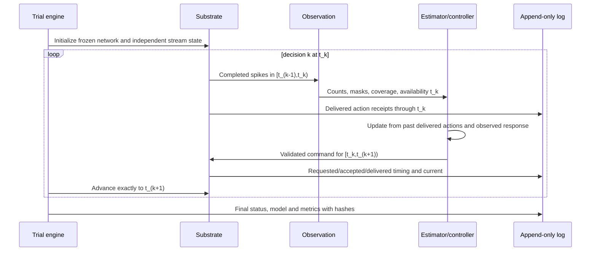

# Mission 001 — System design and contracts

Date 2026-10-18. **Specification, not implemented platform.** Equations and experiment constants are normative in [V0 protocol](../research/002_V0_PROTOCOL.md); source capabilities in [audit](001_ECOSYSTEM_AUDIT.md). V0 executes in virtual time, one fresh process per trial. No hard real-time guarantee.

## Architecture

The optional adapter box is a design boundary, not a dependency or simultaneous backend. A hardware adapter would replace the substrate endpoint; a custom SDK data source would wrap a simulation endpoint for API conformance testing. These are different directions of integration.

## Causal data flow

First decision after calibration uses the last completed calibration bin; no fabricated initial observation. Controller cannot read future noise, perturbation schedule, full neural voltages, connectivity, true efficacy, evaluator targets derived from future responses or future spike bins.

## Time and units

Canonical event time: signed int64 **microseconds since trial start**, nonnegative, monotonic. V0 integration dt=100 µs, observation bin=20,000 µs, control interval=20,000 µs, stimulus held over one control interval. Half-open intervals throughout. A threshold crossing at a bin's right edge belongs to the next bin; Brian's event timestamp convention and reset/monitor schedule must be tested and recorded. Do not stamp a 100 µs event as substep-accurate.

Use Brian quantities inside the backend. Boundary inputs use explicitly named pA/mV/ms/Hz fields; arrays do not rely on implicit unit conventions. Model-injected pA is intracellular-equivalent input, **not electrode µA**. Canonical timing is independent of wall-clock monotonic nanoseconds used for CPU latency. Drift schedule uses simulation time. Store actual scheduled delivery and decision availability separately.

Future official SDK: integer frame index, 25 kHz =40 µs/frame; pulse components have 20 µs resolution. Never identify sample period, neural integrator dt, spike-count bin, control tick, scheduler lead time or wall time as one clock. A 20 µs common grid reconciles 100/40 µs clocks, but short pulses require event splitting/substep integration qualification. Retain original frame index and sample-rate metadata alongside converted microseconds. Exact integer conversion preferred; nonrepresentable future rates require rational conversion and logged rounding policy. No silent interpolation of spikes or masked samples.

## Minimal package layout, once M1 is authorized

`src/neuromancer/substrate.py` (contracts + Brian backend initially), `observation.py`, `identify.py`, `control.py`, `experiment.py`, `evaluate.py`; add files when milestones need them. Configs under `experiments/v0/`; trial outputs ignored under `runs/`. Tests mirror scientific boundaries rather than every helper. Keep the present .gitkeep placeholders until code exists. This is a proposal, not scaffolding to create now.

Only required substrate operations:

- `initialize(config, stream_manifest) -> initial_metadata`: fresh process and explicit Network/Clock, initial connectivity and state hashes, channel map, engine/version, units, simulation kind. Same initialization cannot reuse a previously stimulated Culture/Network instance.
- `advance(command, stop_us) -> StepResult`: command starts at current time and ends at stop_us exactly one control period later; return partial observed spike events, observation coverage, delivered receipts and elapsed wall time. Reject wrong trial ID, nonfinite values, malformed shapes, unknown channels, duplicate IDs, reversed/past times, off-grid times and bounds violations. All validation occurs before neural state advances.
- `close()`: idempotently release monitors/resources and flush trial status. Exceptions do not overwrite prior results.

Initialize/advance are design names, not claimed external APIs. Snapshot/restore is a Brian-specific **test/calibration helper**, not part of a universal substrate interface. Experiment engine may spawn a fresh process and replay a fixed prefix instead. Optional raw samples unsupported in V0: return absent metadata, never zero-filled measured signals.

## Records and schemas (schema_version=1)

All persisted records carry trial_id and schema_version. Metadata additionally carries experiment_kind=`simulation`, config/code/environment/split hashes, engine ID and revision, platform, stream roles/seed descriptors, units and channel map. Future kinds `offline_biological` and `online_biological` use separate run directories and protocols; replay of a recording retains its biological provenance but is not an online experiment.

| Record | Required fields and shape | Contract |
|---|---|---|
| StimCommand | command_id; start_us; duration_us=20000; channels=[0,1,2,3]; current_pA float64[4] | All four sector channels explicit, zero allowed. Validate box, L1 and slew bounds before advance. V0 is a held-current command, not a waveform. |
| StimReceipt | command_id; requested_start_us; delivered_start_us; delivered_stop_us; requested_current_pA[4]; delivered_current_pA[4]; status and reason | V0 delivered=current requested (no saturation hidden in backend). Rejected commands have no delivery. Efficacy is private biological-model state, not a changed delivered-current field. |
| SpikeBatch | start_us; stop_us; event_time_us int64[M]; channel_id int32[M]; coverage_us int64[20]; valid bool[20]; available_us | Sorted time/channel, all events in interval; no controller neuron IDs. Fixed simulated neuron-channel membership in metadata. Overlapping channels prohibited in V0. |
| BinnedObservation | same time/coverage/mask; counts int64[20]; rates_hz float64[20]; available_us | Zero count with valid coverage is real zero; missing count sentinel=-1 and rate=NaN if invalid. Units specified. Masked bins never become zeros in fitting. |
| Estimate | as_of_us; sector_rate_hz[4]; lag_features float64[20]; valid_feature_mask; age_us[4] | State consists of causal rate/lag summaries, not an inferred full voltage state. Invalid estimator output forces the declared ramp-to-zero fallback. |
| ModelSnapshot | model_id; trained_through_us; coefficient matrix 4×21; covariance 4×21×21; residual scale[4]; normalization; update count; adaptation flag | Model receives only eligible observed data and delivered actions. Save fixed model and selected hyperparameters; do not imply Bayesian posterior calibration. |
| Decision | time_us; model_id; target_hz; chosen_current_pA[4]; controller_id; solver status; forecast; latency_ns; fallback reason | Log planned vs delivered. Solver failure cannot silently reuse a stale command. |
| TrialSummary | identities; status; failure code; primary/secondary metrics; resource metrics; artifacts/hashes | No pooled p-value over bins; inference uses network identities. Failed runs remain visible. |

Lag feature 20 = four 4-sector rate lags (16) plus the previous 4-sector action (4); intercept adds one coefficient. Exact ARX indexing and normalization are in protocol. Floats finite except explicitly masked observation fields. Reject duplicate IDs, unknown schemas and pickle/object-dtype input. Scientific array shapes are checked on loading, including baseline metadata and split provenance.

## Subsystems and ownership

| Subsystem | Input → output; owned state | Dependencies / failures | V0 test strategy | Deferred |
|---|---|---|---|---|
| Neural substrate | current schedule + deterministic exogenous innovations → spikes; owns V, E/I current states, refractory state, delays, connectivity, private gain and clock | Brian/NumPy; nonfinite state, clock slip, missed events, wrong signs or reused trial | Single-cell analytical decay/refractory; E/I response; uninterrupted vs chunked including event queue; replay and process independence | AdEx, STDP, morphology, extracellular fields |
| Stimulation | command → validation, queued delivery and receipt; owns current hold and prior action | NumPy; time/channel/unit/budget violation rejects atomically | Boundary and malformed-input checks, no late delivery, exact receipt replay, no neural change after rejection | Multiphasic waveforms, hardware-specific tissue constraints |
| Observation | restricted spike events → counts/rates/masks; owns fixed channel map and coverage | NumPy; duplicate/out-of-window events, missing coverage, sample artifact | Right-edge event fixture, count conservation, missing-vs-zero, hidden neurons inaccessible | Raw waveforms, noise/artifact forward model, electrode overlap |
| State estimation | past bins → sector rate and lag vector; owns filter/lag/age | NumPy; insufficient valid history, dropout | Causality under future-bin changes, correct Hz/coverage normalization, explicit invalid fallback | Kalman/point-process/nonlinear hidden states |
| Identification | eligible lag/action/next-rate pairs → ARX and uncertainty diagnostics; owns coefficients, RLS covariance, residual history | NumPy then SciPy; rank-deficient design, divergence, nonfinite/unstable forecast | Recover known linear fixture, held-out pulse prediction, shuffled-input null, numerical covariance tests | Nonlinear latent or neural models, causal offline biological inference |
| Controller | estimate, target, identified model and previous receipt → command | NumPy/SciPy; infeasible optimization, stale observation, missed deadline | PI anti-windup, MPC constraints, fixed-vs-adaptive same-initial-model, solver-failure fallback, no privileged-state access | Robust MPC, information seeking, RL |
| Experiment | split/config/seed manifest → isolated trials and artifacts; owns lifecycle/phase schedule | stdlib multiprocessing/JSON; incomplete calibration, crash, conflicting output path | Paired streams equal despite actions; no state sharing; interrupted run marked failed; no overwrite | Remote execution, registries, job orchestration |
| Evaluation | immutable observations/receipts + separate full-state diagnostics → metrics/CI | NumPy/SciPy; insufficient valid time, zero denominators, failed trials | Hand-computed metric fixture and network-level resampling, all failures reported | Online dashboards, biological safety conclusions |
| Adapter | later documented engine/SDK events ↔ narrow records; owns clock/unit map | Optional external packages; conversion, buffering, queue/lead mismatch | Fresh-process conformance, event boundary/latency, HDF5 round trip, same intervention causality | Implement only after V0; never promise identical physics |

## Failure policy and data durability

Development validation errors stop that trial before advance. Runtime nonfinite neural state or time discontinuity aborts trial, flushes status and retains data. Controller infeasibility/exception emits the feasible action nearest zero under the prior-current slew bounds and logs fallback; three consecutive such failures abort trial. After any missing observation, ramp each current down by at most30 pA/tick to zero (at most80 ms from120 pA), then remain zero until four consecutive complete bins restore the lag state. PI resets integral on dropout; MPC skips updates with missing lags. Primary comparisons use complete-coverage conditions; dropout is a prespecified stress test, scored with its coverage and abort rate disclosed.

Artifact directory is created exclusively (`exist_ok=False`), with config/split/environment written first. Append command/receipt/decision records; save numerical chunks and hashes, then terminal summary via atomic rename within the directory. On crash a missing terminal summary means incomplete, never PASS. Results are append-only; amendments use new run IDs referencing prior artifacts. Seed/config/code/environment lineage is sufficient for deterministic within-environment replay; serializer bytes need not be identical unless explicitly tested. No raw biological data or credentials in Git.

## Dependency boundaries

Control/identification modules must import neither Brian2 nor cl nor BL-1. They consume numerical observations/actions only. Backend may expose an evaluator-only diagnostic file containing true voltages/gain/connectivity; run controllers without that path or object reference. Evaluator cannot retune controllers or targets. Hardware adapter is not enabled by selecting a config string: a new approved protocol and access qualification is required.

Required contract tests precede controller benchmarking. Do not claim a common backend interface has been validated across engines until an independent backend passes the same timing, observation and intervention tests.
