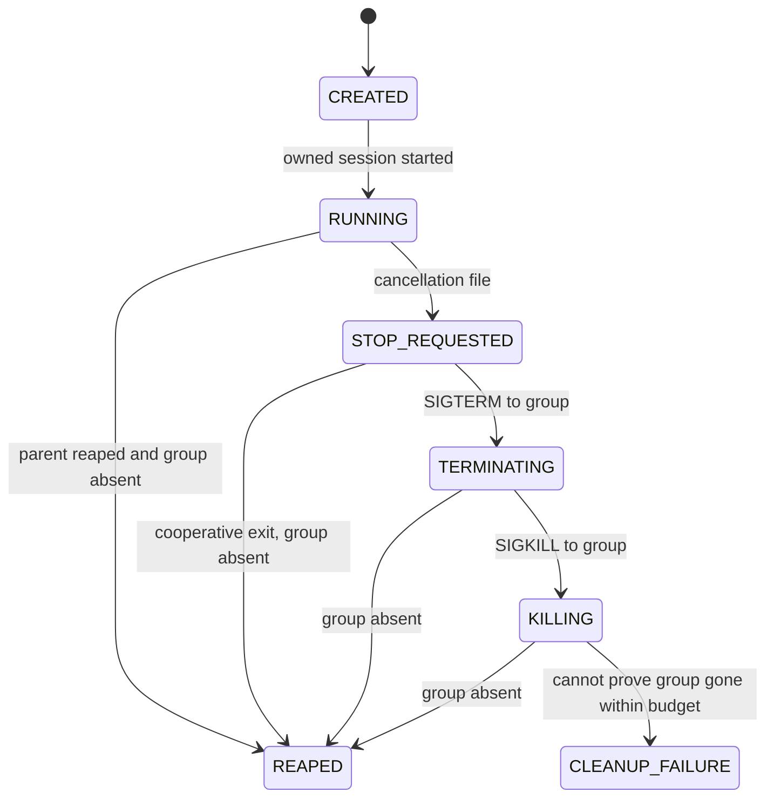

# POSIX resource supervisor — M005A.2

This engineering module owns command processes; it has no neural-model or controller dependencies. No scientific acquisition or PI selection is authorized by its qualification.

## Ownership and clocks

The caller creates one `Deadline(end_ns)` at experiment entry, using `time.monotonic_ns()`. All nested calls receive that same object/absolute value. `supervise` never calls `Deadline.after` or resets a stage budget. The acquisition CLI begins accounting at `main` entry, before parsing/provenance/output creation; child interpreter imports and initialization are inside the parent's budget. Initial parent module loading precedes that entry and must be included by an external caller if part of a larger experiment. Separate invocations are separate budgets unless the caller explicitly shares one deadline through the supervisor API.

Calendar time is provenance only. Forward/backward calendar adjustments do not change the deadline. Monotonic time is same-host/same-boot, not serializable across machines or reboots. Suspend-inclusive elapsed time is **not qualified**: behavior depends on the platform clock, and this mission does not test system suspension or claim calendar-time enforcement across it. The previous timestamp discrepancy remains unexplained.

Default grace reservations are cooperative `.2s`, TERM `.2s`, final KILL/reaping `.4s`. Work cutoff = original hard deadline minus their `.8s` sum. Reaching the work cutoff is DEADLINE_EXCEEDED even when a child returns zero at that instant. Cleanup starts at that cutoff; an early fault starts cleanup early, with each phase clamped to the original hard deadline. The last20ms of the final .4s is reserved for terminal publication (or half that interval for a reap grace below40ms). Grace intervals are upper bounds, not mandatory waits when groups have already disappeared. A caller needing larger cleanup windows must declare them before execution; they reduce available work time rather than extending the deadline. An already exhausted deadline launches nothing.

Every command uses `Popen(start_new_session=True)`: PID equals owned session/process-group leader. Direct children are reaped with `poll()`/`waitpid(WNOHANG)`, never an unbounded executor/context-manager wait. Worker stdout/stderr go to files rather than potentially full parent pipes. Descendants inherit the group; cancellation signals address the entire owned group, including after leader exit. The cooperative stop-file path and the original monotonic deadline are passed in environment variables. The controller-facing interface receives neither resource internals nor evaluator state.

Supported containment assumes trusted workers/descendants do not call `setsid`/`setpgid` to escape their group. This is not a hostile-code sandbox. POSIX only; Windows raises NotImplementedError. Linux cgroups/subreapers and Windows job objects are deferred. A leader exiting with descendants still present causes WORKER_FAILURE and group cleanup. The supervisor cannot reap non-child descendants; OS reparenting/reaping may leave a visible orphan zombie. An existing/uninspectable group at the end is conservatively CLEANUP_FAILURE, including PermissionError from an OS-owned orphan. No live-descendant claim relies solely on the parent exit code.

## State and result contracts

Events carry monotonic timestamps. A command never launched stays CREATED with terminal NOT_STARTED and the stage cause. Normal direct-child exit zero plus group absence becomes COMPLETED. Nonzero exit is WORKER_FAILURE; tracebacks/exit codes are retained. Cancellation that needs TERM/KILL produces worker terminal FORCED_TERMINATION, with the primary stage cause retained. Supervisor terminal statuses are COMPLETED, DEADLINE_EXCEEDED, WORKER_FAILURE, CLEANUP_FAILURE and SUPERVISOR_FAILURE. Cleanup failure takes precedence in status without erasing the original cause. Forced termination is a per-worker outcome, never scientific success.

`terminal.json` contains the command/PID/PGID, lifecycle events, return codes, primary cause, errors, start/work-cutoff/deadline/finish timestamps and cleanup verification. Only COMPLETED may enter downstream scientific verification; worker/trial completion alone is insufficient. Completion is checked against cutoff before final publication and the hard deadline afterward; a publication overrun cannot be returned silently as success.

## Evidence, failure and restart

Atomic JSON writes use a temporary file, file flush/fsync and replace. Existing published JSON survives a failed replacement. A final metadata write failure returns SUPERVISOR_FAILURE and emits the failure record to stderr; the prior progress record remains if its filesystem is usable. Evidence cannot be guaranteed on a wholly unwritable filesystem. Directory-entry durability through power loss is not claimed.

The acquisition runner also publishes NPZ archives by file flush/fsync then replace. Interrupted `.tmp` files are incomplete and must not be scored. Fully published prefixes/branches survive cancellation. Unflushed in-memory samples at forced kill are lost; no claim of sample-level journaling or scientific resume is made. A cooperative worker can publish partial data, but parent cancellation never waits without a bound for it.

Output directories are exclusive. Restart into an existing directory fails rather than overwriting or double-counting trials. Any scientific continuation/reuse requires its own explicit protocol and validation; this mission supplies no automatic resume or controller selection.

## Limits of the guarantee

This is bounded user-space supervision under a responsive OS and filesystem, not hard real-time operation. OS scheduling pauses, uninterruptible kernel I/O, process creation, fsync and power loss cannot be bounded by a Python loop. Tests use independent outer watchdogs and separately inspect descendant PIDs. Real scientific stages remain prohibited until separately authorized; passing synthetic tests does not establish neural throughput or that the reserved confirmation fits its budget. Historical stage scripts retain their original clock semantics as archived evidence and are not a qualified new orchestration entry point.
