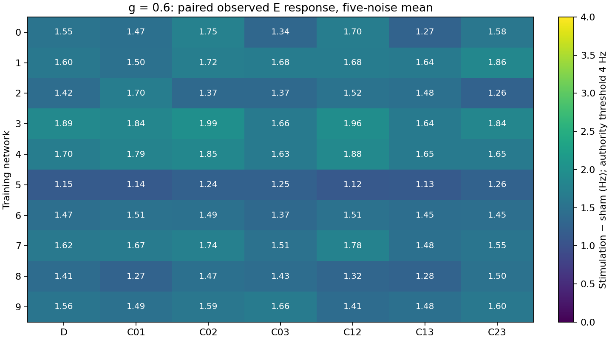
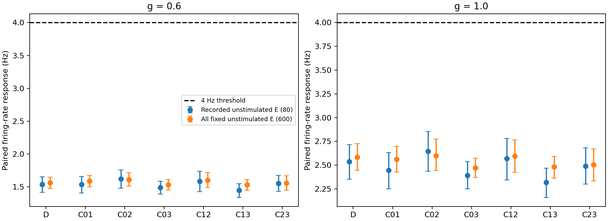
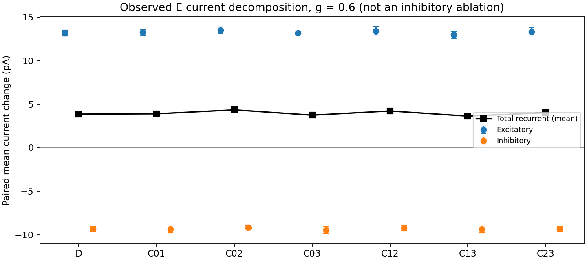
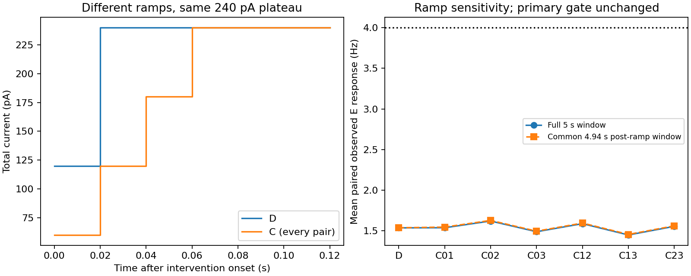

# Mission 002.1 — Control-authority diagnosis

Entirely simulated neural dynamics; no biological evidence. **Diagnostic execution PASS; original V0 control-authority FAIL.** Equal-channel allocation is not the sole explanation: every tested concentrated allocation also fails. Stop before controller/identification evaluation.

## Provenance and preservation

Starting branch `research/m002-brian-substrate`, clean HEAD `b946c8a0b461567f2132642383462492c7b2d24b`. Created `research/m002-1-authority-diagnosis` directly from that revision. The 74 previously tracked files, including all original 38 tests, M001/M002 results, the model, dependencies and frozen V0 protocol, remain byte-identical. [Preservation hashes](evidence/m002_1/preservation.json).

- Preregistration committed **before scientific execution**: `654830973c75b1aed1a6077ab46112b9c8fd534f`.
- Executed diagnostic runner: `47967dade312b55ab6968575e2c4fb5354e34f3c`. Execution provenance records its HEAD, source hashes and actual working-tree state.
- Analysis/selection rules committed before inspection of new numerical outcomes: `4e47f8a48c421431a88eb9b770c738b5a6328ac8`.
- Subsequent changes add synthetic analysis coverage, independent artifact/count checks, tables, figures and this report. They do not change simulation or analysis rules. The final evidence commit is a descendant of these revisions; its exact SHA is given in the mission handoff rather than a self-referential hash inside its own contents.

[Preregistration](evidence/m002_1/PREREGISTRATION.md), [reproduction instructions](evidence/m002_1/README.md).

## Design, timing and exposure

Ten training networks (IDs 0–9), five independent noise replicates per network (IDs 0–4), two gains (0.6 primary, 1.0 secondary), eight allocations: **50 common baseline states and 800 five-second branches**. Replicate zero reproduces historical M002 evidence; it is not independent of that historical experiment. Replicates 1–4 are new noise, not new network topologies. No validation/test topology or response-dependent seed replacement.

Each trial runs the unchanged 5 s burn-in and 10 s zero-current baseline at gain 1. The reported baseline is [7,15) s. At 15 s the engine checkpoints neural/current/OU state, refractory history, delay queues, clocks, observation/filter cursors, prior command and noise offset. Every intervention restores that checkpoint. All conditions receive identical exogenous innovations at identical simulated times; spike-dependent execution does not consume the noise stream. Both sham gains must give identical counts and sampled currents. Network parameter roles 0–3 remain fixed across replicates; role 4 supplies independent noise. Source, versions, seed roles, parameter hashes, checkpoint hashes and noise block hashes accompany each trial.

Evaluation is [15,20) s including ramp. Integration is 100 µs; current holds and observations are 20 ms. The primary observation remains the raw whole-window spike count of the same 80 recorded unstimulated E neurons divided by 80×5 s. Filtered sector traces are retained, not substituted for this measure. Current decomposition samples `I_E` and `I_I` every 20 ms at Brian's `end` slot, starting at grid label 15 s; these are sampled state estimates, not exact continuous-time current integrals. Observation bins are [start,stop), available only at stop.

| Action | Target pA, channel order 0–3 | First target tick | Summed channel exposure pA·s | Aggregate model charge pC |
|---|---|---:|---:|---:|
| S | 0,0,0,0 | 0 ms | 0 | 0 |
| D | 60,60,60,60 | 20 ms | 1197.6 | 59880 |
| C01 | 120,120,0,0 | 60 ms | 1192.8 | 59640 |
| C02 | 120,0,120,0 | 60 ms | 1192.8 | 59640 |
| C03 | 120,0,0,120 | 60 ms | 1192.8 | 59640 |
| C12 | 0,120,120,0 | 60 ms | 1192.8 | 59640 |
| C13 | 0,120,0,120 | 60 ms | 1192.8 | 59640 |
| C23 | 0,0,120,120 | 60 ms | 1192.8 | 59640 |

Every schedule starts from zero and changes each channel by at most 30 pA per tick. Currents stay nonnegative, <=120 pA/channel and <=240 pA total. D's first tick sums to 120 pA, then 240; C's first four ticks sum to 60,120,180,240. Concentration therefore delivers 4.8 pA·s (0.401%) less nominal exposure. Aggregate injected model charge multiplies summed channel exposure by 50 model cells/channel. Effective drive is separately gain-scaled: at g=.6, D/C have 718.56/715.68 pA·s effective summed-channel exposure. These are model current-injection quantities, not extracellular electrode charge/safety measurements. Actual delivered schedules and timestamps are preserved for every branch.

The preregistered sensitivity window [15.06,20) s is 4.94 s, after all ramps reach target. Every nonzero allocation then has 1185.6 pA·s exposure. This does not erase its different early history and is not a clean charge-matched randomized comparison. The original gate continues to use the full five seconds.

## Outcomes and uncertainty

Paired contrast for action a, gain g, network n, noise replicate r and a fixed evaluator cell set P:

\[
\Delta f_{nrga,P}=\frac{\sum_{i\in P}(N_{nrga,i}-N_{nrgS,i})}{5\,\mathrm{s}\,|P|}.
\]

The primary observed set is always 80 E cells. Evaluator-only sets distinguish the fixed 600 never-targeted E cells, their hidden 520-cell subset, all 800 E, all 200 I, and action-specific directly stimulated/unstimulated E. D directly targets 200 E, C targets 100 E; action-specific unstimulated populations contain 600/700 E. Every action-specific comparison subtracts sham on **identical cell membership**. Sham's directly stimulated rate is undefined, not zero. Sector traces retain observed 20 E, fixed 150 E, all 200 E and 50 I per sector. These hidden measurements never select an intervention.

Per-network fixed-allocation intervals use paired five-replicate responses: sample SD and pointwise 95% Student-t CI, df=4. Global selection uses replicates 0–1 only; evaluation uses independent noise 2–4, df=2. Across-network intervals use the preregistered two-level 10,000-resample percentile bootstrap, resampling networks then noise identities, preserving pairing across actions/gains. Time bins and neurons are not independent replicates. Five noise samples and ten nonbiological networks give limited precision; intervals are descriptive, pointwise and not multiplicity-adjusted. Selected hindsight maxima have selection bias and no confirmatory ordinary CI.

The unchanged threshold is >=4 Hz on >=8/10 network mean responses. Lower-CI threshold counts are an additional stricter uncertainty diagnostic. The global policy maximizes calibration-network threshold count, then overall response, then bank order; it is one fixed allocation. Its noise holdout does not establish generalization to unseen topologies. The per-network hindsight best is an upper bound over this finite bank, not evidence of an implementable controller.

## Software changes and evidence scope

The new `src/neuromancer/authority_diagnosis.py` reuses the existing Brian engine, snapshot/restore, command scheduling, observation extraction and noise streams. It adds only a frozen intervention bank, evaluator groups/current monitor, bounded three-process execution and complete evidence logging. It neither changes the public controller interface nor adds model fitting. Each branch asserts restored state hashes/time/prior input, delivered/requested equality, constraints, observation-to-count reconciliation, finite currents and identical exogenous block hashes. Replicate-zero trials additionally assert historical baseline and distributed-response equality. Partial branch logs survive execution failures.

`reports/evidence/m002_1/analyze.py` contains the frozen paired analysis and allocation split; `export_tables.py` flattens every outcome and per-network CI; `figures.py` renders fixed diagnostic plots; `verify.py` independently recomputes contrasts from per-neuron counts, checks every schedule and hashes prior/raw files. The four added tests cover bank/ramp exposure, evaluator memberships, calibration-only selection and a complete synthetic zero-response pipeline. Synthetic fixture outcomes are software checks and are not included in scientific results.

Raw local evidence remains under `runs/m002_1-authority-01/`, with all 50 per-trial numerical archives, per-neuron sampled-current means and grouped 20 ms current traces. The curated committed archive retains all trial counts, observation/filter traces, actual actions, memberships and group-current means; its current time-course array is explicitly a mean over 50 trials. It does not retain every individual current trace. The raw manifest records hashes for the local raw files; curated evidence has a separate manifest. All NPZ archives use numerical arrays and load with `allow_pickle=False`.

No new dependency, dashboard, universal adapter, scientific model, controller or identification method is introduced. No inhibitory ablation is executed. No original result, negative result or test is replaced.

## Complete numerical authority comparison

All entries below are paired observed E response in Hz, averaged over the five noise replicates. Sham has exactly zero paired contrast for every network/gain; its absolute activity is retained in the all-trial table. No network or condition failed execution.

### Baseline reproduction

All 50 baseline recorded-E means lie within 11.2594–15.0656 Hz. Each replicate-zero value exactly reproduces the corresponding historical M002 baseline; the other four values quantify new-noise variability. No baseline or seed was excluded.

| Network | Original/replicate-zero Hz | Five-noise mean Hz | Across-noise SD Hz |
|---|---:|---:|---:|
| 0 | 12.6984 | 12.7112 | 0.1067 |
| 1 | 14.6469 | 14.6397 | 0.0803 |
| 2 | 11.7578 | 11.8397 | 0.0657 |
| 3 | 14.7594 | 14.6941 | 0.0623 |
| 4 | 15.0656 | 14.9456 | 0.0874 |
| 5 | 12.4875 | 12.4175 | 0.1270 |
| 6 | 14.0453 | 13.9984 | 0.1240 |
| 7 | 13.0578 | 13.1434 | 0.1458 |
| 8 | 12.6172 | 12.5841 | 0.0680 |
| 9 | 11.2594 | 11.3256 | 0.0593 |

### Primary gain 0.6

| Network | D | C01 | C02 | C03 | C12 | C13 | C23 |
|---|---:|---:|---:|---:|---:|---:|---:|
| 0 | 1.5455 | 1.4735 | 1.7515 | 1.3385 | 1.7010 | 1.2685 | 1.5785 |
| 1 | 1.5995 | 1.4985 | 1.7150 | 1.6805 | 1.6800 | 1.6380 | 1.8575 |
| 2 | 1.4230 | 1.6980 | 1.3745 | 1.3710 | 1.5240 | 1.4835 | 1.2640 |
| 3 | 1.8850 | 1.8365 | 1.9910 | 1.6560 | 1.9620 | 1.6350 | 1.8365 |
| 4 | 1.7005 | 1.7915 | 1.8480 | 1.6345 | 1.8795 | 1.6510 | 1.6490 |
| 5 | 1.1495 | 1.1385 | 1.2365 | 1.2480 | 1.1215 | 1.1255 | 1.2605 |
| 6 | 1.4680 | 1.5130 | 1.4870 | 1.3690 | 1.5100 | 1.4500 | 1.4535 |
| 7 | 1.6210 | 1.6665 | 1.7410 | 1.5080 | 1.7755 | 1.4770 | 1.5505 |
| 8 | 1.4120 | 1.2745 | 1.4715 | 1.4265 | 1.3190 | 1.2810 | 1.5045 |
| 9 | 1.5620 | 1.4905 | 1.5915 | 1.6600 | 1.4105 | 1.4830 | 1.5975 |

### Secondary gain 1.0

| Network | D | C01 | C02 | C03 | C12 | C13 | C23 |
|---|---:|---:|---:|---:|---:|---:|---:|
| 0 | 2.4615 | 2.2025 | 2.8795 | 2.1685 | 2.6415 | 2.0260 | 2.5650 |
| 1 | 2.7845 | 2.4640 | 2.8160 | 2.6700 | 2.7160 | 2.5440 | 2.9295 |
| 2 | 2.3290 | 2.5870 | 2.2890 | 2.1920 | 2.4300 | 2.3625 | 2.0265 |
| 3 | 3.0075 | 2.8050 | 3.1940 | 2.7370 | 3.0465 | 2.6120 | 2.9530 |
| 4 | 2.8540 | 2.8985 | 2.9350 | 2.4695 | 3.1010 | 2.6510 | 2.6355 |
| 5 | 1.9720 | 1.8710 | 2.0550 | 2.0115 | 1.8645 | 1.8710 | 1.9860 |
| 6 | 2.3995 | 2.4005 | 2.4050 | 2.2555 | 2.5355 | 2.3950 | 2.3770 |
| 7 | 2.7250 | 2.7500 | 2.9190 | 2.4340 | 2.7785 | 2.3155 | 2.4835 |
| 8 | 2.2825 | 2.0940 | 2.4350 | 2.3275 | 2.2340 | 2.0430 | 2.3750 |
| 9 | 2.5595 | 2.3880 | 2.5475 | 2.6465 | 2.3595 | 2.3565 | 2.5750 |

Every fixed allocation passes **0/10** networks at g=.6 (required >=8/10); every lower-CI count is also 0/10. At g=1, every fixed allocation likewise passes 0/10; the largest network mean is 3.194 Hz. At g=.6 the largest individual noise-trial response is 2.1025 Hz; the largest pointwise per-network upper t-CI is 2.0731 Hz. These descriptive bounds are well below 4 Hz, though finite-bank failure is not a proof against arbitrary admissible time-varying actions.

All 160 network×gain×allocation rows include means, SDs and pointwise CIs for every population in [network_intervention_summary.csv](evidence/m002_1/results/network_intervention_summary.csv). All 800 individual outcomes, including absolute sham rates, are in [all_trials.csv](evidence/m002_1/results/all_trials.csv) and [outcomes.json](evidence/m002_1/results/outcomes.json). The latter also includes sector and current contrasts.

### Across-network comparison and ramp sensitivity

Paired observed E means and hierarchical pointwise 95% CIs (ten networks, five noise replicates):

| Action | g=.6 mean [CI] Hz | g=1 mean [CI] Hz | C−D, g=.6 [CI] Hz | Post-ramp g=.6 Hz |
|---|---:|---:|---:|---:|
| S | 0.0000 [0.0000, 0.0000] | 0.0000 [0.0000, 0.0000] | — | 0.0000 |
| D | 1.5366 [1.4187, 1.6529] | 2.5375 [2.3509, 2.7162] | — | 1.5381 |
| C01 | 1.5381 [1.4063, 1.6616] | 2.4461 [2.2506, 2.6310] | 0.0015 [-0.0655, 0.0810] | 1.5461 |
| C02 | 1.6208 [1.4834, 1.7576] | 2.6475 [2.4372, 2.8550] | 0.0841 [0.0363, 0.1324] | 1.6285 |
| C03 | 1.4892 [1.3934, 1.5855] | 2.3912 [2.2495, 2.5369] | -0.0474 [-0.1208, 0.0236] | 1.4961 |
| C12 | 1.5883 [1.4306, 1.7409] | 2.5707 [2.3433, 2.7803] | 0.0517 [-0.0206, 0.1171] | 1.5961 |
| C13 | 1.4493 [1.3373, 1.5499] | 2.3177 [2.1577, 2.4667] | -0.0874 [-0.1611, -0.0187] | 1.4563 |
| C23 | 1.5552 [1.4353, 1.6776] | 2.4906 [2.3013, 2.6824] | 0.0186 [-0.0496, 0.0931] | 1.5619 |

C02 has the largest pooled concentrated response; its C−D difference is +0.08415 Hz, about 5.5% of D. The descriptive interval excludes zero but is not multiplicity-adjusted or an independent confirmation of selecting the best pair. It is tiny relative to the >2 Hz shortfall. Post-ramp restriction makes little difference: the largest five-replicate network response is 1.9990 Hz. Ramp charge/history differences do not account for the authority failure.

### Global selection and evaluator-only bounds

Global selection on replicates 0–1 selects **C02**. Frozen C02 evaluation on new noise replicates 2–4 gives **0/10** network passes and **1.6043 Hz [1.4623, 1.7476]** aggregate response. Its largest network evaluation mean is 2.0067 Hz. This strategy is implementable as a fixed allocation, but fails. Selection used only observed outcomes, never evaluator-only cells/currents. Its CI is conditional on the trained allocation; it does not propagate every possible calibration-selection outcome.

| Network | Global C02 evaluation mean [95% t-CI], n=3 | Hindsight best action | Hindsight five-noise mean Hz |
|---|---:|---|---:|
| 0 | 1.7508 [1.5407, 1.9610] | C02 | 1.7515 |
| 1 | 1.6833 [1.4038, 1.9628] | C23 | 1.8575 |
| 2 | 1.3717 [1.1060, 1.6373] | C01 | 1.6980 |
| 3 | 2.0067 [1.7885, 2.2249] | C02 | 1.9910 |
| 4 | 1.8242 [1.4082, 2.2401] | C12 | 1.8795 |
| 5 | 1.2225 [0.9288, 1.5162] | C23 | 1.2605 |
| 6 | 1.4517 [1.1688, 1.7345] | C01 | 1.5130 |
| 7 | 1.7375 [1.5746, 1.9004] | C12 | 1.7755 |
| 8 | 1.4700 [1.3208, 1.6192] | C23 | 1.5045 |
| 9 | 1.5242 [1.1995, 1.8488] | C03 | 1.6600 |

The hindsight per-network best also passes **0/10**, ranging 1.2605–1.9910 Hz. It is selected on all five outcomes and is an optimistic finite-bank diagnostic, not an attainable-controller claim. The separate per-network split-noise diagnostic also passes 0/10; choices, SDs and CIs are in [comparison.json](evidence/m002_1/results/comparison.json). No network-specific calibration algorithm has been implemented.





## Evaluator-only recruitment and mechanism

The following are g=.6 mean paired responses, averaged noise-within-network then networks. The full archive includes g=1, all population CIs, per-network variability and all sector contrasts.

| Action | Observed E80 Hz | Fixed unstimulated E600 Hz | Action-specific unstimulated E Hz | Direct active E Hz | All E800 Hz | I200 Hz |
|---|---:|---:|---:|---:|---:|---:|
| S | 0.0000 | 0.0000 | 0.0000 | undefined | 0.0000 | 0.0000 |
| D | 1.5366 | 1.5658 | 1.5658 | 12.7694 | 4.3667 | 1.5118 |
| C01 | 1.5381 | 1.5908 | 1.5994 | 23.9509 | 4.3933 | 1.5161 |
| C02 | 1.6208 | 1.6110 | 1.6122 | 24.1501 | 4.4295 | 1.5301 |
| C03 | 1.4892 | 1.5312 | 1.5298 | 23.9976 | 4.3383 | 1.5152 |
| C12 | 1.5883 | 1.6044 | 1.6132 | 24.2220 | 4.4393 | 1.5271 |
| C13 | 1.4493 | 1.5363 | 1.5447 | 24.0615 | 4.3593 | 1.5175 |
| C23 | 1.5552 | 1.5618 | 1.5655 | 24.2381 | 4.3995 | 1.5299 |

Concentration roughly doubles per-cell direct response (about +24 vs +12.77 Hz) while stimulating half as many cells. It does **not** double unstimulated recruitment. The 600 never-targeted E cells respond by 1.531–1.611 Hz across concentrated allocations, similar to D at 1.566 Hz. Hidden fixed cells behave similarly. Thus the observation firewall is not merely missing a large hidden indirect response. At g=1, direct C/D responses rise to about +39/+21.31 Hz, but fixed indirect E responses remain 2.472–2.600 Hz. Direct-cell recruitment is real; sufficient indirect authority is absent in this bank.

### Recurrent current decomposition

Changes below are per recorded E cell, sampled every 20 ms; mean [hierarchical pointwise 95% CI] for each component, and the sum of component means. A negative inhibitory change means a more negative current.

| Action | Excitatory change pA [CI] | Inhibitory change pA [CI] | Net recurrent mean pA |
|---|---:|---:|---:|
| S | 0.000 [0.000, 0.000] | 0.000 [0.000, 0.000] | 0.000 |
| D | 13.176 [12.844, 13.503] | -9.305 [-9.590, -9.034] | 3.871 |
| C01 | 13.253 [12.894, 13.584] | -9.345 [-9.751, -8.960] | 3.908 |
| C02 | 13.513 [13.113, 13.900] | -9.146 [-9.434, -8.856] | 4.367 |
| C03 | 13.191 [12.973, 13.404] | -9.440 [-9.827, -9.035] | 3.751 |
| C12 | 13.429 [12.961, 13.908] | -9.192 [-9.477, -8.902] | 4.237 |
| C13 | 12.974 [12.583, 13.325] | -9.335 [-9.746, -8.944] | 3.639 |
| C23 | 13.340 [12.919, 13.785] | -9.303 [-9.553, -9.062] | 4.037 |

Inhibitory counter-current is about 68–72% of the added excitatory current across nonsham actions. D recruits +13.176 pA excitation and −9.305 pA inhibition (net +3.871); C02 gives +13.513 and −9.146 pA (net +4.367). The same pattern occurs in the full fixed E population (D +13.150/−9.275; C02 +13.404/−9.198 pA). I firing increases by about 1.51–1.53 Hz at g=.6. These observations are **consistent with competing inhibitory recruitment**, but do not identify its causal contribution: excitation, inhibition and firing are jointly determined by the recurrent system. Component subtraction is not an inhibitory-path intervention.

Observed E sector responses for D are [1.2640, 1.6422, 1.5454, 1.6948] Hz; C02 gives [1.3402, 1.8414, 1.6208, 1.6806]. C02 directly stimulates sectors 0 and 2 yet does not selectively rescue them; sector 1 has its largest indirect response. All 3,200 network/noise/gain/action/sector rows of observed E, fixed unstimulated E, full E and I rates/contrasts are in [sector_trials.csv](evidence/m002_1/results/sector_trials.csv). Sector current changes are retained in the numerical archive and outcomes JSON; none choose a future controller. The globally pooled pattern does not establish sector-specific causation.





### Explanation audit

| Explanation | Evidence and limit |
|---|---|
| Equal-channel allocation alone is inadequate | Rejected as the sole explanation within the prespecified bank: concentration yields only small shifts, and every allocation/oracle fails. |
| Broader weak indirect authority of the chosen observable | Supported for these static holds, budgets, network parameters and gains. Not a proof of mathematical uncontrollability for arbitrary schedules or objectives. |
| Competing inhibitory recruitment | Strong descriptive counter-current and I-rate recruitment; causal contribution remains untested. |
| Stimulation saturation | Not established. Direct and indirect rates increase from g=.6 to 1; two effective gains and two cell-set sizes do not identify a dose-response saturation curve. |
| Unresponsive sparse recording subset | Not the main explanation: fixed full and hidden unstimulated populations also show weak response. Recording-sample differences still explain small allocation rankings. |
| No causal stimulation response | Contradicted: paired gains are positive, direct responses are large and historical g=0 causal controls remain passing. Positive response does not imply tracking authority. |
| Ramp exposure deficit explains concentration failure | Unsupported by the small 0.401% deficit and nearly unchanged post-ramp results; exact charge/history-matched effects were not isolated. |

## Verification and measured performance

Executed locally with Python 3.12.15, Brian2 2.10.1, NumPy 2.5.4; unchanged M002 dependency lock. Apple M5, 10 CPU cores, 16 GB, macOS 26.5.2 arm64; CPU NumPy code generation, three simulation workers.

```sh
python -m neuromancer.authority_diagnosis --output runs/m002_1-authority-01
python reports/evidence/m002_1/analyze.py runs/m002_1-authority-01 runs/m002_1-analysis-01
python reports/evidence/m002_1/verify.py runs/m002_1-authority-01 runs/m002_1-analysis-01
python reports/evidence/m002_1/export_tables.py runs/m002_1-analysis-01
python reports/evidence/m002_1/figures.py runs/m002_1-analysis-01
python -m pytest -q --junitxml=reports/evidence/m002_1/tests.xml
```

**42 tests passed**, including all original 38; 25 upstream Brian/Pyparsing deprecation warnings, no failures, 24.82 s. [Text](evidence/m002_1/tests.txt), [JUnit](evidence/m002_1/tests.xml). Full regression execution followed the last test change; subsequent evidence helpers were checked against all real outputs. Syntax compilation and `git diff --check` also passed. CI was not remotely run.

Independent evidence audit: **800/800** branches and schedules; **zero** current/total/slew violations; all observation counts reconciled with per-neuron counts; all population contrasts recomputed on identical paired memberships; **153** raw artifact hashes verified; all **74** original files byte-identical; ten fixed parameter sets and 50 distinct noise/checkpoint identities. Every historical replicate-zero baseline and D contrast reproduced to 1e−12 tolerance, and both shams agree exactly. Eight PNG/SVG files regenerated byte-identically and all four plots were visually inspected. [Verification](evidence/m002_1/results/verification.json).

| Measurement | Actual result |
|---|---:|
| Full simulation execution wall time, 50 trials | 1932.963 s (32.216 min) |
| Simulated duration | 4750 s: 50×15 s baseline prefix + 800×5 s branches |
| Initialization min / median / max | 13.809 / 26.382 / 33.448 ms |
| Per-trial wall min / median / max | 75.594 / 123.512 / 130.058 s |
| Five-second branch simulation call min / median / max | 3.534 / 6.492 / 7.714 s |
| Observation processing per branch min / median / max | 28.036 / 62.508 / 222.258 ms |
| Evaluator extraction per branch min / median / max | 3.405 / 6.680 / 33.306 ms |
| Worker process peak RSS min / median / max | 998.828 / 1068.109 / 1306.563 MiB |
| Analysis computation, before archive serialization | 1.644 s |

These are instrumented concurrent diagnostic measurements, not an isolated backend throughput benchmark. Workers ran alongside test/analysis preparation and ordinary local activity; branch costs increased during execution. RSS is process lifetime peak, not per-trial allocated memory or total system footprint. Instrumentation samples all neurons’ current states and adds overhead. Every branch timing, prefix timing, initialization and peak RSS is retained in [trial_provenance.json](evidence/m002_1/results/trial_provenance.json).

## Decision, amendment recommendation and next experiment

**M002.1 diagnostic execution: PASS. V0 scientific feasibility: FAIL retained.** All preregistered observations completed and all instrument/regression checks pass, but no explicitly implementable allocation meets >=4 Hz on >=8/10 training networks. Distributed: 0/10; each concentrated pair: 0/10; trained global C02 on independent noise: 0/10; hindsight per-network bound: 0/10. M002 remains partially qualified, not ready for the frozen controller study.

No frozen protocol amendment has been applied. Swapping D for C02 is not a justified rescue: its benefit is much too small. Do not lower the authority threshold retrospectively and call V0 successful. If a lower-excursion tracking question is scientifically valuable, preregister a **new version** with targets constrained to independently measured reachability, a new development-only calibration/confirmation split and unchanged held-out topology protection; that is a different feasibility claim. The original +4 Hz question remains failed. No target value or neural parameter is silently changed here.

**Next falsifiable experiment, proposed only:** test whether the recurrent I→E pathway materially limits indirect response in a separately labeled development model. Preregister path multipliers {1.0, 0.75, 0.5}, keep E→I and I→I unchanged, and compare D/C02 versus matched sham at g=.6 on these training IDs with at least five new noise replicates and fresh, same-duration baseline per multiplier. Fixed allocations are already known; hidden data do not select them. Primary estimand is the pathway-multiplier×stimulation interaction in the observed-80-E paired response. Prespecify a meaningful increase (e.g. >=1 Hz for multiplier .5 vs1, hierarchical CI lower bound >0), report every multiplier/network, and preserve the original-network comparator. No weight/target tuning after outcomes.

This perturbation changes the network and its operating point; baseline rate changes and instability are outcomes, not grounds for deleting seeds. Preregister stop/invalid-regime bounds (nonfinite state, sector mean >=100 Hz or baseline outside 1–30 Hz), disclose all failures and do not replace the original network with an ablated one. If disinhibition increases baseline but not the paired intervention effect, or the interaction CI includes zero, the proposed inhibition-limited-gain explanation is unsupported. If regimes become unstable, the ablation is inconclusive for useful control authority. A positive result would establish a causal pathway effect in this model, with operating-point confounding; stronger mechanistic attribution needs an independently preregistered baseline-matched intervention. It would not validate biology or qualify the original V0.

Principal unresolved risks, in order: (1) unreachable frozen target under tested budgets; (2) a finite static action bank is not the full reachable set; (3) inhibitory mechanism remains descriptive; (4) ten network draws/five noise replicates and selected-action uncertainty limit generalization; (5) biological fidelity and hardware correspondence are unvalidated. The negative result remains useful regardless of whether adaptive control would fail.

No system identification, PI, MPC, RL, plasticity, pathway ablation or Cortical Labs integration was run. Stop after this diagnosis; no automatic merge.
