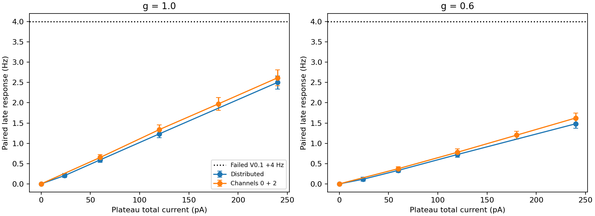
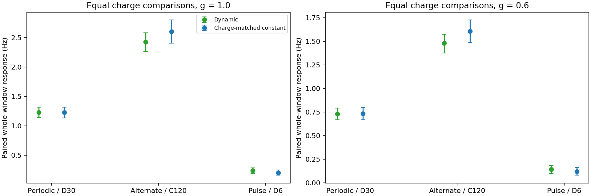
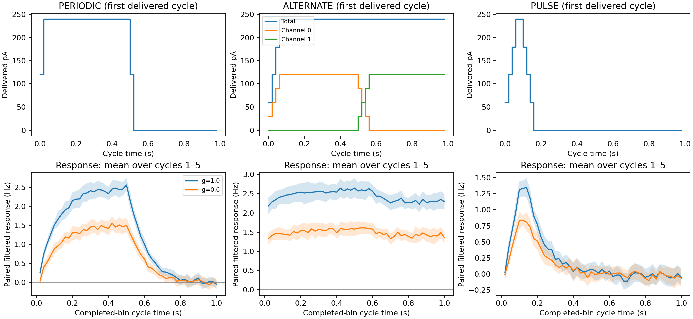
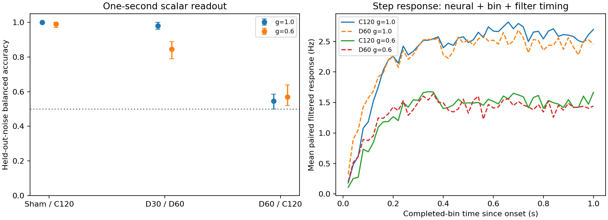
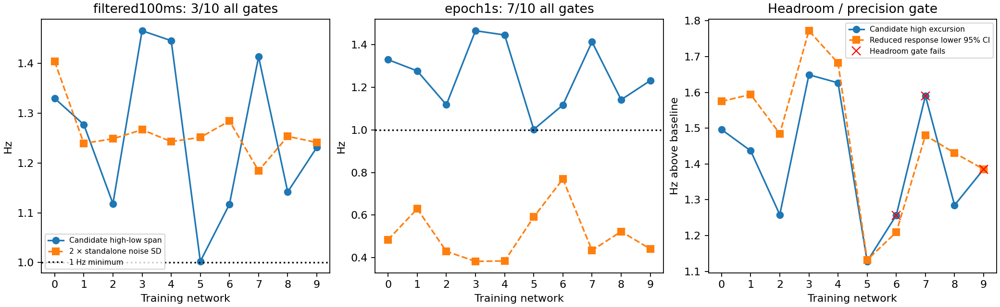

# Mission 002.2 — Reachability mapping and V0.2 redesign

Entirely simulated dynamics. **Execution PASS. V0.2 development screen: HOLD; selected scale: none.** All30 trials/720 branches completed and passed evidence checks. Original V0.1 authority failure remains preserved; no biological or full mathematical reachable-set claim.

## Repository, scope and lineage

Starting clean branch `research/m002-1-authority-diagnosis`, HEAD `aee19dc1c8857b839766619be7f2521521f6eddc`; created `research/m002-2-reachability` directly from it. No merge. All108 previously tracked files are preserved byte-identical, including M001 architecture/research/evidence, M002's38 tests and model, M002.1's42-test state and all negative results. [Preservation manifest](evidence/m002_2/preservation.json).

- Preregistered before neural execution: `19307f99d0b7bd89a8362e46aaf76fdb745a2376` ([protocol](evidence/m002_2/PREREGISTRATION.md)).
- Runner and explicit pre-execution charge correction: `e5c0f4dd6bac8a7cc93a6fed4531db32597acd51` ([amendment001](evidence/m002_2/PREREGISTRATION_AMENDMENT_001.md)).
- Frozen analysis/tests before inspection of new neural outcomes: `f9faa6764bbf7a25095a89162e4513e3b4d43a81`.

The original preregistration mistakenly summed the pulse ramp as720 rather than600 pA-ticks/channel/cycle. Schedule-only tests caught this before any neural experiment. The original preregistration stays unchanged; amendment001 corrects pulse charge to144 pA·s and its matched constant from D7.2 toD6. No pulse, seed, sample size, outcome, threshold or original protocol was changed. Runtime source and both preregistration hashes are retained. Final evidence commit identity is supplied in the mission handoff; a file cannot contain its own commit SHA.

Changes are a new open-loop diagnostic module, added tests and evidence-analysis/report files. No edits to the neural backend, public observation/stimulation contracts, dependencies, existing tests or historical protocols. No ARX, PI, MPC, RLS, RL, plasticity or hardware implementation.

## Exact experiment and resource budget

Ten training networks0–9, three new independent noise replicates5–7, gains1/.6, twelve actions:30 common baseline states and720 branches. Roles0–3 always use replicate0 (fixed network parameters); role4 uses the same root20261018, PCG64/SeedSequence keys and time-indexed OU blocks as M002. No validation IDs10–14 or test IDs100–119. New noise repeats do not create new topologies.

Prefix:5 s burn,10 s baseline at g=1; b uses [7,15) s. Checkpoint exact state at15 s, restore before every6 s branch on[15,21). Restore includes neural/current/OU/refractory/delay states, clocks, prior action, filter/cursors and noise offset. Both shams must match exactly; all branches share exogenous innovations at each absolute time. Each trial runs all24 gain/action branches; no outcome-based stopping or quiet-network exclusion.

Observation stays20 ms bins,20 permitted channels,80 pooled unstimulated E cells, original causal100 ms filter. Integration remains100 µs. Evaluator-only full-neuron events are temporarily retained to compute group/whole-window counts; no hidden activity changes an action. Every observation is available only at its bin end. Network parameter hashes, source, versions, both preregistration hashes, seeds, checkpoint/noise identities and receipts are preserved.

Preregistered budget:4770 simulated seconds (30×15 +720×6), three workers,75 min wall ceiling, expected combined worker memory<5 GiB, disk<250 MiB. Before running, estimated30–45 min using M002.1's4750 simulated seconds/1932.963 wall seconds; this was an estimate, not a benchmark. No downloads, GPU or unrestricted search.

| Action | Desired current pattern pA | Delivered summed-channel exposure pA·s over6 s |
|---|---|---:|
| S | zero | 0 |
| D6 | [6,6,6,6] | 144 |
| D15 | [15,15,15,15] | 360 |
| D30 | [30,30,30,30] | 720 |
| D60 | [60,60,60,60] | 1437.6 |
| C30 | [30,0,30,0] | 360 |
| C60 | [60,0,60,0] | 718.8 |
| C90 | [90,0,90,0] | 1076.4 |
| C120 | [120,0,120,0] | 1432.8 |
| PERIODIC | D60 target.5 s, zero.5 s, six1 s cycles | 720 |
| ALTERNATE | C02 max.5 s, C13 max.5 s, slew crossfade | 1432.8 |
| PULSE | C120 target.1 s, zero.9 s, six1 s cycles | 144 |

Every delivered tick is bounded0–120 pA/channel, total<=240 pA, slew<=30 pA/channel. Charge-matched comparisons are PERIODIC−D30, ALTERNATE−C120, PULSE−D6. No free preramp or terminal charge exemption. Pulse/D6 and alternating/C120 differ in both timing and activated cell sets: equal charge makes them fair resource comparisons, not isolated timing-mechanism experiments. PERIODIC/D30 uses the same four cell groups but changes instantaneous amplitude and timing. C02 is fixed from prior development evidence; no new allocation selection on held-out networks. Aggregate injected model charge is50×summed-channel exposure (pC); efficacy scales effective drive separately and does not falsify delivered receipts. These are model currents, not electrode safety or energy measurements.

Static nominal ramps last0–60 ms. PERIODIC first reaches zero at.52 s/cycle; PULSE at.16 s/cycle. ALTERNATE crossfades while retaining240 pA plateau total. Static/alternating branches can end nonzero because the next branch restores the baseline; endpoints are recorded. Whole-window means include every ramp. Late static means use[16,21) s and do not replace full-window scores.

## Prespecified inference and target screen

One noise replicate contributes one branch outcome. For each fixed network/action/gain, report mean, sample SD and pointwise95% t-CI across three noise replicates (df2). Population intervals use10,000 two-level percentile bootstrap resamples (networks then paired noise), seed20261022. Same resampling identities across conditions/gains. Intervals are descriptive, not multiplicity-adjusted confirmation. No bin, cell, pulse or repeated epoch is an independent network.

Primary paired response is raw observed-E count/(80×6 s) minus matched sham. Also report late raw response, unchanged filtered response, sector and evaluator-only group outcomes. The full finite-bank response range is an empirical set of tested means. Selected maxima are optimistic; neither those nor noise-split best results prove full reachability or a feasible feedback policy.

Baseline raw-bin variability uses[7,15) s. Standalone sham noise uses[16,21):100 ms-filtered scalar SD and SD of five nonoverlapping1 s raw-count rate epochs, pooled as RMS SD across three independent noise runs. Those temporal SDs describe within-trial variability; they do not inflate replication. Matched-noise effects alone can overstate online discrimination. A scalar midpoint readout fits one threshold on noise5 and evaluates noise6/7 on fixed1 s blocks for S/C120, D30/D60 and D60/C120; network-level CIs average noise first. This is a known-network readout diagnostic, not hidden-state observability.

Static t50 uses the paired three-noise mean filtered trace relative to late raw response, requiring3 consecutive completed bins within1 s. Dynamic peak/decay summarize cycles1–5, averaging cycles before noise; first cycle is excluded. Decay t20 starts at actual delivered zero, not nominal off-command, and requires3 consecutive bins. Responses<.25 Hz or no crossing are unresolved/censored. These metrics combine neural, binning and filter timing; no20 ms-bin metric resolves millisecond physiology. Fixed pulse recovery[.3,.9) and periodic off[.6,1) contrasts assess transient undershoot without treating it as sustained negative authority.

Candidate R*=.6×late C120 g=1 response, target offsets .1R*/.9R*, span=.8R*. A scale qualifies only if>=8/10 networks simultaneously meet span>=1 Hz, span>=2×standalone noise SD, upper target<=lower95% t-CI of reduced-gain late response, baseline1–30 Hz and finite state. Report every component, not just intersection. Screen fast100 ms then slow1 s; select the fastest qualifying one. This is a predeclared engineering minimum, not a target chosen from adaptive-controller performance. If neither qualifies, retain HOLD rather than shrink the minimum. The two-SD rule is an engineering screen, not a theorem of feedback impossibility. Actual prospective single-prefix calibration, unmeasured low C02 currents and interpolated L/H setpoints still need independent confirmation even if this scientific paired-response screen passes.

## Complete numerical results

Every reported response is stimulation minus matched sham. Whole-window scores include all6 s of delivered ramps/patterns. Late scores use the final5 s, not a changed observation filter. Three noise repeats are averaged within each network before population summaries.

| Pattern | Whole response g=1 Hz [95% CI] | Whole response g=.6 Hz [95% CI] |
|---|---:|---:|
| S | 0.0000 [0.0000, 0.0000] | 0.0000 [0.0000, 0.0000] |
| D6 | 0.2031 [0.1589, 0.2479] | 0.1182 [0.0792, 0.1616] |
| D15 | 0.5904 [0.5348, 0.6469] | 0.3381 [0.2976, 0.3801] |
| D30 | 1.2272 [1.1335, 1.3196] | 0.7342 [0.6692, 0.7996] |
| D60 | 2.4989 [2.3354, 2.6563] | 1.4802 [1.3671, 1.5815] |
| C30 | 0.6530 [0.5892, 0.7187] | 0.3667 [0.3226, 0.4123] |
| C60 | 1.3353 [1.2214, 1.4438] | 0.7837 [0.7049, 0.8604] |
| C90 | 1.9654 [1.8144, 2.1116] | 1.1988 [1.1013, 1.2915] |
| C120 | 2.6053 [2.4057, 2.8017] | 1.6061 [1.4853, 1.7260] |
| PERIODIC | 1.2275 [1.1413, 1.3163] | 0.7312 [0.6694, 0.7904] |
| ALTERNATE | 2.4294 [2.2671, 2.5866] | 1.4788 [1.3776, 1.5754] |
| PULSE | 0.2371 [0.1933, 0.2885] | 0.1409 [0.0983, 0.1838] |

### All ten networks

Whole6 s paired means in Hz. Per-network SDs and pointwise t-CIs for all240 network/gain/action combinations are in [network_summary.csv](evidence/m002_2/results/network_summary.csv). The720 noise-level outcomes are in [all_trials.csv](evidence/m002_2/results/all_trials.csv). No failed/weak case was removed.

Gain **1.0**. P=PERIODIC, A=ALTERNATE, U=PULSE.

| Network | S | D6 | D15 | D30 | D60 | C30 | C60 | C90 | C120 | P | A | U |
|---|---:|---:|---:|---:|---:|---:|---:|---:|---:|---:|---:|---:|
| 0 | 0.000 | 0.227 | 0.551 | 1.215 | 2.460 | 0.731 | 1.478 | 2.125 | 2.772 | 1.238 | 2.342 | 0.341 |
| 1 | 0.000 | 0.121 | 0.592 | 1.397 | 2.703 | 0.577 | 1.398 | 2.101 | 2.663 | 1.318 | 2.635 | 0.163 |
| 2 | 0.000 | 0.264 | 0.678 | 1.210 | 2.444 | 0.631 | 1.186 | 1.764 | 2.319 | 1.170 | 2.360 | 0.285 |
| 3 | 0.000 | 0.207 | 0.640 | 1.454 | 2.858 | 0.769 | 1.568 | 2.311 | 3.081 | 1.442 | 2.791 | 0.203 |
| 4 | 0.000 | 0.294 | 0.720 | 1.357 | 2.819 | 0.815 | 1.492 | 2.215 | 2.965 | 1.421 | 2.718 | 0.255 |
| 5 | 0.000 | 0.114 | 0.512 | 0.991 | 1.974 | 0.542 | 1.008 | 1.542 | 2.055 | 1.024 | 1.922 | 0.213 |
| 6 | 0.000 | 0.140 | 0.520 | 1.083 | 2.372 | 0.567 | 1.181 | 1.759 | 2.333 | 1.128 | 2.279 | 0.177 |
| 7 | 0.000 | 0.276 | 0.715 | 1.335 | 2.682 | 0.731 | 1.540 | 2.183 | 2.951 | 1.333 | 2.668 | 0.350 |
| 8 | 0.000 | 0.191 | 0.510 | 1.060 | 2.251 | 0.544 | 1.217 | 1.743 | 2.386 | 1.060 | 2.210 | 0.228 |
| 9 | 0.000 | 0.197 | 0.467 | 1.170 | 2.424 | 0.622 | 1.287 | 1.912 | 2.528 | 1.140 | 2.370 | 0.156 |

Gain **0.6**. P=PERIODIC, A=ALTERNATE, U=PULSE.

| Network | S | D6 | D15 | D30 | D60 | C30 | C60 | C90 | C120 | P | A | U |
|---|---:|---:|---:|---:|---:|---:|---:|---:|---:|---:|---:|---:|
| 0 | 0.000 | 0.117 | 0.340 | 0.692 | 1.438 | 0.415 | 0.912 | 1.290 | 1.765 | 0.770 | 1.422 | 0.237 |
| 1 | 0.000 | 0.085 | 0.342 | 0.815 | 1.681 | 0.356 | 0.819 | 1.251 | 1.686 | 0.785 | 1.601 | 0.059 |
| 2 | 0.000 | 0.228 | 0.436 | 0.758 | 1.464 | 0.440 | 0.767 | 1.119 | 1.466 | 0.749 | 1.509 | 0.183 |
| 3 | 0.000 | 0.065 | 0.333 | 0.795 | 1.701 | 0.403 | 0.920 | 1.399 | 1.883 | 0.883 | 1.691 | 0.137 |
| 4 | 0.000 | 0.174 | 0.385 | 0.872 | 1.592 | 0.355 | 0.937 | 1.352 | 1.812 | 0.796 | 1.656 | 0.200 |
| 5 | 0.000 | 0.153 | 0.303 | 0.578 | 1.101 | 0.319 | 0.597 | 0.894 | 1.287 | 0.563 | 1.196 | 0.126 |
| 6 | 0.000 | 0.021 | 0.231 | 0.602 | 1.463 | 0.320 | 0.617 | 1.062 | 1.386 | 0.664 | 1.347 | 0.068 |
| 7 | 0.000 | 0.115 | 0.340 | 0.848 | 1.622 | 0.465 | 0.873 | 1.369 | 1.750 | 0.818 | 1.588 | 0.181 |
| 8 | 0.000 | 0.112 | 0.308 | 0.713 | 1.354 | 0.315 | 0.713 | 1.123 | 1.476 | 0.628 | 1.296 | 0.128 |
| 9 | 0.000 | 0.110 | 0.362 | 0.669 | 1.386 | 0.278 | 0.683 | 1.131 | 1.549 | 0.655 | 1.482 | 0.091 |

### Static late dose response

| Pattern | Final5 s g=1 Hz [CI] | Final5 s g=.6 Hz [CI] |
|---|---:|---:|
| S | 0.0000 [0.0000, 0.0000] | 0.0000 [0.0000, 0.0000] |
| D6 | 0.2059 [0.1577, 0.2564] | 0.1140 [0.0667, 0.1633] |
| D15 | 0.5926 [0.5322, 0.6550] | 0.3340 [0.2850, 0.3818] |
| D30 | 1.2326 [1.1367, 1.3275] | 0.7245 [0.6563, 0.7982] |
| D60 | 2.5006 [2.3370, 2.6602] | 1.4815 [1.3676, 1.5883] |
| C30 | 0.6520 [0.5838, 0.7251] | 0.3761 [0.3324, 0.4211] |
| C60 | 1.3380 [1.2191, 1.4518] | 0.7801 [0.6959, 0.8601] |
| C90 | 1.9722 [1.8122, 2.1259] | 1.2014 [1.1012, 1.2999] |
| C120 | 2.6134 [2.4166, 2.8067] | 1.6241 [1.4981, 1.7457] |



### Finite-bank ranges and efficacy dependence

These are ranges of **mean causal effects of the tested6 s patterns**, not bounds on individual noisy firing rates, arbitrary schedules or hidden states. A selected maximum is optimistic. The scientific paired range is not a controller oracle.

| Network | Static max g=1 Hz | Dynamic max g=1 Hz | Static max g=.6 Hz | Dynamic max g=.6 Hz |
|---|---:|---:|---:|---:|
| 0 | 2.7722 | 2.3417 | 1.7653 | 1.4222 |
| 1 | 2.7028 | 2.6347 | 1.6861 | 1.6007 |
| 2 | 2.4444 | 2.3597 | 1.4660 | 1.5090 |
| 3 | 3.0806 | 2.7910 | 1.8826 | 1.6910 |
| 4 | 2.9653 | 2.7181 | 1.8118 | 1.6562 |
| 5 | 2.0549 | 1.9215 | 1.2875 | 1.1958 |
| 6 | 2.3722 | 2.2792 | 1.4632 | 1.3472 |
| 7 | 2.9507 | 2.6681 | 1.7500 | 1.5882 |
| 8 | 2.3861 | 2.2104 | 1.4764 | 1.2958 |
| 9 | 2.5278 | 2.3701 | 1.5493 | 1.4819 |

All network/gain finite minima, maxima, replicate5-selected identities and their independent-noise6/7 responses are retained in [comparison.json](evidence/m002_2/results/comparison.json). Those selections are evaluator-only diagnostics, not a learned controller or evidence of optimality. Historical V0.1 used a different5 s authority gate and remains FAIL; these6 s experiments do not retrospectively redefine it.

### Dynamic patterns versus equal charge

| Contrast | g=1 paired mean difference Hz [CI] | g=.6 paired mean difference Hz [CI] |
|---|---:|---:|
| PERIODIC−D30 | 0.0003 [-0.0322, 0.0316] | -0.0030 [-0.0458, 0.0407] |
| ALTERNATE−C120 | -0.1758 [-0.2625, -0.0906] | -0.1273 [-0.1952, -0.0625] |
| PULSE−D6 | 0.0340 [-0.0070, 0.0806] | 0.0227 [-0.0251, 0.0678] |

Different waveform peaks are not sustained mean authority. Equal-charge comparisons do not prove a purely temporal mechanism when activated cell sets also differ. No action/frequency/phase optimization was performed.





### Latency, recovery and directionality

| Pattern / metric | Gain | Resolved networks | Min / median / max s among resolved |
|---|---:|---:|---:|
| D60 / static_t50 | 1.0 | 10/10 | 0.060 / 0.080 / 0.120 |
| D60 / static_t50 | 0.6 | 10/10 | 0.060 / 0.120 / 0.280 |
| C120 / static_t50 | 1.0 | 10/10 | 0.080 / 0.120 / 0.160 |
| C120 / static_t50 | 0.6 | 10/10 | 0.080 / 0.130 / 0.160 |
| PERIODIC / recovery_t20 | 1.0 | 10/10 | 0.120 / 0.160 / 0.180 |
| PERIODIC / recovery_t20 | 0.6 | 10/10 | 0.100 / 0.150 / 0.200 |
| PULSE / recovery_t20 | 1.0 | 10/10 | 0.100 / 0.160 / 0.280 |
| PULSE / recovery_t20 | 0.6 | 10/10 | 0.060 / 0.170 / 0.400 |

All80 network/gain timing descriptors, amplitudes and censor flags are in [temporal_metrics.json](evidence/m002_2/results/temporal_metrics.json). These are descriptive crossing times on three-noise mean traces, not independently replicated neural-delay estimates.20 ms quantization,100 ms filtering, slew and threshold definition affect them; requiring3 consecutive bins means online confirmation would occur two bins after the reported retrospective first crossing. No sub-bin latency or exponential decay fit is claimed.

| Recovery window, raw paired response | g=1 mean Hz [CI] | g=.6 mean Hz [CI] |
|---|---:|---:|
| PULSE [.3,.9) s | -0.0082 [-0.0769, 0.0600] | -0.0111 [-0.0672, 0.0497] |
| PERIODIC [.6,1) s | -0.0610 [-0.1488, 0.0267] | -0.0471 [-0.1158, 0.0221] |

Withdrawal can return activity toward baseline; any recovery undershoot is transient evidence, not a demonstration of sustained below-baseline regulation. Positive-only input does not itself prove monotone neural response, but this finite bank must supply actual negative-response evidence before a suppressive objective is proposed. Returning from H to L above baseline is different from suppressing below natural activity.

### Partial recording, full groups and sectors

All full-population measures below are evaluator-only and never choose actions or targets. Fixed unstimulated E600 includes the recorded80; it is not an independent biological validation sample.

| Pattern | Gain | Observed E80 Hz | Fixed unstimulated E600 Hz | All E800 Hz | I200 Hz |
|---|---:|---:|---:|---:|---:|
| D60 | 1.0 | 2.4989 | 2.5617 | 7.2471 | 2.5149 |
| D60 | 0.6 | 1.4802 | 1.5179 | 4.3239 | 1.5109 |
| C120 | 1.0 | 2.6053 | 2.5671 | 7.1587 | 2.4722 |
| C120 | 0.6 | 1.6061 | 1.5864 | 4.4127 | 1.5298 |
| PERIODIC | 1.0 | 1.2275 | 1.2752 | 3.6226 | 1.2576 |
| PERIODIC | 0.6 | 0.7312 | 0.7609 | 2.1669 | 0.7554 |
| ALTERNATE | 1.0 | 2.4294 | 2.5024 | 7.1057 | 2.4678 |
| ALTERNATE | 0.6 | 1.4788 | 1.5361 | 4.3617 | 1.5198 |
| PULSE | 1.0 | 0.2371 | 0.2639 | 0.7321 | 0.2557 |
| PULSE | 0.6 | 0.1409 | 0.1530 | 0.4387 | 0.1544 |

All24 evaluator-group summaries/CIs and20 ms group counts are preserved. The2,880 recorded sector-level outcomes are in [sector_trials.csv](evidence/m002_2/results/sector_trials.csv). ALTERNATE phase responses below average cycles1–5 within each noise replicate first. The four sectors are membership labels in a random recurrent network, not anatomical/MEA geometry.

| Gain | Alternation phase | Sector0 Hz | Sector1 Hz | Sector2 Hz | Sector3 Hz |
|---|---|---:|---:|---:|---:|
| 1.0 | C02 target | 2.1480 | 2.8827 | 2.6180 | 2.6553 |
| 1.0 | C13 target | 1.8573 | 2.3593 | 2.3227 | 2.6967 |
| 0.6 | C02 target | 1.2887 | 1.7673 | 1.5560 | 1.6293 |
| 0.6 | C13 target | 1.1313 | 1.4787 | 1.4307 | 1.6387 |

### Distinguishability on new noise

Scalar1 s rate-minus-baseline midpoint, fitted only on noise5; balanced accuracy on noise6/7. CIs resample ten networks after averaging the two evaluation noise results.

| Conditions | g=1 accuracy [CI] | g=.6 accuracy [CI] |
|---|---:|---:|
| S / C120 | 1.000 [1.000, 1.000] | 0.990 [0.970, 1.000] |
| D30 / D60 | 0.980 [0.960, 1.000] | 0.845 [0.790, 0.890] |
| D60 / C120 | 0.545 [0.500, 0.585] | 0.570 [0.520, 0.640] |

This is one simple pooled-output readout on known network identities, not optimal decoding, full-recording indistinguishability, structural observability, hidden-state reconstruction or controller efficacy. A paired effect with common noise is easier to estimate than an individual online outcome.



## Noise-aware target qualification and V0.2 recommendation

The frozen rule recommends **HOLD**, selected scale **none**. No threshold or target factor was changed after outcomes.

| Network | Baseline mean Hz | Candidate span Hz | Standalone filtered SD Hz | Standalone1 s SD Hz | High excursion Hz | Reduced response lowerCI Hz | Fast all gates | Slow all gates |
|---|---:|---:|---:|---:|---:|---:|---|---|
| 0 | 12.7589 | 1.3300 | 0.7020 | 0.2423 | 1.4963 | 1.5748 | FAIL | PASS |
| 1 | 14.6245 | 1.2772 | 0.6198 | 0.3148 | 1.4368 | 1.5942 | PASS | PASS |
| 2 | 11.8448 | 1.1184 | 0.6244 | 0.2149 | 1.2582 | 1.4847 | FAIL | PASS |
| 3 | 14.6385 | 1.4660 | 0.6335 | 0.1915 | 1.6493 | 1.7724 | PASS | PASS |
| 4 | 14.9708 | 1.4460 | 0.6216 | 0.1924 | 1.6267 | 1.6820 | PASS | PASS |
| 5 | 12.4714 | 1.0024 | 0.6258 | 0.2955 | 1.1277 | 1.1316 | FAIL | PASS |
| 6 | 14.0391 | 1.1172 | 0.6423 | 0.3848 | 1.2569 | 1.2093 | FAIL | FAIL |
| 7 | 13.0604 | 1.4136 | 0.5923 | 0.2172 | 1.5903 | 1.4799 | FAIL | FAIL |
| 8 | 12.6089 | 1.1420 | 0.6268 | 0.2616 | 1.2848 | 1.4306 | FAIL | PASS |
| 9 | 11.3656 | 1.2316 | 0.6207 | 0.2207 | 1.3856 | 1.3851 | FAIL | FAIL |

| Component | Fast100 ms count | Slow1 s count |
|---|---:|---:|
| minimum_span | 10/10 | 10/10 |
| signal_to_noise | 4/10 | 10/10 |
| reduced_headroom | 7/10 | 7/10 |
| baseline_valid | 10/10 | 10/10 |
| Joint gate (required >=8/10) | 3/10 | 7/10 |

The full baseline/noise array and each Boolean margin are retained in comparison.json. Confidence limits have only three independent noise samples (df2); an insufficient headroom lower bound can reflect uncertainty rather than an insufficient mean. The1 Hz and2SD rules are predeclared engineering standards, not universal proofs against feedback. No test network has been opened.



[V0.2 proposal](../docs/research/003_V0_2_PROTOCOL_PROPOSAL.md) specifies actual precontrol calibration, target construction, minimum challenge, strong target-aware open-loop/anti-windup PI, shared fixed/adaptive models, costs, network-disjoint tests, negative controls and joint failure criteria. It is a conditional design, not an implemented algorithm or a claim that adaptive MPC will outperform PI. Any future calibration uses only its own permitted past recordings, never the scientific paired-response oracle. Untested low C02 currents and interpolation to L/H remain qualification gaps.

## Verification, actual performance and evidence

Initial historical suite:42 passed,25 upstream warnings in40.21 s. Final expanded suite: **46 passed**,25 upstream Brian/Pyparsing deprecation warnings in29.34 s. No old test was edited. [Text](evidence/m002_2/tests.txt), [JUnit](evidence/m002_2/tests.xml). Schedule arithmetic failure was caught and corrected before neural execution; no failed scientific trial or unfavorable outcome was deleted.

```sh
python -m neuromancer.reachability --output runs/m002_2-reachability-01
python reports/evidence/m002_2/analyze.py runs/m002_2-reachability-01 runs/m002_2-analysis-01
python reports/evidence/m002_2/verify.py runs/m002_2-reachability-01 runs/m002_2-analysis-01
python reports/evidence/m002_2/figures.py runs/m002_2-analysis-01
python -m pytest -q --junitxml=reports/evidence/m002_2/tests.xml
```

Execution uses Python3.12.15, Brian2 2.10.1, NumPy2.5.4, unchanged resolved dependencies, NumPy CPU code objects on the Apple M5/16 GB/macOS arm64 environment. No GPU, new package installation, hardware experiment or remote CI run. Three simulation workers; observation/event retention and group extraction add overhead. Measured wall times include concurrent local activity and verification preparation; these are not isolated single-core benchmarks.

| Measurement | Actual value |
|---|---:|
| Full scientific execution wall | 2114.167 s (35.236 min) |
| Simulated duration | 4770 s |
| Initialization ms: min / median / max | 25.335 / 26.907 / 48.896 |
| Per-trial wall s: min / median / max | 202.517 / 205.204 / 223.213 |
| Branch simulation call s: min / median / max | 7.433 / 7.694 / 11.152 |
| Observation processing per branch ms: min / median / max | 69.099 / 88.881 / 244.750 |
| Evaluator extraction per branch ms: min / median / max | 8.834 / 10.869 / 19.163 |
| Worker lifetime peak RSS MiB: min / median / max | 983.312 / 1002.234 / 1045.031 |
| Analysis computation before table/archive writing | 0.913 s |
| Full analysis CLI wall | 4.792 s |
| Figure rendering CLI wall | 1.825 s |
| Initial uncached verification CLI wall | 94.100 s |
| Cached verification CLI wall | 4.054 s |
| Final figure rendering CLI wall | 1.882 s |

Peak RSS is process-lifetime high-water memory, not per-trial allocation or combined system usage. All initialization, prefix, branch, extraction and observation timings are retained per trial. The35.236 min run met the75 min ceiling; no outcome-based early stop occurred. Worker peak RSS stayed below1.05 GiB. Raw and curated scientific artifacts each occupy under25 MiB, well within the250 MiB budget. The first audit redundantly decompressed NPZ arrays; caching them once reduced verification from94.100 to4.054 s, with all identical checks rerun and passing. This changed only verification I/O, not simulation or the frozen analysis.

Independent [verification](evidence/m002_2/results/verification.json): all720 actual schedules/constraints, all raw hashes, all108 historical files, observed/group/per-neuron counts, exact recomputation of every causal filter, original parameter identity,30 distinct noise/checkpoint identities and target gates recomputed from counts. Both shams agree exactly. Figure regeneration hashes and source lineage have separate manifests. All five diagnostic figures were visually inspected; ten PNG/SVG artifacts regenerated byte-identically.

The committed [numeric archive](evidence/m002_2/results/reachability_data.npz) contains every trial’s observations, group bin counts, per-neuron totals, delivered/desired schedules, memberships and timestamps. [Trial manifests](evidence/m002_2/results/trial_provenance.json) preserve every seed/configuration/checkpoint; [receipts](evidence/m002_2/results/delivered_actions.json) preserve every dose/constraint audit. Local raw files remain under ignored runs/m002_2-reachability-01; no historical raw data was deleted. [Reproduction guide](evidence/m002_2/README.md).

## Scientific limitations and review

- Finite action bank, short6 s episodes, ten procedural networks and three new noise repeats do not establish a full reachable set, optimal controllability, rare-event safety or biological relevance.
- Matched noise identifies input effects within this model; standalone noise and independent-noise readout are essential before inferring useful regulation. Filter/bin/slew timing prevents a physiological interpretation of crossing latencies.
- Pulse/alternation comparisons confound temporal and spatial recruitment; current totals are controlled but mechanisms are not isolated. No inhibitory causal ablation was performed.
- The target screen is conditional on C02 and the declared bandwidth/minimum span, with noisy lower confidence bounds and no simultaneous coverage guarantee. Slow qualification cannot rehabilitate fast tracking or the V0.1 +4 Hz gate.
- Candidate paired-response target scale is not the same as prospective preceding-zero calibration. Low-current interpolation, drift of baseline estimates and independent target realization require new confirmation.
- Existing M002 numerical convergence/timing/replay qualifications remain preserved; this entire dynamic bank was not separately rerun at50 microseconds, in Linux/another simulator, on hardware or with biological recordings.
- Strong PI/feedforward may eliminate any adaptive-model benefit. Target scaling alone has no methodological novelty; no controller comparison has been measured here.

No ARX, PI, MPC, RLS, RL, plasticity, inhibitory ablation or hardware integration was implemented. No merge or automatic next implementation.

## Scientific interpretation and explicit decision

**Execution PASS; V0.2 controller-study readiness HOLD.** All720 branches,46 tests and the independent artifact/count/filter/source audits pass. V0.1 remains FAIL. No neural parameter, observation definition or current constraint has changed.

The tested constant C120 has the largest pooled mean response: **2.6053 Hz [2.4057,2.8017] at g=1** and **1.6061 Hz [1.4853,1.7260] at g=.6** over6 s. Its final5 s reduced-gain response is1.6241 Hz [1.4981,1.7457]. The best static per-network means at g=.6 range1.2875–1.8826 Hz; this is a finite-bank, noisy mean-effect range, not a guarantee of tracking or a boundary on all policies. No tested network-mean effect approaches the historical+4 Hz requirement.

Periodic delivery has essentially the same mean response as charge-matched D30 (g=.6 difference−.0030 Hz, CI[−.0458,.0407]). Pulse−D6 is+.0227 Hz [−.0251,.0678], without a clear advantage; the spatial pattern also differs. ALTERNATE loses.1273 Hz [−.1952,−.0625] relative to charge-matched C120. Thus this small dynamic bank provides no pooled mean-authority rescue. Network2 has a small selected dynamic mean1.5090 versus static maximum1.4660 Hz, a noisy hindsight comparison that does not justify an oracle policy or a general dynamic advantage. Peaks and recovery transients remain separately documented.

Baseline raw recorded-E means span11.3047–15.1297 Hz across the30 trials; raw20 ms baseline SD spans2.5984–3.2516 Hz. Across-network RMS-noise descriptors are.5923–.7020 Hz for existing100 ms-filtered sham output and.1915–.3848 Hz for1 s raw-rate epochs. Large dose changes are distinguishable at1 s: S/C120 accuracy is1.00 at g=1 and.99 at g=.6; D30/D60 is.98/.845. The D60/C120 allocation readout is much weaker (.545/.570), and uses only the pooled scalar, not an optimized multichannel decoder.

The fixed1 Hz minimum span passes all10 networks (network5 is borderline at1.0024 Hz). Signal/noise passes4/10 at100 ms and10/10 at1 s. Reduced-gain confidence-bound headroom passes7/10, giving joint fast3/10 and slow7/10, below the frozen8/10 standard. Failed headroom networks are6,7,9: lower-bound-minus-high-target margins **−.047571,−.110418,−.000456 Hz**, respectively. No rounding exemption is applied. All ten **point-mean** reduced-gain responses exceed their candidate highs by.1032–.2848 Hz, so the failed lower-bound gate is not evidence that these means are below target. Three noise repeats provide limited precision; the current data do not establish the conservative joint qualification.

**Recommendation:** preserve V0.2 as a conditional **slow1 s candidate**, not an approved tracking protocol. The M002.2 rule selected no scale; a slow follow-up is a new confirmation question motivated by the10/10 slow-noise result and7/10 confidence gate, not a retroactive PASS. Do not implement identification/controllers yet. Immediate scientifically supported work is quantitative evoked/dose-response identification; if the original larger/faster target is essential, investigate a separately justified and versioned substrate family. This dataset does not prove that meaningful slow control is impossible, so changing neural weights now is premature.

## Next falsifiable experiment — calibration/target confirmation only

Preregister all training IDs0–9 and five independent new noise IDs8–12, unchanged model and1 Hz floor. Lock the **slow1 s candidate** as primary for that study; retain fast metrics as descriptive, with no post-outcome switch. Use the proposal's actual allowed51 s calibration prefix, then eight6 s matched branches per trial: S, C120 and calibration-derived low/high lookup holds at g=1/.6. Lookup uses permitted past observed h(q), and evaluator-known g only for a clearly labeled open-loop reachability assay; no ARX, PI, MPC or RLS. Invalid/nonmonotone calibration or q>120 is a recorded failure, never a clipped target or replacement network.

Test whether at least8/10 networks satisfy the unchanged span/noise/headroom criteria **and** realize L/H within a mean absolute normalized error<=.25 of span at both gains. Include every calibration failure, target span, dose and confidence interval.4950 simulated seconds, three workers,75 min ceiling; about36.6 min projected from M002.2 throughput, explicitly an estimate. This new experiment has not been run or authorized automatically.

Falsification: fewer than8/10 qualified networks, unreliable target calibration, lookup error above the prespecified tolerance, insufficient headroom, or invalid instrument checks. A pass would qualify only calibration-derived slow setpoints for a later instrument/controller study; it would not prove feedback success or adaptive-model benefit. A failure favors a different scientific objective (e.g. evoked-response estimation under weak indirect drive) or separately motivated substrate redesign, while preserving this family’s negative results.
