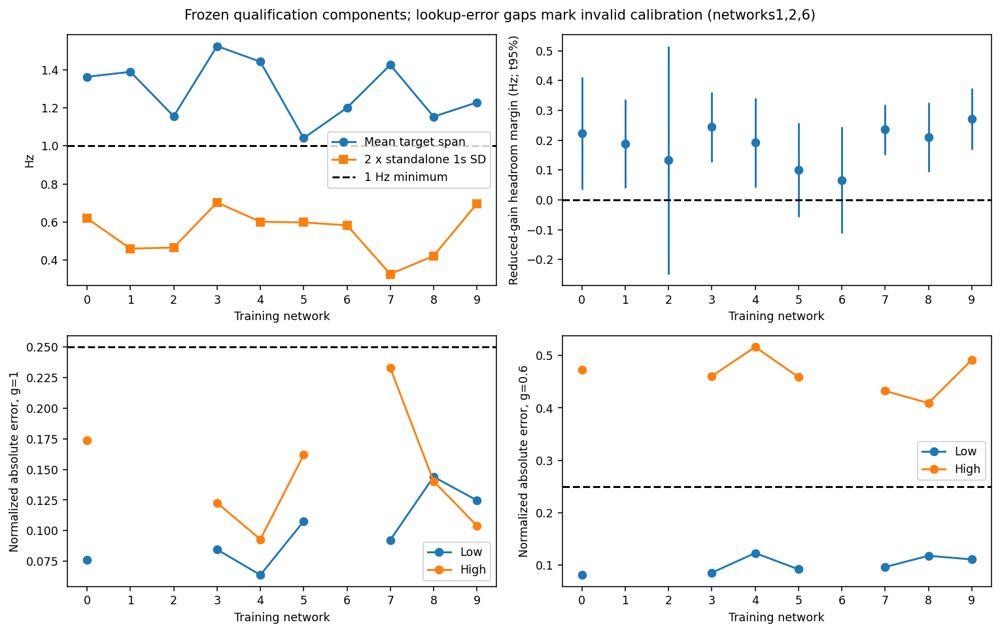
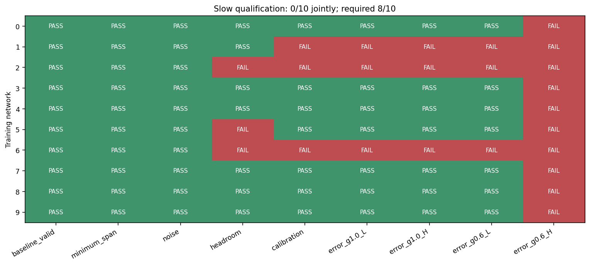

# Mission 002.3 — Prospective calibration and slow-target qualification

**Execution PASS. Scientific qualification FAIL:0/10, required8/10. V0.2 remains HOLD.** Entirely simulated dynamics. No biological, feedback-controller, adaptive-control or learning claim.

## Scope and immutable lineage

Starting branch `research/m002-2-reachability`, exact clean HEAD `a1c236e062c221523dc03e87d483301aa079e1c3`. Review branch `research/m002-3-calibration`. Preregistration commit `ad5c213`; scientific execution source `df50431`; numerical analysis freeze `d3190d6` preceded inspection of new outcomes. Full preregistration revision `ad5c21337fb1f8002e8d267c3bcdca97b5e6240e`; execution revision `df504317372a18be2bf486f1ed53f951695cb561`; initial analysis revision `d3190d6cb4f7d4cc53e9fe452bf2131a0cd63d66`. Final review revision is recorded in the completion report; all execution/analysis hashes are preserved in evidence. Historical file hashes are [preserved](evidence/m002_3/preservation.json); no old file is edited. V0.1 +4Hz failure and M002.2 slow7/10 HOLD retain their original interpretation.

The only runtime additions are a pure observation/receipt calibration function and a fixed, private evaluator. Existing Brian dynamics, topology, integrator, random streams, observations and constraints are reused unchanged. No new dependency, controller framework, frontend, model fitting stack or simulator abstraction.

## Preregistered question and gain-access resolution

Can a fresh causal empirical calibration construct a nontrivial slow target pair and realize it through blind lookup holds, including after an unobserved efficacy loss? This is mean-output calibration feasibility, not tracking a changing trajectory. The primary statistic uses fixed nonoverlapping1s raw-count epochs; the original20ms observations and100ms filter remain intact.

The historical conditional proposal describes an **evaluator-known-gain** lookup `q=q_eff/g`. M002.3 explicitly prohibits true efficacy in calibration and lookup. The committed [preregistration](evidence/m002_3/PREREGISTRATION.md) resolves this before neural execution: `q=h^{-1}(target-b)` is identical at both gains, with no division by gain and no post-loss recalibration. The evaluator alone applies gain1/.6 after the checkpoint. This blind robustness experiment is a stricter/different assay than the proposal's known-gain reachability check; its failure cannot establish target unreachability. It cannot claim an open-loop policy detects an unobserved gain change. The fixed target factor.6 is a disclosed design assumption, not a measurement of gain.

## Exact experiment

Ten unchanged development networks0–9; five independent new noise replicates8–12, root20261018. Never inspect validation10–14 or test100–119. Fixed50 trials,400 confirmation branches,4950 simulated seconds. No exclusions, replacement seeds, enlarged sample or action optimization.

Prefix:5s zero burn,10s zero baseline; b from[7,15)s observed80E counts. Four alternating4s zero/4s C02 holds q30,60,90,120 over[15,47)s. Score final3s each block; h(q)=hold mean−immediately preceding zero mean, h(0)=0. Require every increment>1e-9Hz and positive endpoint, no isotonic repair. At47s freeze `R*=.6h(120)`, `L=b+.1R*`, `H=b+.9R*`, `span=.8R*`. Piecewise-linear inverse on measured[0,120] only; no clipping, extrapolation or hidden-state/gain input. Four-second zero washout ends51s. Each of eight6s branches restores that exact checkpoint: S,C120,L,H at gain1, then S,C120,L,H at gain.6. All use identical absolute-time exogenous noise[51,57)s. Late mean[52,57)s and full6s are reported.

Calibration accepts exactly2350 completed20ms observations/receipts through47s, counts/masks/coverage/timing/delivery checked. Later observations are rejected, and neither evaluator engine objects nor gain are arguments. Invalid maps retain their complete values/targets, mark lookup invalid and run labeled zero-current L/H safe fallbacks; they fail qualification rather than disappear. The original constraint validator still atomically rejects bad commands.

C02 uses u=(q,0,q,0), q<=120pA, sum<=240pA, delta<=30pA/channel/tick. Actual ramps are preserved. Prefix nominal exposure is2400pA*s; aggregate model charge120000pC, including ramps and offsets. Confirmation nominal/effective current exposure, per-channel charge and squared-current cost are distinct. Effective exposure multiplies nominal by evaluator gain; these are simplified model-current quantities, not extracellular stimulation energy or biological safety measurements.

## Frozen decision rules and uncertainty

Each network must jointly pass: all baseline means1–30Hz, sector means<100Hz and finite/no timing/constraint/replay faults; mean span>=1Hz; mean span>=2×RMS standalone1s SD; lower95% t bound of paired reduced-gain C120 response minus that replicate's high excursion>=0; all five calibration maps valid; mean absolute late target error/that trial's span<=.25 **separately for L/H at both gains**. Confirmation sector6s means>=100Hz also invalidate numerical activity qualification. At least8/10 networks must pass every component.

Standalone SD is computed per replicate from the five raw1s sham epochs[52,57)s, then RMS across five replicates. Headroom uses paired replicate-specific margins, not a confidence bound against a hindsight averaged target. Errors compare actual absolute rate to the prospectively frozen target, not sham-corrected responses. The t multiplier is2.7764451051977987, df4. Network means are the independent units for10,000-draw descriptive percentile bootstrap(seed20261023); bins are never replicates. Intervals are pointwise and the small noise/network sample has limited precision. Wilson95% interval for the qualification proportion is descriptive for this fixed development cohort, not held-out generalization.

## Verification plan and resource accounting

The [independent verifier](evidence/m002_3/verify.py) reconstructs baseline, h, target mathematics, inverse interpolation, delivered schedules/exposure, counts, original causal filter and all network gates separately from saved numerical records. It also checks all historical file hashes, source/preregistration identities, fixed memberships, distinct noise ledgers and checkpoint OU states, sham equality and identical gain-blind lookup rows. Original regression tests retain delay-queue/refractory/clock restoration, chunk equivalence, causal response, zero coupling, isolation and invalid-command coverage. This is independent analytical recomputation within the session, not external human or second-simulator replication.

Scientific budget:75min wall, three spawned CPU workers with one BLAS thread each, intended worker-total peakRSS<5GiB, raw+curated disk250MiB. M002.2's prior runtime supplied a ~36.6min planning estimate, not a new benchmark. All actual times, memory and any overlap with verification work are reported at completion. No GPU or cross-platform bitwise replay claim.

## Complete numerical qualification

All50 trials and400 branches completed; zero timing/replay/constraint/numerical failures and no exclusions or replacement seeds. **0/10 joint qualification**, with descriptive Wilson95% interval[0,.2775]. This interval is not a held-out-network estimate. Every network passes baseline, minimum1Hz span and standalone1s noise. Seven pass all-map validity, seven pass headroom; their intersection with the other prerequisites contains six networks. None passes reduced-gain high-target realization.

The following table reports means across five replicates. Headroom is the paired C120(g=.6) minus sham response, minus that replicate's prospective high excursion; interval is across-noise t95%. Targets are absolute observed rates. All underlying per-replicate values and maps are in [calibration_trials.csv](evidence/m002_3/results/calibration_trials.csv).

| Network | b Hz | L Hz | H Hz | Span Hz | 1s SD Hz | Headroom Hz [95%] | Invalid maps | Joint |
|---|---:|---:|---:|---:|---:|---|---:|---|
| 0 | 12.7775 | 12.9478 | 14.3106 | 1.3628 | 0.3094 | 0.2238 [0.0357,0.4120] | 0 | FAIL |
| 1 | 14.6006 | 14.7742 | 16.1630 | 1.3888 | 0.2300 | 0.1886 [0.0393,0.3379] | 1 | FAIL |
| 2 | 11.9322 | 12.0766 | 13.2318 | 1.1552 | 0.2327 | 0.1334 [-0.2487,0.5155] | 1 | FAIL |
| 3 | 14.6841 | 14.8746 | 16.3986 | 1.5240 | 0.3513 | 0.2445 [0.1275,0.3615] | 0 | FAIL |
| 4 | 14.9150 | 15.0953 | 16.5373 | 1.4420 | 0.3005 | 0.1923 [0.0425,0.3420] | 0 | FAIL |
| 5 | 12.4287 | 12.5588 | 13.5992 | 1.0404 | 0.2990 | 0.1011 [-0.0561,0.2582] | 0 | FAIL |
| 6 | 13.9744 | 14.1244 | 15.3244 | 1.2000 | 0.2912 | 0.0665 [-0.1115,0.2445] | 1 | FAIL |
| 7 | 13.0294 | 13.2076 | 14.6332 | 1.4256 | 0.1631 | 0.2362 [0.1520,0.3204] | 0 | FAIL |
| 8 | 12.5169 | 12.6610 | 13.8142 | 1.1532 | 0.2108 | 0.2101 [0.0938,0.3265] | 0 | FAIL |
| 9 | 11.3000 | 11.4535 | 12.6815 | 1.2280 | 0.3480 | 0.2710 [0.1677,0.3743] | 0 | FAIL |

Mean span is1.2920Hz, descriptive network-bootstrap95% interval[1.2010,1.3830]. Network means range1.0404–1.5240Hz. Standalone1s SD ranges.1631–.3513Hz; original100ms-filter SD ranges.5661–.6763Hz (secondary only). No switch back to the fast candidate was considered. Individual spans and their uncertainty remain reported, even when an individual replicate is below1Hz; the frozen minimum gate is the network mean, not an altered all-replicate rule.

### Actual target realization, including failures

Values below are mean absolute late-rate error divided by each replicate's own span; required<=.25 in each of four cells. H at g=.6 includes t95% uncertainty. Full intervals for every cell are in [comparison.json](evidence/m002_3/results/comparison.json) for qualified maps and [report_statistics.json](evidence/m002_3/results/report_statistics.json) for complete actual outcomes.

Asterisked networks have one invalid-map replicate. Their displayed values include that replicate's **zero-current safe-fallback outcome**, not a valid lookup estimate. The frozen primary analysis marks their lookup errors nonqualifying/undefined rather than dropping the failed replicate; the separate descriptive export reports the actual finite error against the unchanged target. These supplementary numbers cannot qualify an invalid map. No scientific gate or denominator was changed.

| Network | L,g=1 | H,g=1 | L,g=.6 | H,g=.6 [95%] |
|---|---:|---:|---:|---|
| 0 | 0.0760 | 0.1740 | 0.0807 | 0.4729 [0.3649,0.5809] |
| 1* | 0.0948 | 0.3126 | 0.0802 | 0.5380 [0.1607,0.9153] |
| 2* | 0.1184 | 0.3630 | 0.1492 | 0.6477 [0.0604,1.2350] |
| 3 | 0.0846 | 0.1227 | 0.0852 | 0.4608 [0.3288,0.5929] |
| 4 | 0.0638 | 0.0929 | 0.1226 | 0.5165 [0.4351,0.5978] |
| 5 | 0.1076 | 0.1618 | 0.0916 | 0.4590 [0.2321,0.6859] |
| 6* | 0.1408 | 0.3257 | 0.1261 | 0.5719 [0.2300,0.9138] |
| 7 | 0.0924 | 0.2328 | 0.0960 | 0.4324 [0.2116,0.6533] |
| 8 | 0.1440 | 0.1403 | 0.1174 | 0.4093 [0.1813,0.6374] |
| 9 | 0.1248 | 0.1040 | 0.1105 | 0.4916 [0.3446,0.6387] |

All four primary error components require map validity as well as the mean-error threshold. Component counts are L1:7/10, H1:7/10, L.6:7/10, H.6:0/10. Among the seven all-map-valid networks the reduced-gain high error is.4093–.5165span, versus.25 allowed. Across all10 networks including invalid fallbacks, high error at g=.6 is.5000span (descriptive network-bootstrap95% interval.4607–.5449); corresponding stationary high error is.2030[.1473,.2636]. A descriptive full-cohort mean cannot replace the per-network joint gate.

No negative confidence bound for a nonnegative error is clipped: a symmetric small-sample t interval can extend below0. All200 target/condition/replicate errors, including explicit fallback flags, are in [all_realization_errors.csv](evidence/m002_3/results/all_realization_errors.csv); [confirmation_trials.csv](evidence/m002_3/results/confirmation_trials.csv) contains every one of400 branches, full/late rates, signed and absolute errors, paired responses, delivered-dose costs and timings. [network_qualification.csv](evidence/m002_3/results/network_qualification.csv) contains all frozen component decisions.

### Calibration failures and causal interpretation

Three of50 prefixes(6%) have local nonmonotone estimates:

| Network/noise | Estimated h at adjacent doses, Hz | Reversal | Handling |
|---|---|---:|---|
| 1/11 | h30=1.2167, h60=1.0833 | −.1333Hz | Invalid; L/H zero fallback at both gains |
| 2/12 | h90=1.9708, h120=1.9125 | −.0583Hz | Invalid; L/H zero fallback at both gains |
| 6/8 | h30=.9000, h60=.8333 | −.0667Hz | Invalid; L/H zero fallback at both gains |

These are failures of this finite preceding-zero calibration procedure, not proof that the true stationary dose-response curve is nonmonotonic. Sequential noisy block estimates and unmeasured low-dose interpolation are plausible limitations. No isotonic correction, longer calibration, removed replicate or replacement network was used. The remaining47 maps were positive/strictly increasing; no out-of-range extrapolation or interpolation numerical failure occurred. A failed map generated four explicitly labeled L/H fallback branches, totaling12/400 branches; all remained in evidence.

Maximum C120 late paired response is2.6641Hz at g=1 (network-bootstrap95% interval2.4451–2.8715) and1.6403Hz at g=.6 (1.5078–1.7671). Every network's mean reduced headroom margin is positive, but networks2,5,6 fail its lower-confidence gate. Paired sham outputs agree exactly across gains; stimulation therefore remains causally effective in this simulated model. This is neither the original+4Hz authority success nor mathematical reachable-set identification.

The high-target blind lookup underdelivers after gain loss. C120 itself is a useful prespecified contrast: its mean absolute high-target error at g=.6 is.1509span[.1289,.1712], but at g=1 it is.9235[.8720,.9733]. Selecting lookup at gain1 and maximum at gain.6 using the hidden gain would be an oracle strategy, not an implemented prospective policy. These references show why blind-calibration failure must not be relabeled proof that no permissible action can approach H.

Matched sham's low-target mean error is.1595span[.1401,.1784] and high-target error1.1448[1.1235,1.1660]. Low-target success alone is weak evidence: L−b=.125span while tolerance=.25span, so an ideal zero-input baseline would pass the low component. The minimum1Hz span and demanding high-target component are preserved; no retrospective tightening or relaxation occurs. There is no feedback-specific, adaptive or learning result.

[All calibration maps](evidence/m002_3/results/calibration_maps.png), [1s confirmation time courses](evidence/m002_3/results/confirmation_timecourses.png), [secondary100ms causal-filter diagnostics](evidence/m002_3/results/secondary_100ms.png). Gaps in primary lookup-error plots mark invalid maps, not excluded networks; time-course averages explicitly include their zero-current fallbacks. SVG versions accompany every figure.

## Executed verification and actual costs

Initial suite:46 passed,25 upstream warnings,45.24s. Added eight tests: exact target/inverse math, causal masks/timestamps/data separation, no gain/private-state input, nonmonotonicity/unreachable/ill-conditioned maps, C02 current/slew/prefix budget, network-level gate aggregation, independent fresh streams/fixed network identity, lineage and complete invalid-cohort analysis fixture. Final complete suite: **54 passed,25 warnings,28.56s**, [text](evidence/m002_3/final_tests.txt), [JUnit](evidence/m002_3/final_tests.xml). Original46 tests remain unchanged. `pip check` reports no broken requirements. Linux CI, cross-platform bitwise identity and upstream Brian's complete suite were not executed here.

A first analysis attempt failed on a duplicate `gain` keyword in CSV-row construction. [Failure log](evidence/m002_3/analysis_initial_failure.txt), [reporting-only correction](evidence/m002_3/REPORTING_FIX_001.md) and byte-identical [frozen analysis](evidence/m002_3/analyze_frozen.py) preserve that defect. The fixture was strengthened to include real receipt gain/name fields. The sole numerical-analysis diff asserts matching gain and removes the duplicate keyword; no scientific equation, threshold or neural run changed. Eight corrected fixtures passed17.93s before reanalysis. The analysis source hash in its output identifies the repaired exporter. Supplementary fallback-inclusive error and fixed-reference tables are descriptive exports, never replacement primary gates.

Independent recomputation passed400/400 branches,50/50 calibrations,all200 target-error records and all10 gate decisions. A second analysis reproduced eight scientific/data files byte-identically; ten PNG/SVG files regenerated byte-identically. It checked raw-to-curated equality, all148 unchanged historical files, old parameter hashes/membership, all prefix/branch budgets, exact original causal-filter reconstruction, whole-neuron versus recorded counts,50 distinct noise ledgers and50 distinct checkpoint OU states, matched-noise/sham equality and identical blind lookup commands at both gains. Start-state hashes were checked on each restore during neural execution; original regressions test Brian queues/refractory/clocks/wrapper state exactly. Independent checking here means a separate analytical formulation within this session, not a separate research group or a second neural simulator. [Verification](evidence/m002_3/results/verification.json).

Commands and replay instructions: [commands.txt](evidence/m002_3/commands.txt), [README](evidence/m002_3/README.md). The complete numerical archive is [calibration_data.npz](evidence/m002_3/results/calibration_data.npz), loaded with allow_pickle=False. It contains all prefix/confirmation counts, original filtered observations, delivered rows, recording/stimulation memberships and evaluator-only whole-neuron totals. Valid masks/coverage and integer-us grids are canonical and checked, not inferred future data. All seeds, configuration and source hashes are in [trial_provenance.json](evidence/m002_3/results/trial_provenance.json) and [raw_provenance.json](evidence/m002_3/results/raw_provenance.json). Original per-trial archives remain locally in ignored runs/m002_3-calibration-01/; their hashes are retained in raw_summary.json.

Actual CPU machine:Apple M5,10 physical/logical cores,16GiB RAM; macOS26.5.2 arm64,Python3.12.15,Brian2 2.10.1,NumPy2.5.4. [Environment](evidence/m002_3/environment.json). NumPy CPU simulation, three workers, one BLAS thread each. No GPU acceleration or real-time claim.

| Measurement | Actual result |
|---|---:|
| Neural scientific volume | 4950 simulated seconds,50 trials,400 branches |
| Full fixed-run wall time | 2799.711s (46.662min), below75min ceiling |
| Aggregate simulated seconds / wall second | 1.7680 |
| Engine initialization,median[min,max] | 29.029ms [24.022,177.371] |
| Trial worker wall,median[min,max] | 162.846s [141.304,191.126] |
| Prefix worker wall,sum over50 | 4444.768s |
| Confirmation worker wall,sum over400 | 3745.377s |
| Confirmation neural call wall,sum | 2788.137s |
| Confirmation observation processing,sum | 40.899s |
| Maximum worker RSS high-water | 1.2671GiB |
| Conservative3×maximum worker RSS bound | 3.8013GiB, below intended5GiB |
| Calibration nominal exposure,each prefix | 2400pA*s (120000pC aggregate model charge) |
| Confirmation nominal exposure,all branches | 223128.969036pA*s |
| Confirmation nominal aggregate model charge | 11156448.451801pC |
| Confirmation effective exposure,all branches | 178503.175229pA*s |
| Numerical analysis wall | 1.769s |

Each C1206s hold delivers1432.8pA*s, not the1440pA*s ideal rectangle. L exposure ranges0–148.770pA*s and H0–1082.654702pA*s across actual trials; zeros include invalid-map fallbacks. Costs/gain/squared currents are preserved per branch. Prefix cost is not exempted from the budget, and no electrochemical energy or tissue-safety claim follows from these model charges.

These are actual shared-machine timings, not controlled scaling benchmarks. Regression/software checks overlapped part of the run. Worker sums overlap in wall time; they are not added to elapsed time. RSS is per-process high-water, not simultaneous aggregate memory;3×max is a conservative worker-only bound. Runtime ranges are descriptive and do not support timing significance claims. The prior~36.6min estimate was lower than the observed46.662min; neither is extrapolated into future controller or hardware performance.

## Decision, limitations and next falsifiable experiment

**Execution PASS:** all fixed trials completed, observation/gain separation and stimulation constraints verified, independent gate/count/filter/dose recomputation passed,54 tests passed, full negative outcomes and lineage retained. **Scientific qualification FAIL; recommendation HOLD:**0/10 pass all frozen slow-target requirements. The result does not authorize validation/test access or controller implementation.

The principal limitations are finite/noisy single-prefix calibration (three local reversals), reduced-headroom uncertainty on three networks, and systematic blind high-target underdrive after hidden gain loss. Five noise replicates and10 development networks give limited precision; no bins inflate replication. The1s scale qualifies only the noise screen, and realization uses the prescribed final5s mean: no instantaneous1s or100ms tracking claim is established. Low-target tolerance is permissive relative to its small excursion. Public calibration uses no true gain, neuronal identities/connectivity or private state; evaluator measurements remain separate. The schedule-only ramp helper is qualified only for fixed C02; it is not a general four-channel slew/total-current projector. For example, changing endpoint(120,120,0,0) to(120,0,60,60)pA can produce a270pA intermediate componentwise ramp; the unchanged engine atomically rejects it before simulation. No such transition occurs in M002.3. Future mixed allocations need a separately tested feasible scheduler; the engine remains the authoritative validator for every command. Cross-platform replay, physiological realism, extracellular stimulation/recording, actual neural drift/plasticity and living-preparation access remain untested.

Prioritize stimulation-response identification rather than further target engineering. A next separately preregistered falsifiable experiment could test whether fixed-budget observation-only calibration predicts responses to reserved randomized doses better than a no-input model, under stationary and hidden efficacy-loss conditions. Include fresh independent noise, fixed zero-reference/excitation budgets, no-input and input-shuffle controls, held-out time windows, complete network reporting and predetermined effect/precision thresholds. A candidate falsifiable endpoint is>=10% reserved evoked-response MSE reduction versus a no-input predictor, with a paired network-level95% benefit interval excluding0; either failure rejects that future identification claim. This is a proposed new gate requiring a complete preregistration, not a result measured here. A post-loss calibration or gain-aware assay must be a separately labeled information/budget condition. No such identification,feedback or recalibration experiment was implemented here.

[Updated V0.2 recommendation](../docs/research/004_V0_2_CALIBRATION_RECOMMENDATION.md). Preserve V0.1 failure and M002.2's original7/10 screen. Do not shrink targets, extend calibration, tune inhibition/current or select better networks. Stop after M002.3; no ARX,PI,MPC,RLS,RL,plasticity or hardware integration follows automatically.

## Final repository audit

Starting revision: `a1c236e062c221523dc03e87d483301aa079e1c3`, clean tracked/untracked status. Final verified implementation/evidence revision: `1c814845ff358bcc97dce8cec252c44118b1aed4` on `research/m002-3-calibration`. This report is a documentation-only successor to that immutable evidence revision; the exact final report commit is returned in the mission completion message and resolves with `git log -1 --format=%H -- reports/M002_3_CALIBRATION.md`. Final working-tree status is checked after that commit. No merge or push was performed.

The [verification manifest](evidence/m002_3/verification_manifest.json) hashes all source/test/evidence/recommendation artifacts and identifies the execution, original/repaired analysis and preregistration revisions. It excludes its own hash and this final narrative to avoid self-referential identities. All148 starting files remain byte-identical. Raw scientific evidence is10,407,146bytes; curated results12,175,209bytes; combined22,582,355bytes, below250MiB. Evidence is complete, including all400 branches,200 target-error outcomes,152 original raw artifact hashes and ten deterministic figure files.
