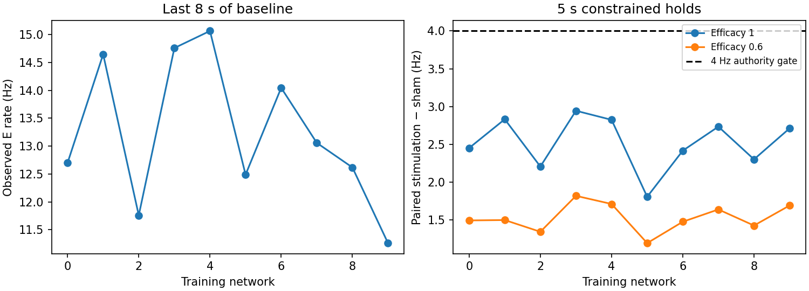

# Mission 002 — Brian2 substrate qualification

**Decision: PARTIAL. Core instrument qualification PASS; frozen V0 development control-authority gate FAIL. Do not proceed to identification, PI/MPC, or adaptive-control evaluation.**

Date: 2026-10-18, America/New_York. Evidence category: entirely simulated neural dynamics. No biological recording, living preparation, hardware interface or clinical claim. Implementation and diagnostic work completed; the failed scientific gate is retained rather than repaired by changing the prescribed model.

## 1. Git revision, branch and M001 preservation

- Starting HEAD: `011c3ce1a71960544032717e91076730416c19fd`, branch `main`, with exactly the 13 uncommitted M001 research/evidence files described in the mission.
- Preserved all 13 files in commit `d5a16da30eadf981a85d6676302b572b03d9c338` on main, then created **`research/m002-brian-substrate`** as requested. Main received only the preservation commit; no implementation was merged there.
- Dynamics/interface implementation: `11929aff3ea1ee2329faf3fe635715b6f3343812`.
- Packaging/provenance/usage review: `7efb3deac880a049e582ee54f803561da1c33288`. Final evidence/report and an additional inhibitory-path test are recorded in its descendant commit; the final commit identity is available from `git rev-parse HEAD` and the mission handoff.
- The six M001 documents, numerical protocol and seven evidence files are **byte-identical** to preservation commit d5a16da. [Preservation hashes](evidence/m002/m001_preservation.json). No scientific protocol amendment was applied. No reset, force push, experiment deletion, automatic merge or controller implementation occurred. Repository .venv was not replaced.

Diagnostic provenance records the HEAD/dirty state at execution and hashes the actual source. Some scientific runs began before the implementation commit existed. Their dynamics source hash was verified byte-identical to committed 11929af; this is recorded in [verification.json](evidence/m002/verification.json). This avoids claiming that an earlier dirty-tree run occurred at a later clean revision. Packaging metadata and plotting improved afterward without changing the dynamics. Final report/evidence additions do not alter those measured algorithms.

## 2. Implementation summary

Minimal installable Python3.12 package, Brian2 **2.10.1**, NumPy **2.5.4**; test and diagnostic plotting extras are pinned. [Full resolved dependency lock](../requirements-m002.txt), [package configuration](../pyproject.toml), [usage](../README.md). Editable installation, wheel construction and installed-wheel smoke execution succeeded; the wheel CLI works without a Git checkout, recording unavailable Git metadata explicitly.

Files:

- `src/neuromancer/substrate.py`: typed immutable Config, Command, Receipt, StepResult and process-isolated Trial.
- `src/neuromancer/_brian.py`: private network construction, explicit numerical streams, stimulation schedule, replay and evaluator diagnostics.
- `src/neuromancer/observation.py`: half-open event bins, masks and causal rate filter.
- `src/neuromancer/diagnostic.py`: smoke, ten-network authority, bounded convergence and performance entry points. No controller or model fitting.
- `tests/test_substrate.py`: unit/integration qualification, including actual E/I event paths and cross-process trials.
- `.github/workflows/ci.yml`: Python3.12 Ubuntu tests, dependency consistency, smoke diagnostic and artifact upload. **Added, not remotely executed.** Linux numerical/installation qualification is pending CI, not asserted from local tests.

One process owns each public Trial. The parent receives only numerical observations, receipts, timing and configuration hashes; no Brian objects, voltages, noise state, neural identities, connectivity, gain or mutable neural arrays cross the public interface. Evaluator access is deliberately private and used only by tests/diagnostics. This is an API/process boundary for honest experiment code, not an adversarial Python security sandbox.

## 3. Mathematical correspondence to frozen V0

The numerical protocol remains [M001 V0 version1](../docs/research/002_V0_PROTOCOL.md). Production model:

\[
C\dot V_i=-(C/\tau_{m,i})(V_i-E_L)+I_{E,i}+I_{I,i}+180\,\mathrm{pA}+\eta_i+g\sum_j M_{ij}u_j.
\]

For nonrefractory cells, Brian exponential Euler updates this conditionally linear system. Threshold is V>=−50 mV, reset/rest −65 mV; the membrane remains fixed at reset for2 ms while synaptic and OU states continue. C=200 pF, tau_m independently U[18,22) ms; initial V U[−65,−50) mV. Current states and OU deviation start at zero, and delay queues start empty.

1000 cells,800 E/200 I; directed Bernoulli p=.05, no autapses/duplicate pairs. E synapses jump I_E by independent U[12,18) pA; I synapses jump I_I by U[−72,−48) pA. Exponential decay constants5/10 ms. Independent per-edge delays are uniform on {1000,1100,...,2000} µs. All recurrent groups communicate across four sector labels.

Each sector has200 E/50 I. Select50 E stimulation cells without replacement; select20 other E and5 I recording cells. Four5-E channels plus one5-I channel/sector yield20 recording channels and100 recorded neurons. Stimulation groups and recording memberships never overlap. This is current injection into model cells, not calibrated MEA stimulation or extracellular voltage.

OU current uses exact colored-noise recurrence before every membrane update:

\[
\eta_{n+1}=a\eta_n+40\mathrm{pA}\sqrt{1-a^2}\epsilon_n,\quad a=e^{-\Delta t/5\mathrm{ms}}.
\]

The default grid is100 µs;50 µs is exposed only for convergence qualification. There is no plasticity, adaptation, STDP, analog signal synthesis or biological learning mechanism. The gain0.6 diagnostic is an operator-controlled multiplier, not a delivered-current change or neural plasticity.

## 4. Stimulus and observation timing contracts

`advance(command, stop_us)` advances exactly one20,000 µs interval from the current trial time. Commands identify the trial and command, all four ordered channels, current in pA, integer start and exact duration. No requested/current array is silently clipped. Every accepted current is nonnegative, <=120 pA/channel, sum<=240 pA and changes by <=30 pA/channel from the previous delivered tick. Exact valid boundary120+120+0+0 was tested.

Invalid schema, identity, shape, channel, past/future time, NaN/Inf, negative current, excess current/total/slew or duplicate command raises ValueError **before** advancing state/time or consuming a noise block. Invalid requests have no delivered receipt. `None` is defined separately: deliver max(previous−30,0) per channel and mark the receipt as a missing-command fallback. Requested and delivered currents/times remain separate. Efficacy never appears as a falsified delivered current.

Brian clocks are distinct:100 µs neural integration,20 ms scheduled current holds. Scheduler order: held-current update (`start`,−2), OU update (`start`,−1), membrane/synaptic state update (`groups`), threshold/recording (`thresholds`), delayed synaptic arrival (`synapses`), reset (`resets`). A synaptic arrival affects subsequent membrane integration, not earlier steps. Tests verify the actual arrival grid and pending queues across a run split.

Observation bins are nonoverlapping [start,stop); available_us=stop_us. A right-edge spike belongs to the next bin. Brian timestamps label the threshold scheduler slot after that grid update; they are not a substep estimate of continuous-time threshold crossing. All returned events are sorted time/channel and restricted to the20 permitted channels. Several neurons may legitimately produce multiple events on one channel at the same grid time.

Counts include legitimate zeros. With full20 ms coverage, per-channel rate=count/(5×.02) Hz. Evaluator missing-channel fixtures use valid=False, coverage0, count−1 and rateNaN, and omit their unavailable events; missing data are never converted to silence. The public base-case substrate has complete coverage and does not simulate a dropout mechanism.

Sector E rates pool20 observed E neurons. The causal100 ms filter initializes at15 s from the completed baseline [7,15) s and then uses alpha=exp(−.02/.1). Before initialization its filtered values are unavailable/NaN, not fabricated. Baseline means in all ten saved authority archives were checked against filter initialization. No future bin or later command can change an already returned immutable observation.

## 5. Randomness, isolation and replay

SeedSequence root20261018, PCG64, roles0 membrane/init,1 connectivity,2 weights/delays,3 channel map,4 OU,5 calibration,6 masks,7 reserved Brian RNG. Roles0–3 always use replicate0; all network parameters/memberships therefore remain fixed across repeats. No Brian stochastic expression, `rand()` connectivity or spike-triggered RNG draw exists; role7 is reserved rather than resetting global state unnecessarily. Roles5/6 are reserved for later protocol phases, not silently implemented as controllers.

OU one-second block keys are(network_id,4,replicate_id,block_index). The previously unspecified within-block draw layout is fixed here:20,000×1000 independent standard normals on the50 µs grid. For100 µs, adjacent pairs combine as(a_fine eps_even+eps_odd)/sqrt(1+a_fine²). This preserves independent standard-normal coarse innovations and exactly nested OU endpoints. Block hashes, generator version, root/key definitions and realized parameter hashes are recorded. Different stimuli, spikes, callbacks, replay paths or record-retention choices cannot change which innovation is used at a given simulated time.

Brian stores neuron/current/refractory/delay state and all clocks; the wrapper additionally saves prior action, command IDs, filter, monitor cursor and noise-hash ledger. Restoring invalidates/recreates the correct noise block at the saved offset. Reset restores the initial episode. Tests cover fresh replay, a mid-episode checkpoint, explicit pending synaptic events, a one-second block boundary and continuous-versus20 ms chunked simulation. Full spikes, observations and final voltage/OU state agree **exactly within this environment**. Different dt comparisons use rate/response tolerances, not exact spike equality.

## 6. Executed tests and installation checks

Commands used the existing isolated `/tmp/neuromancer-audit/venv/bin/python` (Python3.12.15), leaving repository .venv unchanged:

```sh
python -m pip install --no-build-isolation -e '.[dev,diagnostic]'
python -m pip check
python -m pytest -q --junitxml=reports/evidence/m002/tests.xml
python -m pip wheel --no-build-isolation --no-deps . --wheel-dir /tmp/neuromancer-m002-wheel-v2
```

**38 tests passed in19.14 s**, zero failures.25 upstream PyparsingDeprecationWarnings arise from Brian's `parseAll` spelling; they were retained, not suppressed. [Text output](evidence/m002/tests.txt), [JUnit](evidence/m002/tests.xml), [dependency check](evidence/m002/pip_check.txt), [wheel build](evidence/m002/wheel_build.txt). A wheel installed to a separate target location ran the smoke CLI successfully with Git metadata null. Its PNG/SVG were byte-identical to editable-install smoke figures. [Wheel smoke provenance](evidence/m002/wheel_smoke/provenance.json).

| Required qualification | Evidence / result |
|---|---|
| A initialization/replay | Parameter-role identity, hashes, episode/midpoint replay: PASS |
| B continuous/chunked | Identical observations/spikes/final states through1.12 s and a noise-block boundary: PASS |
| C causal response | Explicit controlled responsive fixture, disjoint stimulated/observed cells, positive delayed response: PASS |
| D zero effective coupling | Both responsive fixture and full stochastic default network have exact stimulus/sham equality at g=0: PASS |
| E delay/refractory | Actual E/I arrival paths, pending-delay restoration, analytical decay/sign and2 ms reset hold: PASS |
| F counts/channels | Independently count actual recorded-neuron memberships plus half-open artificial boundary cases: PASS |
| G disjoint membership | All4×50 stimulation cells and20×5 recording cells distinct and nonoverlapping: PASS |
| H invalid actions | Atomic rejection, exact current boundary, duplicate IDs and bounded missing-action behavior: PASS |
| I public state boundary | Separate worker, immutable numerical records, no public neural objects/identities: PASS |
| J trial isolation | Two concurrent public trials, independent time/reset/state and matching seeded observations: PASS |
| K causal order | First-sample OU/membrane analytical check, arrival grid, future action/boundary mutation controls: PASS |
| L numerical/resources | Finite state in ten30 s development diagnostics, bounded timing/RSS, three nested-dt checks below: PASS for these probes |

The responsive fixture explicitly changes its own drive, initialization and one connection to isolate causality. It is labeled in test source and **never substituted for the default V0 authority test**. No upstream Brian full suite, remote CI, Linux run or biological validation is claimed.

## 7. Numerical convergence results

Training networks0–2: common nested OU paths,5 s burn-in, then paired5 s sham/current holds at each dt. Bound=max(0.5 Hz,5% of50 µs result); all three pass. This checks baseline/held response, not the complete later V0 short-pulse/identification protocol. No exact spike equality across dt is required.

| Network | Baseline difference Hz | Allowed Hz | Response difference Hz | Allowed Hz | Result |
|---|---:|---:|---:|---:|---|
| 0 | 0.1625 | 0.6425 | 0.2875 | 0.5000 | PASS |
| 1 | 0.0750 | 0.7354 | 0.1750 | 0.5000 | PASS |
| 2 | 0.0350 | 0.5893 | 0.0825 | 0.5000 | PASS |

[Complete convergence outputs and provenance](evidence/m002/convergence/convergence.json). A single finite-duration realization per network cannot establish distributional convergence for every parameter/network/perturbation.

## 8. Ten-network control-authority diagnostic

All training IDs0–9, replicate0, frozen parameters. For each:5 s burn-in;10 s zero-input baseline; save common endpoint; three paired5 s branches (sham, equal-channel60 pA at g=1, equal-channel60 pA at g=.6). Current ramps from0→30→60 pA over the first two ticks. Exogenous noise matches exactly in every branch. Reported baseline uses the last8 s; response is the5 s mean observed, unstimulated E rate minus paired sham. No network omitted or replaced.

| Network | Baseline E Hz | Maximum sector 8 s mean Hz | Response g=1 Hz | Response g=.6 Hz | 4 Hz authority |
|---|---:|---:|---:|---:|---|
| 0 | 12.6984 | 16.0688 | 2.4525 | 1.4950 | FAIL |
| 1 | 14.6469 | 15.4187 | 2.8325 | 1.5000 | FAIL |
| 2 | 11.7578 | 13.1438 | 2.2075 | 1.3450 | FAIL |
| 3 | 14.7594 | 15.6500 | 2.9450 | 1.8200 | FAIL |
| 4 | 15.0656 | 15.8688 | 2.8250 | 1.7125 | FAIL |
| 5 | 12.4875 | 13.9500 | 1.8075 | 1.1950 | FAIL |
| 6 | 14.0453 | 18.2375 | 2.4175 | 1.4775 | FAIL |
| 7 | 13.0578 | 16.4375 | 2.7350 | 1.6400 | FAIL |
| 8 | 12.6172 | 13.9187 | 2.3025 | 1.4275 | FAIL |
| 9 | 11.2594 | 14.1312 | 2.7125 | 1.6925 | FAIL |

**Activity gate:10/10. Authority gate:0/10; required>=8/10. FAIL.** Every paired response is positive, but the reduced-efficacy gain ranges1.195–1.820 Hz. Even the g=1 equal-budget mean responses remain below4 Hz. This fails the prescribed equal-channel-hold prerequisite; it does **not** prove that no admissible uneven action or transient schedule can ever reach+4 Hz.

No confidence interval over correlated20 ms bins is substituted for independent noise replication. The protocol's additional independently randomized-input positive-response CI gate was not executed after the necessary fixed-hold authority gate failed. It remains unqualified, not silently waived. The held-out cohorts and ARX/PI/MPC/adaptation phases were not opened.

[All network summaries and provenance](evidence/m002/authority/authority.json). Raw time courses and realized numerical arrays remain locally under ignored `runs/m002-authority-01/`; the committed JSON records every network outcome. Original run-summary hashes also reference those raw NPZ files. They can be regenerated from the CLI; curated copies intentionally omit the bulk archives.



## 9. Failure mechanism diagnostic

One bounded evaluator-only probe repeated network0's exact branches, adding20 ms private current-state sampling and whole-population spike counts. It reproduced the original observed rates exactly (self-checks in [probe source](evidence/m002/mechanism_probe.py)); no scientific parameter was changed. [Numerical results](evidence/m002/mechanism.json).

- Directly injected E cells:13.474 Hz sham→34.762 Hz at g=1, or26.245 Hz at g=.6.
- Recorded, unstimulated E cells:12.750→15.2025 or14.245 Hz.
- Hidden, unstimulated E cells:12.9331→15.4954 or14.5023 Hz.
- I population:13.038→15.527 or14.544 Hz.
- Recorded-E sampled mean recurrent excitation increases by about21.60 pA at g=1, while inhibition becomes about15.34 pA more negative: net added recurrent current about6.26 pA. At g=.6 the corresponding net increase is about3.72 pA.

The actuator works; the observation firewall correctly excludes directly stimulated cells. Limited transfer to unstimulated cells and countervailing recurrent inhibition are consistent with weak indirect authority. This is a descriptive mechanism diagnosis, not a causal inhibitory-ablation result. It does not justify changing weights, disjoint membership or actuator limits to force a pass.

## 10. Actual local performance and memory

Apple M5,10 CPU cores(4P/6E),16 GB, macOS26.5.2 arm64; Python3.12.15. [Environment/lock identity](evidence/m002/environment.json). NumPy CPU code objects; no GPU/CUDA or standalone acceleration. Four fresh-process5 s runs, one sample/case, with exactly65,664 whole-population spikes and6,621 observed spikes in every case.

| Spike policy | Neural run chunks | Initialization ms | Total wall s | Neural wall s | Observation total ms | Simulated s/wall s | Peak RSS MiB |
|---|---|---:|---:|---:|---:|---:|---:|
| cleared | 1 s noise blocks | 29.712 | 5.965 | 4.338 | 30.833 | 0.838 | 931.9 |
| cleared | 20 ms | 38.618 | 16.243 | 14.421 | 30.714 | 0.308 | 882.8 |
| retained | 1 s noise blocks | 35.898 | 4.027 | 2.938 | 32.432 | 1.242 | 964.5 |
| retained | 20 ms | 21.567 | 14.195 | 12.757 | 35.607 | 0.352 | 887.4 |

[Machine-readable measurements](evidence/m002/performance/performance.json). Initialization excludes Python/import and first noise-block generation. Total wall includes noise generation/hashing, scheduler/run preparation, numerical simulation and observation work. Neural/observation times are internally measured; per-bin values in StepResult are amortized when the evaluator runs a whole predeclared batch. Peak RSS is OS process high-water, not current/incremental allocation.

Retaining all65,664 spike events uses787,968 logical event-array bytes, versus0 retained event bytes after clearing. Both modes still collect transient spikes and preserve aggregate counts; the extra monitor and noise workspace dominate peak RSS. These single timing samples do **not** show that retention makes simulation faster; OS load, allocator/cache behavior and ordering are uncontrolled. Chunking overhead is substantial in both measured pairs. Public IPC round-trip latency was not separately benchmarked. Current NumPy stepping is not qualified for real-time50 Hz operation; it is a virtual-time research instrument. No full V0 throughput estimate is extrapolated from either this measurement or M001's small API probe.

## 11. Limits and critical verification review

- Exact replay is environment-specific; cross-platform bitwise equivalence and a clean Linux install await CI. Timing measurements are single-case observations, not scaling laws.
- Default scientific equations and distributions match the frozen protocol. The failure is not repaired by selecting responsive networks or altering currents/weights. E/I point neurons, random topology, current-injection units and perfect spike detection remain simplified simulation assumptions.
- Reset/checkpoints cover Brian queues/clocks/refractory state and wrapper/filter cursors. Whole-trial isolation is tested in separate processes; evaluator same-process objects are private and cannot be passed to a controller.
- Built-in default filter is unavailable until baseline completion; there is no silently preinitialized estimator and no ARX, PI, MPC, RLS, RL, plasticity or SDK adapter.
- Spike clearing uses Brian monitor.resize and its N variable because reinit() is unimplemented in this pinned version. This version-sensitive path is covered by retention/replay/count tests and must be requalified before upgrading Brian.
- Committed evidence is curated JSON/JUnit/figures/probe source. Large raw NPZ remain local and are regenerable; the curated directories' copied original summaries include references to those uncommitted arrays. The final curated manifest hashes only files actually committed.
- Some development diagnostics overlapped other numerical qualification work. Their wall times are provenance only; the separately sequenced performance experiment supplies the timing table. No numerical comparison depends on wall time.
- Independent verification here consists of distinct analytical fixtures, event/count recomputation, nulls, replay/isolation checks, artifact hashes and critical code review by this session. It is **not** an external human replication or independently authored simulator comparison.

## 12. Decision and proposed amendment (not applied)

| Layer | Decision |
|---|---|
| Software timing, units, constraints, causality, replay and isolation | PASS,38 tests plus executable diagnostics |
| Bounded numerical checks and baseline activity | PASS for the tested family/durations |
| Frozen development authority requirement | **FAIL,0/10 at g=.6** |
| Randomized-input confidence interval/identification gate | NOT RUN; prerequisite failed |
| Mission002 overall | **PARTIAL; not a Mission PASS and not ready for controller evaluation** |

A future protocol amendment requires an explicit scientific choice: either study a smaller, independently justified reachable target range, or justify a different actuation/substrate model with its own calibration. Do not merely lower the gate while retaining claims about+4 Hz control. Stronger stimulation, recording injected cells or weakening inhibition would change the question and may create an artificially easy benchmark. None was applied.

## 13. Next falsifiable experiment and stop

Proposed next experiment, **not executed**: on training networks only, compare a small preregistered static bank of equal-total-current actions at g=.6—equal60 pA and the six pairs of120 pA/120 pA with two zero channels, all using the same slew constraints. Hypothesis: some spatial allocation reaches+4 Hz in>=8/10 training networks despite the equal-current hold's failure. Use paired sham replays and independent noise repeats; reject the hypothesis if it fails. This tests whether the authority failure is specific to the prescribed allocation or broader within the allowed actuator set, without introducing a controller or changing neural parameters.

Only after reviewing that result should a researcher approve a protocol amendment or retain the original question as infeasible. **Stop here. No identification or controller work follows automatically.**
