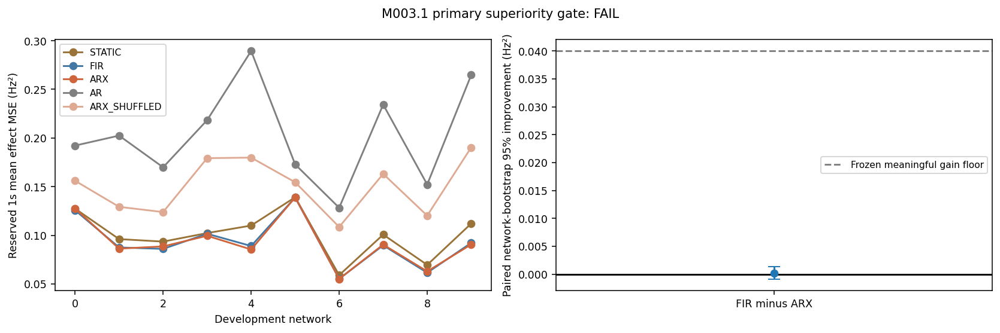
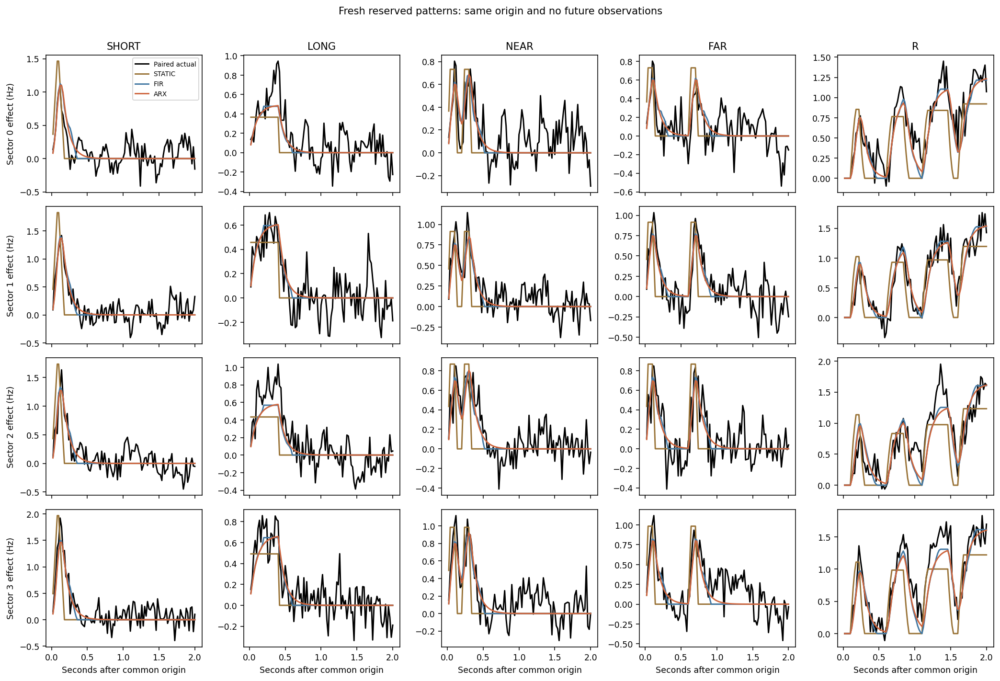

# M003.1 — model necessity and dynamical state information audit

**Execution PASS with a declared resource-control limitation; scientific superiority FAIL.** ARX showed only 0.19% mean benefit over the selected input-only FIR, with an interval spanning zero and 5/10 positive networks. Linear counterfactual contrasts do not require origin observation history.

Simulation-only scientific comparison. The M003 ARX-versus-AR result and all V0.1/V0.2 failures remain unchanged. This mission tests a stronger stimulation-only comparator and explicitly audits what the contrast metric can identify. No controllers, neural parameter changes or locked-network experiments.

## Repository, chronology and immutable evidence

Starting clean branch `research/m003-system-identification`, exact HEAD `22547cfe37e81e66bccb67cbc90d96186a73a964`. New review branch `research/m003-1-model-necessity`. All 849 initially tracked files were hashed before new work; all 637 hashes in the complete prior M003 evidence inventory were checked. Prior D/V/G verification records were read without modifying or rerunning their output files. This includes the positive stationary prediction results, weak fast-response results, uncertainty shortfalls and gain-loss limitations.

The new protocol `docs/research/006_M003_1_MODEL_NECESSITY_PROTOCOL.md` was committed in `a29e2ac` before acquisition. Model/schedule implementations and six analytical tests were frozen in `1e15e23` before new neurons were run. Prefix-only selection, evaluator and independently tested verifier were committed in `b3776ff` before reserved outcomes were scored. Initial candidate definitions and scientific gates were not revised after outcomes. Exact final implementation/evidence and publication revisions appear in the closing note and final mission response.

## Frozen hypothesis and its identifiability limit

Primary H1: ARX reduces reserved 1-second mean stimulation-minus-sham response MSE versus the globally validation-selected strongest STATIC/FIR family by at least **10% mean relative benefit**, **0.04 Hz² mean absolute benefit**, a **positive lower paired network-bootstrap 95% confidence bound**, and positive benefit in **at least 8/10 networks**. These are new M003.1 engineering requirements, justified as practical relative and absolute prediction gains; the absolute floor is squared 0.2 Hz, not a 0.2 Hz RMSE reduction. They are not retroactively inherited M003 gates. Point magnitudes/count passing with insufficient interval precision yields HOLD; other failed superiority gates yield FAIL. A negative result does not falsify M003's weaker AR comparison or establish statistical equivalence.

A crucial algebraic limitation was preregistered. For linear additive ARX,

\[
\widehat y_k=c+\sum_{i=1}^{p}A_i\widehat y_{k-i}+\sum_{j=0}^{3}B_j u_{k-j},\qquad
\Delta\widehat y_k=\sum_{i=1}^{p}A_i\Delta\widehat y_{k-i}+\sum_{j=0}^{3}B_j\Delta u_{k-j}.
\]

At the common origin, both branches share the same completed observed history and prior inputs, so initial contrasts are zero. The second equation is a stimulation-only IIR kernel. Initial observed state cancels; even a superiority PASS would show a useful fitted kernel/parameterization relative to the tested FIR, **not a need for origin observation-conditioned state**. Fitting ARX still uses lagged observations to estimate coefficients. This distinction separates training information, absolute prediction and counterfactual effect prediction.

## Model definitions and information sets

All models fit the same 1,550 target rows k=800..2349 ([16,47) seconds), with fit-only feature means, population standard deviations floored at 1 Hz/1 pA, common output-centering/intercept treatment and an unpenalized intercept. Augmented least squares minimizes mean squared error plus ridge penalty. No private neural state, true gain, future observation or paired sham response is a model feature. No model receives an extra origin baseline or sham-derived offset; input-only absolute baselines are fitted intercept/output means. Past delivered inputs initialize FIR. Only AR/ARX condition on completed observed histories.

| Family | Equation/features | Candidate history | Total coefficients, four outputs |
| --- | --- | --- | --- |
| STATIC | c+D₀u[k] | Current bin only | 20 |
| FIR | c+Σ Dⱼu[k−j] | q=10 or 50 input lags; sampled extent 0–180 or 0–980 ms | 164 or 804 |
| ARX | c+Σ Aᵢy[k−i]+Σ Bⱼu[k−j] | p=1 or 4 observed lags (20/80 ms); four input lags (0–60 ms); recursive IIR | 84 or 132 |
| AR reference | Same observed lags, input terms omitted | p=1 or 4 | 20 or 68 |
| Input-shuffled STATIC/FIR/ARX | Matching form/history, fit inputs alone circularly shifted 500 bins | Lock corresponding selected unshuffled history; retune penalty | Same as matching family |

Each dynamic family has eight (history,penalty) candidates, STATIC four. Penalties .0001,.001,.01,.1; shuffles get four penalties at their matching history. Each unshuffled family selects its best global chronology-validation 1-second **absolute-rate** loss; STATIC/FIR winner is frozen before confirmation. Ties within 1e-12 choose fewer features then larger penalty. Family selection is global, never a per-network or confirmation oracle. Different parameter counts and input-history budgets are reported rather than artificially equated. The long FIR is deliberately a strong stimulation-only competitor. Static is linear channel dose, not an exhaustive nonlinear dose-response model.

Numerical rejection criteria: rank deficiency/nonfinite design, standardized condition >1e6, penalized condition >1e8, AR/ARX companion radius ≥.999; nonfinite or |forecast|>100 Hz invalid, no clipping. All candidates/normalizations/coefficients/singular values and rejected cases are retained. Old M003 model source is unchanged; the new estimator uses its ARX form with the newly matched target window.

The input-only forecasting API accepts `(model, input_history, plan)` and no rate argument. Its wrapper never reads observations. For ordinary next-step prediction, AR/ARX get completed actual branch observations, while STATIC/FIR retain their declared input-only information. An ordinary-prediction advantage is therefore interpreted separately from open-loop causal-response superiority.

## Fresh cohort, schedules and causal timing

Only original development networks 0–9 × independent new neural noise IDs 22,23,24 (30 trials), plus prespecified null networks 0,1,2 × noise 25 with effective coupling zero throughout prefix/branches (3 trials). No seed replacement or network exclusion. Old validation 10–14 is historical evidence, not new confirmation and not used for current tuning. Locked test 100–119 remains untouched. Root20261018, original parameter roles0–3 replicate0, exogenous OU role4 by absolute 1-second blocks, action role5 blocks0/1/2/4. Bootstrap seed 20261101 is separate analytical randomness.

Original 1,000-cell recurrent E/I LIF model, OU process, connectivity, weights, delays, memberships and integrator remain fixed: 100 µs integration, 20 ms spike-count/command bins, original 100 ms causal filter, four observed unstimulated E-sector rates. Stimulation groups and recording cells remain disjoint. No new voltage/MEA model or plasticity. Four channel commands retain 0–120 pA/channel, ≤240 pA total and ≤30 pA/channel/tick slew.

The unchanged six-branch M003 runner is reused with a process-local registered schedule/name adapter; no historical code or global parent-process state is changed. Prefix: zero burn0–5s, baseline5–15s, random excitation15–47s, hypervalidation47–55s, separate interval-calibration origins55–62s, zero wash63–67s. All models share target rows starting16s. Balanced original16-action bank and guarded500ms slots use fresh random orders. Hypervalidation scores 36 origins every200ms from 47 through 54s. Calibration uses 36 origins55–62s at horizons1/10/50/100bins; the2-second target at 62s ends64s in zero washout, as implied by the frozen arithmetic and explicitly saved in snapshots. No calibration reaches67s confirmation.

At67s save and restore full neural, filter, queue, refractory, OU, clock, cursor and previous-action state. Six 2-second branches share absolute-time exogenous noise. Pair index `(network+noise−22) mod6` rotates all six channel pairs prospectively; all four structured probes in a trial share that pair.

| Branch | Requested holds, relative to 67s | Integrated actual summed commands |
| --- | --- | --- |
| S | Zero | 0 |
| SHORT | 120 pA on pair for0–.10s | 24 pA·s |
| LONG | 30 pA same pair for0–.40s | 24 pA·s |
| NEAR | 60 pA for0–.10s and.20–.30s | 24 pA·s |
| FAR | 60 pA for0–.10s and.60–.70s | 24 pA·s |
| R | Four guarded500ms slots, fresh block4 bank allocation,120/240/360/400ms holds | Measured per trial |

All schedules include ordinary slew onset/offset. Equal24pA·s structured exposure is independently checked including tails, not inferred from steady currents. Multiply by 50cells/channel for1,200pC total model charge; this is no biological charge-density safety claim. SHORT/LONG distinguish duration at equal exposure; NEAR/FAR distinguish100/500ms requested recovery gaps. The finite bank was not selected where ARX was expected to win. The1s mean can attenuate timing differences; secondary time courses cannot rescue H1.

Canonical timestamps are integer microseconds: prefix bin k=[20000k,20000(k+1)); confirmation k=[67000000+20000k,67000000+20000(k+1)). Observation available at stop; prediction uses only completed observations through k−1. Future **known open-loop plans**, not unavailable future receipts, are supplied equally to all models. Requested steady vectors, validated slew plans and actual deliveries are preserved separately; all plan/delivery and timing checks occur live and independently in the evidence audit.

## Evaluation and uncertainty

Primary truth is the mean first50 bins of active−matchedS rates, four sectors. Predictions are differences of saved common-origin plan and zero-plan forecasts; no sham outcome enters prediction. MSE averages four sectors/five active conditions, then three repeated noise trials within each network. Ten independent networks are the inferential units. Whole-network paired bootstrap10,000 draws gives95% percentile intervals; no bin/pulse/sector pseudoreplication. Relative benefits use the frozen.04Hz² denominator floor, with all floor incidents reported.

Secondary endpoints separately report20ms/200ms/2s mean effects, condition/sector errors and bias, SHORT−LONG and NEAR−FAR dynamic contrasts, absolute common-origin output MSE, conditional next-step error, within-branch residual lag1 correlation, calibration errors and empirical output coverage/widths. Residuals are not concatenated across restored branches. Intervals come from separate calibration errors per sector/horizon, empirical95th percentile method higher; overlapping origins are correlated and do not certify95% coverage or paired-effect uncertainty.

Ablations include static versus FIR history, ARX versus both individually, input shuffling, mean-observation-history replacement at origin and independent zero-initial-state ARX input convolution. The last two contrast identities use1e-9Hz tolerance. Null truth must be exactly zero across raw counts, observed rates and whole-neuron totals; fitted false-response RMS is reported against a descriptive.2Hz warning, not a changed acceptance gate. Sham absolute errors and reserved unseen R are reported separately.

## Primary result: scientific FAIL

The strongest chronology-validation-selected stimulation-only comparator was **FIR(q=10, λ=.1)**. ARX selected p=4, λ=.1; STATIC λ=.0001; AR p=1, λ=.0001. All three shuffled controls chose λ=.1 at their corresponding unshuffled history lengths. Global validation losses are STATIC=.216575, FIR=.192352, ARX=.183665, AR=.414850 Hz². ARX winning validation absolute prediction does not predetermine the reserved intervention-contrast result.

| Primary criterion | Frozen requirement | Observed | Outcome |
| --- | --- | --- | --- |
| Mean relative benefit | ≥10% | 0.1879%,95% CI[−1.0230%,1.4526%] | FAIL |
| Mean absolute benefit | ≥.04Hz² | .000205461Hz² | FAIL |
| Paired95% absolute interval | Lower bound>0 | [−.000854752,.001336507]Hz² | FAIL |
| Networks with positive benefit | ≥8/10 | 5/10 | FAIL |

FIR primary MSE=.092724912Hz² versus ARX=.092519451Hz². The upper confidence bound on mean ARX gain is far below the engineering floor. There were **zero denominator-floor incidents**. Relative benefit is the prespecified mean of network-relative scores, not the ratio of cohort mean errors. This is a negative superiority finding, not a preregistered statistical-equivalence claim. No threshold, stimulus, seed or model grid was changed to alter it.

### All networks and models

Every entry is a mean over three new noise replicates within that network. FIR/ARX parentheses are SDs of the three trial MSEs, not network-level confidence intervals. All 33 trial records, including nulls, and every condition/sector are in `evidence/m003_1/results/trial_metrics.json` and `all_predictions.csv`.

| Network | STATIC | FIR mean(SD) | ARX mean(SD) | AR reference | FIR−ARX |
| --- | ---: | ---: | ---: | ---: | ---: |
| 0 | 0.127379 | 0.125752 (0.054902) | 0.127473 (0.054553) | 0.192192 | -0.001721 |
| 1 | 0.096072 | 0.087502 (0.010524) | 0.086265 (0.009145) | 0.202445 | +0.001238 |
| 2 | 0.093504 | 0.086010 (0.032505) | 0.088576 (0.042039) | 0.169873 | -0.002566 |
| 3 | 0.102280 | 0.101581 (0.057397) | 0.099498 (0.056334) | 0.218318 | +0.002083 |
| 4 | 0.109989 | 0.088987 (0.029192) | 0.085416 (0.024999) | 0.289397 | +0.003571 |
| 5 | 0.139106 | 0.138779 (0.043280) | 0.138911 (0.042088) | 0.172859 | -0.000132 |
| 6 | 0.058998 | 0.055238 (0.009180) | 0.055147 (0.009551) | 0.128282 | +0.000091 |
| 7 | 0.100713 | 0.089698 (0.017727) | 0.090419 (0.018175) | 0.234322 | -0.000721 |
| 8 | 0.069562 | 0.061538 (0.027343) | 0.062913 (0.028807) | 0.152198 | -0.001375 |
| 9 | 0.112051 | 0.092164 (0.025627) | 0.090577 (0.023410) | 0.264773 | +0.001587 |

| Network | STATIC shuffled | FIR shuffled | ARX shuffled |
| --- | ---: | ---: | ---: |
| 0 | 0.179161 | 0.182712 | 0.156019 |
| 1 | 0.165946 | 0.158543 | 0.129236 |
| 2 | 0.152872 | 0.150279 | 0.123852 |
| 3 | 0.229924 | 0.244819 | 0.179265 |
| 4 | 0.250916 | 0.250481 | 0.179831 |
| 5 | 0.168472 | 0.169735 | 0.154518 |
| 6 | 0.131916 | 0.135838 | 0.108541 |
| 7 | 0.203004 | 0.208579 | 0.163104 |
| 8 | 0.138796 | 0.140215 | 0.120180 |
| 9 | 0.230008 | 0.232286 | 0.190352 |

### Complete model-level prediction comparison

Hz² for all errors; coverage is empirical absolute-output1s coverage. All CIs use ten whole-network vectors, not30 independent networks.

| Model | 1s evoked MSE [95% CI] | Absolute1s MSE | Ordinary next-step MSE | 1s coverage | Residual lag1 correlation |
| --- | --- | ---: | ---: | ---: | ---: |
| STATIC | 0.100965 [0.086602,0.114617] | 0.288152 | 1.369336 | 85.69% | +0.5869 |
| FIR | 0.092725 [0.078344,0.107951] | 0.209346 | 1.244144 | 89.44% | +0.5774 |
| ARX | 0.092519 [0.078147,0.107975] | 0.196703 | 0.701917 | 90.56% | +0.0836 |
| AR | 0.202466 [0.174473,0.232792] | 0.885996 | 0.787306 | 79.58% | -0.2177 |
| STATIC_SHUFFLED | 0.185101 [0.161627,0.209853] | 0.938388 | 2.177412 | 75.69% | +0.6053 |
| FIR_SHUFFLED | 0.187349 [0.162803,0.213756] | 0.957506 | 2.194363 | 76.39% | +0.6040 |
| ARX_SHUFFLED | 0.150490 [0.133777,0.167139] | 0.454650 | 0.715818 | 89.17% | +0.0518 |

ARX improves ordinary next-step error by about43.6% versus FIR and absolute1s error by about6.0%; these are different tasks/information sets. Its mean intervention gain over FIR is negligible. ARX still beats AR on this new bank (absolute benefit.109946Hz²,95% CI[.080867,.141488]) and input-shuffled ARX (.057971 [.042111,.074415]); neither secondary success rescues H1.

STATIC primary error=.100965Hz². ARX−STATIC superiority also fails its engineering magnitudes: ARX gain.008446 [.003987,.013726]Hz², mean relative8.61%, positive9/10. Thus static is a useful low-complexity coarse-rate baseline, but a positive small accuracy difference is present; this is no proof of equivalence or of no dynamics.

## Timing, horizon and state-information ablations

| Mean effect horizon | STATIC MSE | FIR MSE | ARX MSE |
| --- | ---: | ---: | ---: |
| 20ms | 0.177330 | 0.095830 | 0.093904 |
| 200ms | 0.216969 | 0.202611 | 0.201875 |
| 1s primary | 0.100965 | 0.092725 | 0.092519 |
| 2s | 0.064816 | 0.056323 | 0.056103 |

The primary negative finding is not rescued by a selected fast horizon: FIR and ARX remain close at 20ms/200ms/2s. STATIC is visibly less faithful to transient smoothing and has larger first-bin error. All three are linear approximations, and the original100ms observation filter contributes to apparent dynamics. The FIR support choice is validated predictive regularization, not a measured physiological time constant. The q=50 alternative and all its coefficients/validation losses remain retained, not retrospectively retuned.

### Every reserved condition

| Condition | Actual mean effect Hz | STATIC MSE | FIR MSE | ARX MSE |
| --- | ---: | ---: | ---: | ---: |
| S | 0.000000 | 0.000000 | 0.000000 | 0.000000 |
| SHORT | 0.235584 | 0.082465 | 0.079130 | 0.079975 |
| LONG | 0.282985 | 0.110343 | 0.099598 | 0.099243 |
| NEAR | 0.257387 | 0.120226 | 0.112810 | 0.112381 |
| FAR | 0.230019 | 0.103962 | 0.099935 | 0.099729 |
| R | 0.446001 | 0.087830 | 0.072150 | 0.071269 |

Sham effect is a self-contrast, hence exactly zero; it is excluded from primary MSE. R-only prediction also shows no meaningful ARX edge. All 33 fresh R sequences (including nulls) differed from every aligned four-slot fitting window, independently checked; no collision/seed was replaced. These are new orders/durations within the same bank, not unrestricted extrapolation.

The delivered SHORT pulse has a160ms nonzero support after its requested100ms hold because of slew tails. LONG lasts400ms. NEAR/FAR effective zero-current gaps are80/480ms, versus requested100/500ms. Actual exposure remains24pA·s for all four; these differences are retained rather than equating dose from peak values. SHORT and LONG share identical first20ms delivery; NEAR and FAR share identical first200ms. Independent checks confirm exact early counts/rates and equal forecasts before their future plans diverge. The zero early timing-contrast errors are causal sanity checks, **not evidence of dynamical predictive skill**.

At1s, SHORT−LONG contrast MSE is STATIC=.096216,FIR=.096216,ARX=.096231Hz²; NEAR−FAR=.080692,.080692,.080605. By then all structured current and most kernels have settled; equal integrated exposure makes static and this finite FIR predict identical integrated structured effects. Actual nonlinear/stochastic timing differences remain in the residuals. These values do not establish that timing is irrelevant to the neural substrate. SHORT−LONG also changes amplitude and duration jointly; NEAR−FAR is the cleaner fixed-amplitude spacing comparison. No observational decomposition is used to claim a neural mechanism.

Replacing origin observation histories by the common fitting mean changes ARX active-minus-sham forecasts by at most **7.11e−15Hz**. An independently constructed zero-state ARX input convolution agrees to **1.85e−14Hz**; both are well inside the frozen1e−9 tolerance. Thus these effect predictions contain no demonstrated dependence on origin observation history. This is an algebraic identity for this linear architecture, not a claim that neural observations are unnecessary for fitting or that true neural responses lack state dependence.

## Negative controls, conditioning and calibration

All three g=0 fixtures had exactly identical counts, filtered observations and whole-neuron branch totals under every action and sham. Their fitted models still have finite spurious effects; no false biological response is fabricated.

| Null network,noise 25 | STATIC false RMS Hz | FIR false RMS Hz | ARX false RMS Hz |
| --- | ---: | ---: | ---: |
| 0 | 0.040119 | 0.048271 | 0.050310 |
| 1 | 0.048537 | 0.044579 | 0.032240 |
| 2 | 0.018414 | 0.018350 | 0.019839 |

Charge-accounting note: inherited `model_charge_pC` denotes nominal command-equivalent charge across50 targets/channel before efficacy scaling. At primary g=1 this equals the1,200pC effective model injection; null g=0 has the same command ledger but **zero effective injected charge**. It is not hardware charge density.

All were below the descriptive.2Hz warning; this is only three null networks, not a population false-positive-rate guarantee. Input shuffling worsens primary error in the full cohort: STATIC .185101,FIR .187349,ARX .150490Hz², versus .100965,.092725,.092519 unshuffled. Accurate input timing matters; this is separate from observation-state necessity. All shuffled models, including unfavorable cases, are reported and use their own validation-selected penalty at matched history length. The first lag rows before the shifted interval remain unshifted by preregistration, so this is a specific misalignment control rather than removal of every input association.

All **1,200 candidate models** and **231 selected models** were valid; none was silently excluded or substituted. The selected FIR has40 features/164 coefficients; ARX32 features/132 coefficients, so the chosen FIR has more parameters but no online observation conditioning. Candidate q=50 FIR has200 features/804 coefficients. Every singular spectrum/rank and all grid losses remain committed.

| Selected family | Standardized condition range | Penalized condition range | Companion radius range |
| --- | --- | --- | --- |
| STATIC | 1.111–1.184 | 1.111–1.184 | 0.000–0.000 |
| FIR | 80.372–94.774 | 9.319–9.625 | 0.000–0.000 |
| ARX | 49.752–77.999 | 6.752–10.718 | 0.790–0.848 |
| AR | 1.243–2.576 | 1.243–2.575 | 0.640–0.869 |
| STATIC_SHUFFLED | 1.111–1.184 | 1.123–1.167 | 0.000–0.000 |
| FIR_SHUFFLED | 76.472–89.065 | 9.349–9.595 | 0.000–0.000 |
| ARX_SHUFFLED | 48.616–68.230 | 6.776–9.561 | 0.797–0.939 |

Calibration and coverage concern **absolute output means**, not calibrated effect intervals.

| Model | Calibration1s MAE Hz | Reserved1s coverage | Nominal95% gap | Mean full interval width Hz |
| --- | ---: | ---: | ---: | ---: |
| STATIC | 0.359934 | 85.69% | -9.31pp | 1.733378 |
| FIR | 0.344703 | 89.44% | -5.56pp | 1.679424 |
| ARX | 0.338209 | 90.56% | -4.44pp | 1.658695 |
| AR | 0.509709 | 79.58% | -15.42pp | 2.484397 |
| STATIC_SHUFFLED | 0.503400 | 75.69% | -19.31pp | 2.432132 |
| FIR_SHUFFLED | 0.510234 | 76.39% | -18.61pp | 2.460948 |
| ARX_SHUFFLED | 0.460055 | 89.17% | -5.83pp | 2.255989 |

FIR/ARX undercoverage at 1s and2s persists; neither provides certified uncertainty. Calibration uses only 36 overlapping origins, and2s windows extend into washout. Empirical within-calibration coverage, every horizon/sector width and all network bootstrap intervals are archived. The markedly reduced ARX ordinary residual autocorrelation supports its value for conditional rate prediction, not for the primary contrast task.

## Software qualification, repair and actual costs

**Execution PASS.** All 33 preregistered neural trials and198 branches completed, with zero invalid receipts, zero exclusions and no repeated neural acquisition. All 849 historical files remain byte-identical. Final regression suite: **74 passed,25 warnings in 16.61s** (the65 prior tests plus9 new tests). The warnings are retained Brian2/pyparsing deprecations. Earlier71/72-test runs and all fixture outputs remain preserved rather than overwritten.

New analytical tests cover independent static coefficients, delayed FIR impulse recovery, independent ridge/forecast equations including50-lag FIR and p=4 ARX, fit-only scaling/shuffle boundaries, input-only observation mutation, no future data, kernel/history cancellation, exact input rank/charge/constraints, network statistics and consistent caller histories. Deterministic early-plan mutation tests and actual neural checks prove future divergent commands do not change an identical causal prefix.

A software error was found and repaired before any confirmation scoring: the first fitting attempt passed4 replacement rate rows against3350 input rows for the ARX ablation; the existing aligned-history contract rejected it. The caller-only repair uses full-length fitting-mean histories, and50 completed prefix rows for both rate/input histories in ordinary prediction. The predictor still reads only its declared last p observations and three input lags. This altered no model equation, coefficient, seed, trial, schedule, observation or gate. The original failed attempt/log/source commits are archived under `results/failed_fit_001` and `FAILED_FIT_001.md`. All 33 files already produced by the failed run (candidate scores, selection and first selected models) matched the deterministic rerun **byte-for-byte** before scoring. No scientific endpoint was opened by the fitter.

A one-off metadata writer also encountered unavailable `st_birthtime_ns`; the documented timing-span fallback uses the available float-second `st_birthtime`. Its assertions had already checked all repeated coefficient artifacts. It did not change scientific data or analysis. Failed-attempt runtime was not separately instrumented; no isolated CPU/runtime estimate is invented.

The independent audit recomputed **1431 coefficient sets** (1200 candidates+231 selected), **1386 four-output100-step forecasts**, all 138,600 four-output ordinary predictions, input/filter/count alignment, exact original memberships and parameter hashes, null equality, plan/delivery constraints, early causal prefixes, calibration widths, all primary/secondary errors, residual correlations, global selection and the primary network-bootstrap gate. It reported PASS in 15.979s and independently reproduced scientific FAIL. A further archive audit recomputed all secondary bootstrap bounds/relative intervals and original memberships. These are independent analytical formulas in this session, **not an external investigator or independent neural-simulator replication**.

Reanalysis reproduced all scientific JSON fields, CSVs, numeric archives and every PNG/SVG byte-for-byte; only the measured `analysis_wall_s` differs. The curated committed-layout copy was independently verified again. Full raw prefixes, plans, confirmation counts, filtered rates, evaluator totals, seed/noise/checkpoint/source/configuration manifests, coefficients, failed run, forecasts and receipts are retained.

Actual acquisition:2607 simulated seconds / **934.273 wall seconds** (15.57min), aggregate2.79 simulated seconds/wall second across three workers. This includes construction, prefixes and restored branches, not a single-thread neural-throughput benchmark. Peak recorded worker RSS=1327218688 bytes (1.236GiB). Simultaneous aggregate memory was not directly measured. Successful complete fitting/selection/calibration/forecast stage=17.312s; original-to-repaired completion filesystem span=121.711s including repair/testing. Initial analysis=3.518s, independent verification=15.979s. All measured stage costs remain well within 45/15/15-minute budgets. Disk accounting is in the final verification manifest.

Warm-cache selected-model API probe, fixed n0/noise 22 with no confirmation access: five refits and50 predictions of 100bins per family, requested BLAS thread control; actual Accelerate count was not verified. All repeats reproduced coefficients/predictions exactly. Medians below are measured costs on this one fixture, not whole-cohort calibration requirements or hardware latency guarantees.

| Model | Coefficients | Selected fit ms | 100-bin forecast µs |
| --- | ---: | ---: | ---: |
| STATIC | 20 | 0.265 | 13.938 |
| FIR | 164 | 2.845 | 40.334 |
| ARX | 132 | 1.942 | 658.792 |
| AR | 20 | 0.261 | 360.334 |
| STATIC_SHUFFLED | 20 | 0.263 | 13.875 |
| FIR_SHUFFLED | 164 | 2.572 | 40.875 |
| ARX_SHUFFLED | 132 | 1.918 | 663.355 |

The same31s fit,8s hypervalidation and calibration prefix were granted to every model. This mission did not test shorter calibration/sample efficiency. Selected FIR has more coefficients than ARX but avoids recursive observation state and is faster in this API probe. Environment: existing Python3.12.15, Brian2 2.10.1, NumPy2.5.4, Matplotlib3.10.8, pytest9.1.1; macOS26.5.2 arm64. Full manifests specify versions/source. `pip check` found no broken requirements. No installation/download or new dependency.

Resource-control deviation: post-run NumPy build inspection identified Apple Accelerate. The preregistration requested one BLAS thread per worker, but `OPENBLAS_NUM_THREADS=1`/`OMP_NUM_THREADS=1` did not verify that constraint on this backend; actual thread count was not measured. Do not call the costs standardized single-thread benchmarks. The three worker processes, wall/disk budgets, exact repeated coefficients and scientific reanalysis remain verified. No scientific stimulus, cohort, numerical model, fit rule or gate was changed; performance generalization is limited. See `RESOURCE_DEVIATION_001.md` and `observed_environment.json`.

Acquisition wall time includes some concurrent regression checks and normal local workload; it is not an isolated-machine throughput measurement. The cost probe ran after those checks finished.

## Scientific interpretation, recommendation and remaining limits

**Scientific superiority FAIL.** For the tested1s intervention-response statistic, observation-conditioned ARX adds no demonstrated predictive value over the selected stimulation-only FIR. The result is precise enough that its mean-gain interval falls far below the prespecified meaningful improvement. This does not invalidate M003's ARX-versus-AR result; it narrows that result to useful stimulation-response information, not demonstrated origin-state necessity.

Recommend the selected **input-only FIR(q=10,λ=.1)** as the current response-prediction reference: it matches ARX's primary performance without online observation history and better represents smoothing/time courses than the static model. Retain the20-parameter STATIC model as the cheapest coarse1s baseline; its small but positive error penalty and transient mismatch mean it should not be labeled universally equivalent. Keep ARX for conditional absolute-rate prediction, where completed observations do help. None is a controller, and no controllability or V0 qualification is inferred.

Limitations, in priority order:

1. Linear contrast cancellation makes this endpoint structurally unable to prove origin-state necessity, even if ARX had won. Recorded observations remain essential for training; true nonlinear neural state dependence is not ruled out.
2. One-second averaging hides timing structure. Equal-charge structured actions make many integrated linear predictions identical; actual timing/nonlinear/stochastic differences remain unexplained. SHORT/LONG confounds amplitude with duration; NEAR/FAR helps isolate spacing but does not identify hidden mechanisms.
3. Only this finite bank, stationary efficacy and ten previously studied development networks with three fresh noise repeats were tested. Old validation was inspected historical evidence, not new network-disjoint confirmation. No claim about all FIR kernels, nonlinear static maps, other neural regimes or arbitrary amplitudes.
4. FIR history/penalty grids and31s fitting budgets are bounded. The unselected1s-support FIR is fully preserved but not retrospectively selected from confirmation. No formal equivalence or sample-efficiency claim was preregistered.
5. Empirical intervals under-cover, calibration origins overlap and some2s targets extend into zero washout. Residual correlation and uncertainty remain, despite nearly equal primary means. No paired-effect coverage guarantee.
6. The simulator provides exact resets and matched-noise sham branches that living biology cannot supply online. This audit is not external replication; alternate OS/backends, biological relevance, plasticity and control were not tested.

## Next falsifiable experiment; stop

Preregister a state-dependence identification experiment using the same action under prospectively defined, observation-based low/high origin-rate strata, with matched evaluator-only sham branches. Compare the frozen best input kernel with a transparent origin-rate×input interaction model. Ask whether completed observable state predicts a change in the causal response beyond a stationary input kernel on fresh development noise; failure would further support a state-independent kernel within that regime. Freeze interventions, strata, splits and a meaningful-effect gate before running it. No hidden-state labels or future observations may choose strata. This is proposed only, not implemented; locked100–119 remains unopened.

M003.1 stops here. No PI,MPC,RLS,RL,change-point controller,neural retuning,plasticity,CL1/hardware integration,frontend or automatic merge.

## Revision closure and implementation inventory

Starting revision: **`22547cfe37e81e66bccb67cbc90d96186a73a964`**, clean `research/m003-system-identification`. Verified implementation/evidence revision: **`ae8f0cbda1a0a1a90932bd3b8e94d096171fbc97`**, clean `research/m003-1-model-necessity` after commit. This closure is a documentation-only child publication; its exact final HEAD is returned in the final mission response (a document cannot contain its own Git object hash). No executable, frozen numerical data, protocol or test changes in that publication.

All **849 historical files are unchanged**. Difference from starting revision:404 added paths, zero historical modifications/deletions. The402-file source/evidence inventory totals44,989,198 logical bytes (42.91MiB); measured allocated study disk including original raw/model/failed/reanalysis copies was103,251,968bytes (98.47MiB), before writing the small final manifest. This excludes the shared Git object store and pre-existing Python environment. The600MiB study budget was respected. Every hashed artifact is tracked, including133 intentionally curated NPZ archives; ignored scratch/cache files are not substituted for committed evidence.

| Added path | Responsibility |
| --- | --- |
| `docs/research/006_M003_1_MODEL_NECESSITY_PROTOCOL.md` | Complete preregistration, new engineering gates, bank/splits and structural identifiability proof |
| `src/neuromancer/necessity.py` | Static/FIR fits, unchanged-form AR/ARX adapter, transparent selection/gate |
| `src/neuromancer/necessity_experiment.py` | Fixed schedule adapter and bounded33-trial acquisition CLI |
| `tests/test_necessity.py` | Nine new analytical, causality, alignment and network-statistics fixtures |
| `reports/evidence/m003_1/{fit_models,analyze,verify}.py` | Prefix-only selection, reserved evaluator, independent equations |
| `reports/evidence/m003_1/{figures,reproduce,bundle_audit,cost}.py` | Deterministic figures/reanalysis, whole-network archive checks and measured API costs |
| `reports/evidence/m003_1/results/{raw,models,failed_fit_001}/` | Every raw trial/receipt/seed/source/config, successful coefficients and failed attempted fit |
| `reports/evidence/m003_1/results/` | Numeric arrays, every model/network/noise/condition/sector metric, figures and verification |
| `reports/evidence/m003_1/{README,commands,FAILED_FIT_001,RESOURCE_DEVIATION_001}.md` | Reproduction/schema, actual command record and transparent limitations |
| `reports/evidence/m003_1/verification_manifest.json` | Complete hash inventory, final checks, separate execution/scientific decisions |

All code/evidence is committed on the review branch. No merge, push, locked-network acquisition, controller or automatic follow-on study.
