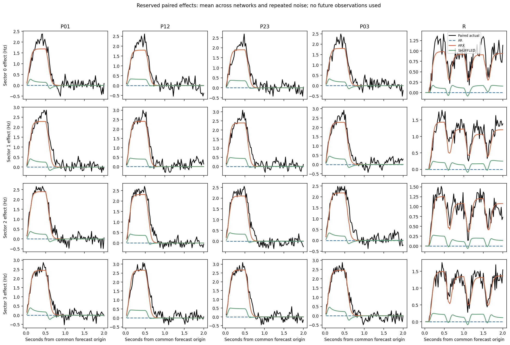
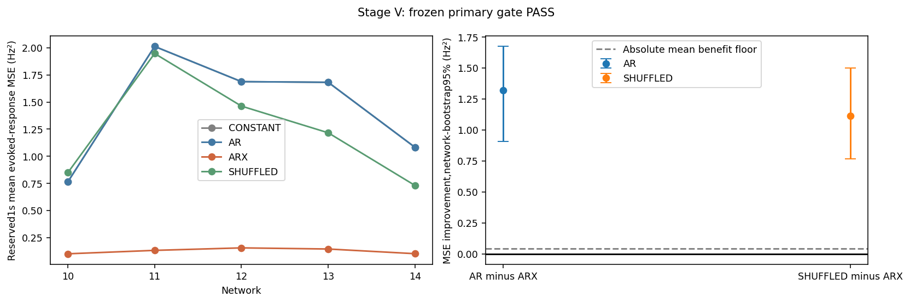
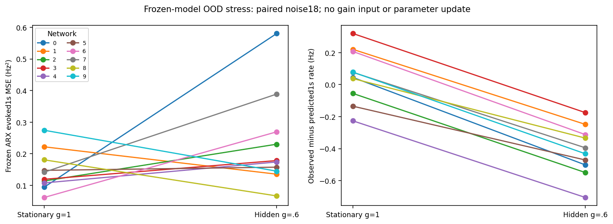

# M003 — causal stimulation-response system identification

**Execution PASS; stationary identification and network-disjoint replication PASS.** ARX reduced the preregistered 1-second intervention-response error by 92.0% versus AR in development and 90.6% in validation, with positive network-level confidence intervals and a strong shuffled-input advantage. Fast-response and uncertainty limitations remain; this is not control qualification.

**Simulation only.** This is a new identification experiment. M002/M002.1's failed V0.1 +4Hz authority gate and M002.2/M002.3's failed V0.2 qualification remain unchanged. Prediction success cannot rescue those protocols or establish controllability.

## Repository and preregistration

Starting branch `research/m002-3-calibration`, clean verified HEAD `1a58bedbcceab6c71408b0357dd5515e65d5c25f`. Review branch `research/m003-system-identification`; no merge or push. `reports/evidence/m003/preservation.json` records all 210 starting tracked files; independent verification checks every hash, including historical neural source, tests, protocols, numerical data and negative results.

The protocol `docs/research/005_M003_IDENTIFICATION_PROTOCOL.md` was committed in `5a824a7` before acquisition. `PREREGISTRATION_CLARIFICATION_001.md`, committed in `e6050e0` before acquisition, resolves two concrete software-contract defects: four completed rate lags require a60ms fitting warm-up; AR-only validation chooses a shared observation lag order for AR/ARX/shuffled models. It changes neither neural parameters nor prior protocols. Acquisition/predictor code was frozen in `e6050e0`; fitting and primary analysis in `961f923` before reserved outcomes were read. Independent verifier/figure source was committed in `da677d8`; `58df8f4` adds software-only delayed/noisy-system fixtures. Raw stage provenance records the actual acquisition HEAD, source bytes and working-tree state. Later descriptive exports do not select models or alter gates.

Final evidence and report revisions are recorded in the closing revision note after evidence verification. All added files are M003 protocol, two small package modules, analytical tests, evidence scripts, runbook, complete data/coefficients/manifests/figures and this report. No existing file was edited.

## Frozen question and mathematical model

H1: delivered-stimulation-aware ARX reduces reserved **1s mean intervention-response MSE** by at least10% versus matched stimulation-blind AR. Require mean absolute reduction≥.04Hz², paired whole-network-bootstrap95% lower bound>0, and positive benefit in≥8/10 development networks. Apply all the same guards versus time-shuffled-input ARX. Validation replication requires≥4/5 positive networks and the same magnitude/interval gates. These are conjunctive requirements; no best-horizon or subgroup substitution. The absolute floor is squared.2Hz, an engineering criterion, not a.2Hz RMSE improvement or biological threshold.

The unchanged Brian2 substrate integrates recurrent E/I LIF dynamics at 100us. There are1000 neurons, original OU drive and synapses, four disjoint50-cell stimulation groups,20 disjoint5-cell recording groups, original20ms spike-count observations and original100ms causal filter. Models see only four filtered unstimulated E-sector rates. Original membrane/synapse equations and parameter distributions remain in `docs/research/002_V0_PROTOCOL.md` and the preserved substrate; no adaptation, plasticity or parameter retuning occurs.

For observed rate vector y[k]∈R⁴ (Hz), delivered current u[k]∈R⁴ (pA):

\[
\widehat y_k=c+\sum_{i=1}^{p}A_i y_{k-i}+\sum_{j=0}^{3}B_j u_{k-j}.
\]

AR omits all B terms; constant predicts the fitting mean. SHUFFLED uses the same ARX form, with only fitting-period input rows circularly shifted500bins=10s. Matched observed histories, target rows and scoring times are identical. No private voltage, connectivity, whole-neuron totals, gain or paired sham observations enter fitting or pre-evaluation forecasts. Model state consists only of fixed coefficients/scales/means and completed public histories.

At a common forecast origin, recursive AR/constant forecasts are identical under active and sham plans, hence their predicted contrast is exactly zero **by construction**. A large ARX-vs-AR contrast advantage alone is consequently weak evidence about dynamical mechanisms. The shuffled-input guard and new randomized sequences check useful temporal input-response prediction; they do not establish physiological mechanism or that ARX outperforms a simple input-only/static-gain model, which was not among this mission's requested models.

## Acquisition and chronology

D: development networks0–9×new noise 18–20,30 trials at g=1; mandatory nulls0–2×noise 21 at g=0,3 trials. D scientific PASS and independent software audit preceded opening V. V: network-disjoint identities10–14×18–20,15 trials, frozen D hyperparameters with separately fitted per-network coefficients. G: development0–9×18 only,10 trials, exact replay of g=1 prefix followed by hidden g=.6; byte-identical frozen D predictors/plans/intervals. Locked network identities100–119 were never acquired or instantiated by the study. No noise replacement or network exclusion.

Each trial has zero burn0–5s, baseline5–15s, randomized fit15–47s, hypervalidation47–55s, independent interval calibration55–63s and zero wash63–67s. The causal filter initializes15s from baseline[7,15)s. All models use1597 fit targets k753..2349 ([15.06,47)s); no history padding. The fitting phase's broad15s timestamp in model diagnostics does not override that exact row contract.

The16-action bank includes zero, every single channel30/90pA, all six120/120pA pairs, and distributed60pA. Fresh bank permutations in.5s slots, each with 100ms zero guard, yield balanced multi-amplitude/channel excitation with independent fit/hyper/calibration/random blocks. Every delivered row obeys0–120pA/channel, sum≤240pA, and change≤30pA/channel per20ms. Guarded transitions reuse the existing qualified slew helper. Requested steady vectors, slew-validated known plans and actual deliveries are distinct preserved arrays; their equality where appropriate is asserted, never assumed.

At67s, restore the exact neural/filter/OU/queue/refractory/clock/observation-cursor state for each of six2s branches: shamS, four.5s pair pulses P01/P12/P23/P03 with recovery, and a reserved four-slot randomizedR sequence. All share absolute-time exogenous noise. A model receives known future open-loop plans, not future delivered receipts; subsequent exact plan/delivery checks qualify them. At bin k start only rates through k−1 are available. Outputs are available at bin stop; all times are integer microseconds and half-open intervals. This is not an online controller.

Each paired P schedule delivers120pA*s of summed channel-command exposure including slew tails. Multiply by 50 cells/channel for6000pC model charge across cells. R exposure varies and is fully tabulated. These quantities are simulated current exposure, not an MEA hardware charge-density or biological safety statement.

## Estimation, selection and uncertainty

Candidate p∈{1,4}, ridge λ∈{.0001,.001,.01,.1}, eight candidates per family. Fit-only feature means/SDs, rate1Hz/current1pA scale floors; output centering in Hz; unpenalized intercept; augmented least squares/SVD. No clipping of unstable predictions. Reject deficient/nonfinite design, standardized condition>1e6, penalized condition>1e8, or autoregressive radius≥.999; |prediction|>100Hz is invalid. Full16-input-history rank/conditioning is checked on every actual fitting design. All candidates and diagnostics are retained.

AR-only hypervalidation globally selects p and AR λ, then ARX/shuffled independently select λ at that shared p. Equal weighting across30 D trials (three per network);36 recursive1s-mean validation origins every200ms. Selected p=1, λ_AR=.0001, λ_ARX=.0001, λ_SHUFFLED=.01. AR has4 features+intercept per output,20 coefficients; ARX/shuffled20 features+intercept,84 coefficients; constant4. No V/null/stress retuning. Validation tests the identification **procedure with a new network's32s prefix**, not zero-shot coefficient transfer.

Separate55–63s calibration supplies empirical95th-percentile absolute output-mean prediction errors at 20ms/200ms/1s, per sector, with 36 overlapping origins. These output intervals are descriptive, correlated-sample estimates, not certified95% or paired-effect intervals. A frozen lower5th-percentile observed-minus-predicted1s calibration residual supplies a descriptive stress flag; it is never tuned on changed-gain outcomes.

For branch a, evaluator-only truth Δyᵃ=mean(first50 observed a−pairedS); predicted Δŷᵃ is the corresponding difference between saved plan and zero-plan forecasts. Primary trial error averages squared discrepancy over four sectors and five active branches, excludes trivialS. Average three noise errors within network before inference. Whole-network paired bootstrap10,000 draws seed 20261030 gives95% percentile intervals. Ordinary next-step MSE, using completed actual observation history at each step, is separate.20ms/200ms/2s mean-effect horizons and R alone are secondary, never replacements for H1. No bins, sectors or restored branches count as independent network replicates.

## Stationary scientific results

All errors below are Hz², except explicitly labeled rates. Network-bootstrap intervals average noise within network first. Every network/replicate/model/condition/sector is preserved in `reports/evidence/m003/results/{D,V}/all_predictions.csv`, `trial_metrics.json` and numeric archives. No result is excluded.

| Cohort | Constant/AR MSE | ARX MSE | Shuffled MSE | AR→ARX mean relative benefit | Absolute benefit,95% CI | Gate |
| --- | ---: | ---: | ---: | ---: | --- | --- |
| Development n=10 | 1.728121 | 0.138158 | 1.424961 | 92.02% | 1.589963 [1.339356,1.825678] | PASS |
| Validation n=5 | 1.445584 | 0.126427 | 1.240983 | 90.65% | 1.319157 [0.906595,1.674051] | PASS |

Against SHUFFLED, development absolute benefit1.286803Hz² [1.102097,1.481088], mean relative90.37%; validation1.114556Hz² [.765288,1.500668], relative89.03%. Positive benefits against **both** comparators occurred in 10/10 development and5/5 validation networks. No denominator-floor incidents. Both exceeded all frozen absolute/relative/interval gates.

### Development: all networks

| Network | AR/constant | ARX | ARX SD across3 noise repeats | Shuffled | Both benefits positive |
| --- | ---: | ---: | ---: | ---: | --- |
| 0 | 1.229620 | 0.064462 | 0.034392 | 0.932519 | yes |
| 1 | 2.068963 | 0.185347 | 0.033477 | 1.358751 | yes |
| 2 | 1.550770 | 0.119777 | 0.021735 | 1.245867 | yes |
| 3 | 2.400715 | 0.170873 | 0.088423 | 1.748521 | yes |
| 4 | 2.105496 | 0.183478 | 0.065715 | 2.093631 | yes |
| 5 | 0.975832 | 0.099459 | 0.042007 | 1.093030 | yes |
| 6 | 1.392468 | 0.109520 | 0.069349 | 1.177125 | yes |
| 7 | 1.878896 | 0.127517 | 0.012647 | 1.659279 | yes |
| 8 | 1.546335 | 0.122354 | 0.057889 | 1.252018 | yes |
| 9 | 2.132120 | 0.198795 | 0.079351 | 1.688873 | yes |
### Validation: all networks

| Network | AR/constant | ARX | ARX SD across3 noise repeats | Shuffled | Both benefits positive |
| --- | ---: | ---: | ---: | ---: | --- |
| 10 | 0.763138 | 0.100156 | 0.017724 | 0.848145 | yes |
| 11 | 2.012786 | 0.131738 | 0.041413 | 1.947605 | yes |
| 12 | 1.688058 | 0.154719 | 0.041142 | 1.462468 | yes |
| 13 | 1.681782 | 0.144372 | 0.042903 | 1.216264 | yes |
| 14 | 1.082158 | 0.101151 | 0.045925 | 0.730436 | yes |

### Horizons, ordinary prediction and negative controls

The first-bin20ms effect is small and stochastic: **ARX did not outperform zero-effect AR at that horizon**. Longer averaging reduces error and is the prespecified primary task; it does not establish accurate spike-scale dynamics.

| Cohort | Mean horizon | AR MSE | ARX MSE | Shuffled MSE |
| --- | --- | ---: | ---: | ---: |
| D | 20ms | 0.102683 | 0.107648 | 0.099560 |
| D | 200ms | 1.536659 | 0.204051 | 1.027056 |
| D | 1s primary | 1.728121 | 0.138158 | 1.424961 |
| D | 2s | 0.649915 | 0.072344 | 0.532566 |
| V | 20ms | 0.078724 | 0.089563 | 0.075046 |
| V | 200ms | 1.395183 | 0.202355 | 1.050654 |
| V | 1s primary | 1.445584 | 0.126427 | 1.240983 |
| V | 2s | 0.547792 | 0.067135 | 0.464875 |

Ordinary next-step MSE (constant,AR,ARX,shuffled) is D=(2.303496,.795742,.736603,.791184), V=(2.183596,.813910,.756856,.811620). The AR→ARX ordinary reduction is about7.4%/7.0%, much smaller than the intervention-contrast reduction. Filtering and ongoing-rate autocorrelation make ordinary AR prediction relatively easy. These ordinary scores alone would not establish intervention identification.

Reserved randomized R-only 1s MSE (AR,ARX,shuffled) is D=(1.392443,.131964,1.072857), V=(1.029953,.078258,.828587). All 30 D and15 V primary R sequences are independent role5-block3 draws and differ from every aligned four-slot fitting window; no seed was replaced. This checks new sequences within the same finite action bank, not arbitrary amplitudes or all possible interventions. Pair allocations were represented in fitting; the reserved pulse duration/recovery differs.

Reserved shamS is evaluated for ordinary predictions and interval coverage, and its predicted/actual self-contrast is exactly zero; it is excluded from primary MSE to avoid trivial dilution. In all three whole-prefix g=0 null fixtures, every intervention and sham has **exactly equal** raw counts, filtered rates and whole-neuron spike totals. Fitted null ARX still predicts1s RMS false responses n0=.139600,n1=.155866,n2=.111447Hz, all below the preregistered descriptive.2Hz warning. Finite-data spurious response remains; three null networks cannot establish a population false-positive rate.

D ARX empirical next-step output coverage94.88%; common-origin coverage at 20ms/200ms/1s=95.00%/96.39%/92.36%. V common-origin=96.11%/92.50%/93.06%. These are not calibrated paired-response intervals. The1s coverage shortfall, small calibration sample and overlapping origins preclude a guaranteed uncertainty claim. All model/sector widths, per-trial coverage and bootstrap bounds are retained.

All 720 D model-grid candidates were numerically valid; none rejected or silently substituted. Selected ARX design rank21 including intercept; standardized condition D46.58–56.30 including null fixtures, penalized45.48–54.89, radius.622–.704. The16-column input-only rank was full for every fit; actual input condition D46.50–48.31,V46.48–48.66. Every singular value and selected/candidate coefficient is committed. Condition numbers diagnose the tested regression design, not hidden neural-state observability/controllability. Linear poles mix neural response, filtering and stochastic statistics and are not identified physiological synaptic constants.

## Hidden-efficacy frozen-model stress

All ten development networks used noise 18 and exactly the same67s g=1 prefix/checkpoint/absolute-time OU as their D counterparts. Gain changed privately to.6 only at 67s. Selected coefficients, normalization, future plans, common-origin forecasts and interval widths were copied byte-for-byte from D; no gain input, refit, recalibration or online update. No sham outcome was given to the predictor. The generic comparator gate printed in G `comparison.json` is **descriptive only**: G has no preregistered new qualification gate and cannot rescue or override D/V.

| Network | Stationary18 evoked MSE | Changed evoked MSE | Stationary observed−predicted1s Hz | Changed observed−predicted1s Hz |
| --- | ---: | ---: | ---: | ---: |
| 0 | 0.094396 | 0.580656 | 0.045050 | -0.501812 |
| 1 | 0.222037 | 0.135424 | 0.220560 | -0.248513 |
| 2 | 0.113856 | 0.230314 | -0.054967 | -0.549571 |
| 3 | 0.119283 | 0.178536 | 0.319616 | -0.174895 |
| 4 | 0.107735 | 0.174063 | -0.226392 | -0.705317 |
| 5 | 0.147529 | 0.157604 | -0.134780 | -0.471055 |
| 6 | 0.061745 | 0.269485 | 0.207246 | -0.312388 |
| 7 | 0.141762 | 0.389010 | 0.076960 | -0.394891 |
| 8 | 0.180765 | 0.066641 | 0.037923 | -0.334192 |
| 9 | 0.274404 | 0.144979 | 0.078114 | -0.432207 |

Paired stationary18 ARX primary MSE=.146351 versus changed=.232671Hz². Change=.086320Hz², network95% CI[−.018430,.203796]: **the error-increase interval includes zero**, and some networks improve. Do not infer uniformly worse prediction from the mean alone. Intervention-contrast prediction bias (predicted−actual) shifts from−.173066 to+.296351Hz; paired shift+.469417 [.427374,.503935]Hz. The frozen model tends to overpredict the weaker response.

The observational1s residual score (observed−predicted, five active branches/four sectors) shifts from+.056933 to−.412484Hz; paired change−.469417 [−.503935,−.427374]. Changed-as-lower AUROC=.99 [.96,1.00], from ten paired networks with one noise repeat each. The frozen calibration threshold yields stationary false-positive fraction.06 [0,.12] and changed-positive fraction.64 [.42,.84] across active schedules. This aggregates repeated-state counterfactual branches; it is not a qualified online detector or independent continuous biological observation stream.

Ordinary next-step residual mean changes−.036011→−.128916Hz, average within-trial SD.863898→.867966Hz. Network-average within-trial2.5%/50%/97.5% quantiles change (−1.632410,−.069714,1.727732)→(−1.752256,−.152384,1.616251)Hz; these are descriptive averages of distributions, not pooled-bin confidence intervals. Ordinary MSE increases by.021247 [.008654,.033475]Hz² to.774567. Every per-trial quantile and sector residual is preserved.

Common-origin ARX1s output-interval coverage drops from 90.83% on paired stationary18 to 83.33%, a paired−7.50percentage-point change [−12.92,−1.67]. Interval full widths are unchanged: network means3.579043Hz at 20ms,2.780509Hz at 200ms,1.680830Hz at 1s. Ordinary teacher-forced next-step coverage remains95.21% after loss, partly because completed post-change observations enter its histories. That is conditional prediction with a fixed model, not adaptation.

## Software qualification, costs and evidence

Baseline before changes:54 tests passed in 25.37s. Final regression+M003 suite: **65 passed, 25 warnings in 25.26s**, preserving all 54 historical tests. Eleven new tests cover known linear coefficients (including original-noise analytical standard errors), serialized forecasts, exact lag/delay alignment, no-input zero contrast, fit-only normalization/shuffling, future-data mutation, shared lag selection, finite/rank/stability rejection, guarded input-bank rank/exposure, filter warm-up, network-level absolute gates/precision handling and a complete synthetic analysis fixture. No synthetic fixture is reported as neural validation. Existing tests preserve neural replay, timing, delay/refractory, isolation and action constraints.

Initial new fixture failure is preserved: an overly tight coefficient tolerance under noise SD.01 was inappropriate for correlated regressors. Low-noise recovery and an additional original-noise recovery test using analytical standard errors both pass. No neural outcome, seed or threshold was altered. See `predictor_initial_failure.txt` and test Git history.

Independent `verify.py` uses raw-unit recurrence and separately recomputed ridge normal equations, not the production forecast helper. It checks every candidate/selected coefficient, all forecasts and ordinary predictions, chronological feature/target alignment, fit normalization, selection, source hashes, every raw/filter count, exact memberships, input rank, action exposure, preservation, null equality and paired replay. This is an independent analytical implementation in the same session, **not an external reviewer or second simulator**.

| Stage | Trials/branches | Independent coefficient checks | Common-origin forecasts checked | Scientific wall s / ceiling | Max worker RSS GiB |
| --- | --- | ---: | ---: | --- | ---: |
| D | 33/198 | 852 | 792 | 853.281 / 2700 | 1.238 |
| V | 15/90 | 60 | 360 | 394.330 / 1500 | 1.003 |
| G | 10/60 | 40 | 240 | 288.338 / 1200 | 1.186 |

All 58 trials/348 branches completed:4582 simulated seconds,1535.949 scientific wall seconds (25.60min), aggregate2.98 simulated seconds/wall second across three workers. This includes initialization/prefixes/branching; it is not a single-thread neural integration benchmark. No branch, network or failed draw was discarded. Constraint violations0; exact matched-noise/checkpoint/plan checks all passed. Maximum per-worker RSS is1.238GiB; aggregate simultaneous process memory was not directly measurable (sandbox denied process listing), so do not treat three times that maximum as a measured aggregate peak. The90min wall and300MiB disk budgets were respected; actual final artifact bytes are in `verification_manifest.json`. No expensive download or install occurred.

The local pinned environment is Python3.12.15, Brian2 2.10.1, NumPy2.5.4, Matplotlib3.10.8, pytest9.1.1 on macOS26.5.2 arm64. `pip check` reports no broken requirements. Actual raw-stage manifests contain OS/Python/package versions, root/role/block/noise identities, CLI, source revisions/hashes and clock. Stage D acquisition at e6050e0 was clean; V at 58df8f4 was clean; G at 58df8f4 had only untracked M003 documentation/descriptive-helper/test-output files, recorded verbatim. No qualified package source changed between stages.

Byte-for-byte reanalysis reproduced every numerical output/selection/data archive and all PNG/SVG figures for D,V,G; only measured analysis wall time differs. `reproducibility.json` enumerates every checked hash. Curated copies retain full raw separate archives as well as combined arrays and all coefficient snapshots; the independent verifier was rerun against the committed-layout copies. Initial pre-V development verification is separately retained. Original `runs/` archives also remain. Complete commands/logs, tests/XML, source/seed/configuration/receipt lineage, numerical tables and figures live under `reports/evidence/m003/`. Only the documented fit/prediction/evaluator boundaries access reserved files.

## Decision, failure regimes and scientific limits

**Execution PASS. Stationary development scientific PASS. Network-disjoint validation replication PASS.** This qualifies the frozen1s mean stimulation-response identification task in this unchanged simulated family. Efficacy stress is a completed descriptive assay with detectable bias/coverage shifts and inconclusive precision on the evoked-MSE increase; no robustness, adaptation or detector qualification is asserted. Prior V0.1/V0.2 authority failures remain failures.

Principal unresolved limitations, in priority order:

1. AR/constant response contrast is zero by construction. A static channel-dose or input-only FIR model might explain most1s success. The shuffled guard defeats this particular misalignment control, not every simpler explanation, and does not identify recurrent synaptic causation.
2. Fast20ms contrast prediction did not improve; longer means and the100ms observation filter attenuate transient errors. Results concern four coarse partially observed rate outputs, not hidden-state recovery, spike timing or arbitrary nonlinear dynamics.
3. Empirical uncertainty undercovers at 1s and under efficacy change. Calibration has only 36 overlapping origins; ten development/five validation networks and three noise repetitions limit precision, with stress one repeat/network. Bootstrap intervals describe this sampled cohort; no population or biological guarantee.
4. Validation uses each network's own32s identification prefix. It does not demonstrate cross-network coefficient transfer, unknown-gain correction or future-sequence extrapolation beyond this finite bank, amplitudes and duration range.
5. Common-noise counterfactual truth and exact repeated-state branches are evaluator-only simulator affordances. Online biology does not supply simultaneous sham outcomes or exact resets. The residual discrimination assay cannot be deployed directly from these statistics.
6. Linear poles/coefficients describe filtered observations, not neural connectivity or unique physiological parameters. Zero-coupling models still show small spurious fitted effects. No plasticity, learning, controller superiority, full reachability or biological relevance was tested. Independent equations in this session are not external replication; Linux/other numerical backends were not rerun.

## Next falsifiable experiment; stop

Before using identification success to justify a controller, preregister a **new** comparison against static dose-response and input-only finite-impulse-response predictors, with equally causal plans and matched fitting/validation budgets. Ask whether observation-conditioned ARX adds≥10% and≥.04Hz² intervention-response improvement with positive paired network95% CI on fresh development noise and genuinely new pulse durations. If it fails, favor the simpler input-response interpretation. Freeze that study before any eventual locked-network confirmation; IDs100–119 remain untouched now. This proposal is not implemented or claimed as a result.

M003 stops here. No PI,MPC,RLS,RL,neural retuning,plasticity,CL1 integration or dashboard was implemented.

The curated evidence/source inventory contains637 hashed files totaling35,680,791 logical bytes (34.03MiB). Measured allocated disk across the evidence and all local raw/model/reanalysis directories was92,954,624 bytes (88.65MiB), before writing the small final manifest. Both are actual filesystem measurements, not compressed-size projections.

## Revision closure and implementation inventory

The verified implementation/evidence revision is **`4b1e9c4ac16c99d288834db0f67a28eac55c366f`**, on `research/m003-system-identification`; its working tree was clean after commit. Starting revision was **`1a58bedbcceab6c71408b0357dd5515e65d5c25f`**. This closure is published in a documentation-only child commit; that publication's exact HEAD is returned in the final mission response (a committed document cannot contain its own Git object hash). No executable code, frozen numerical evidence or protocol changes in the publication commit.

The complete difference from the starting revision contains639 added paths and zero modifications/deletions of the210 historical files. Main additions:

| Path | Responsibility |
| --- | --- |
| `src/neuromancer/identify.py` | Pure observation/current linear predictors, ridge estimation, fit-only normalization, network bootstrap/gates |
| `src/neuromancer/identification_experiment.py` | Fixed balanced excitation, admissible delivery, checkpoints, paired acquisition and gated stage CLI |
| `tests/test_identify.py` | Eleven analytical, causality, constraint, separation and evaluator tests |
| `docs/research/005_M003_IDENTIFICATION_PROTOCOL.md` | Frozen hypotheses, schedules, models, cohorts, budgets and decisions |
| `reports/evidence/m003/PREREGISTRATION_CLARIFICATION_001.md` | Pre-acquisition warm-up/shared-history correction |
| `reports/evidence/m003/fit_models.py` | Prefix-only global selection/per-trial fitting, saved forecasts before reserved evaluation; frozen-model stress reuse |
| `reports/evidence/m003/analyze.py` | Evaluator-only paired effects, ordinary predictions, intervals, stress and hierarchical inference |
| `reports/evidence/m003/verify.py` | Independent numerical/lineage audit |
| `reports/evidence/m003/{figures,summarize,reproduce}.py` | Deterministic figures, descriptive exports and byte-for-byte reanalysis |
| `reports/evidence/m003/results/{D,V,G}/` | Every raw trial/plan/receipt, selected/candidate coefficient, prediction, metric and figure |
| `reports/evidence/m003/{README,commands}.md` | Reproduction steps, schema, units and actual command record |
| `reports/evidence/m003/verification_manifest.json` | Complete637-file source/artifact hash inventory and final checks |

The offline audit instructions restore the exact original relative evidence references without rerunning neurons; reproducing neural trajectories is separately available through the acquisition CLI. Neither was confused with external scientific replication. No automatic merge, controller implementation or subsequent mission follows this report.
