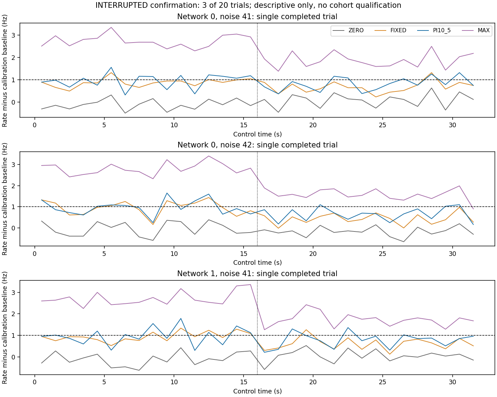

# M005A.3 — PI scientific qualification continuation

**Execution PARTIAL; scientific qualification NOT ESTABLISHED; M005B HOLD.** The original global PI selection was completed and frozen, but a prospectively declared clock-discrepancy stop interrupted reserved confirmation. No scientific threshold, target, gain, seed, network or neuron parameter was changed. No retry or adaptive-control experiment followed.

## Revision, preservation and authorization

Starting clean branch `research/m005a-2-resource-supervisor`, HEAD `8dd104f232078cf1271688ab3c287f0b0c2a9490`. Review branch `research/m005a-3-pi-qualification`. All **6786 starting tracked files remain byte-identical**, including every historical scientific report/protocol/result and all installed source. Final publication revision is supplied in the mission return; this report is part of that commit.

Inspected the complete M005A/M005A.1/M005A.2 reports, protocol009, PI and neural implementations, tuning/failure archives, resource-supervisor implementation and evidence. [Initial audit](evidence/m005a_3/initial_audit.json) and [preservation inventory](evidence/m005a_3/preservation.json) preserve the starting state. M005A.2's2616-file inventory matched. No historical branch was merged. Validation and locked cohorts were not acquired.

Prospective [amendment010](../docs/research/010_M005A_3_CONTINUATION_AMENDMENT.md) first committed `afdb987a189171b6b14f23ac6acd8bd1d763cb6e`, with capture details finalized before acquisition in the selection commit. It explicitly accepts complete corrected TUNE data for development selection without rehabilitating M005A's60-minute resource failure. No additional tuning simulations were authorized or run. The original unspent **90-minute confirmation allowance** remained unchanged; no outcome-dependent extension.

## Complete tuning reuse and frozen PI

All10 original network/noise40 prefixes and120 required branches were complete. The failed first attempt remains separate and unused. Original scoring was rerun on every completed corrected branch. The independent verifier reconstructed all600 metric rows, event counts/filter/calibration/causal PI/actions/exposure/OU samples/network parameters and the global selection in36.573859s. Tuning-stage supervision completed within its shared20-minute cap.

| Original candidate | Mean frozen selection score, Hz |
|---|---:|
| PI10_5 | 0.242291666667 |
| PI20_10 | 0.249440104167 |
| PI30_15 | 0.354785156250 |

Score = across-network mean of .5*(STATIC MAE over[8,32)s + LOSS MAE over[20,32)s); ties within1e-12 choose smallerKp thenKi. No per-network or confirmation-dependent selection. Selected **Kp=10pA/Hz, Ki=5pA/(Hz·s)** with the original calibrated feedforward and anti-windup. [Frozen record](evidence/m005a_3/selection_freeze.json), [all candidate/network scores](evidence/m005a_3/tuning_analysis/selection.json) and [independent verification](evidence/m005a_3/tuning_verification.json).

Exact selection revision **`604302e9eecc491b8855a6ccbcaf4e195cb2adb2`** was committed with all tuning evidence before confirmation. Selection-file SHA256 `076604e732e1f97d02195c6d3798f0fba1998f4e9605c9492480cf51f794da36` matches acquisition provenance. The acquisition wrapper checked a clean checkout and the committed selection blob before starting. Later working-tree changes are output/evidence only. Tuning gates in the original scorer are development diagnostics, not confirmation qualification.

## Reserved execution and clock stop

The unchanged qualified acquisition CLI prescribed20trials (networks0–9 × noise41,42), eight32s branches per51s calibration prefix: ZERO,FIXED,MAX,PI10_5 × STATIC/LOSS. Total160branches/6140simulatedseconds. Target remains calibration baseline+1Hz, original1s causal feedback,20ms legal stimulation updates and100us integration. LOSS changes evaluator-only gain1→.6 at relative16s. Controller inputs never include gain or evaluator state. All policies have the same calibration and actuator bounds.

The supervisor assigned one monotonic deadline of5400s, with .8s reserved cleanup **inside** that cap. Its POSIX active-machine qualification from M005A.2 remains valid for that stated contract. macOS `caffeinate` held an observed PreventUserIdleSystemSleep assertion, but that does not prevent forced clamshell sleep.

Monitoring recorded calendar elapsed503.315595s versus monotonic469.449916s, a **33.865679s discrepancy**. The clock implementation is `mach_absolute_time()`; calendar uses adjustable CLOCK_REALTIME. [Clock investigation](evidence/m005a_3/clock_investigation.json), [resource samples](evidence/m005a_3/resource_samples.jsonl), [power assertion](evidence/m005a_3/power_assertions.txt).

The OS power log reports **clamshell sleep at00:40:53 and wake at00:41:32 on2026-10-28 America/New_York**, overlapping the gap. This supports suspension as the explanation in this run; the39s rounded power-log interval is not asserted equal to the measured clock gap. It does not establish the cause of the old M005A overrun. [Power log excerpt](evidence/m005a_3/recent_sleep_wake.txt).

Amendment010 explicitly required stop/HOLD on an observed clock discrepancy because suspend-inclusive enforcement was not qualified. The owned acquisition parent received SIGINT. This was a deliberate external resource-contract stop, not a spontaneous neural/controller exception and **not a90-minute budget exceedance**. No deadline was reset and no replacement acquisition followed. The supervisor records `SUPERVISOR_FAILURE / KeyboardInterrupt()` for the requested interruption; [clock_stop.json](evidence/m005a_3/clock_stop.json) supplies its external cause.

Capture closed after **542.862513 calendar seconds** and **508.844052 monotonic seconds**. The external5405s cleanup-only watchdog did not intervene. All six started worker groups were reaped; the three active workers used STOP_REQUESTED→TERMINATING→REAPED, with no KILL escalation. Cleanup after the first stop request took **0.237636375s**, within the original .8s reserve. No live owned group/PID remained in independent checks. [Supervisor terminal record](evidence/m005a_3/confirmation/supervision/terminal.json), [capture closure](evidence/m005a_3/acquisition_closure.json).

## Preserved cohort and missing work

| Network | Noise41 | Noise42 |
|---|---|---|
| 0 | Complete | Complete |
| 1 | Complete | Aborted during prefix |
| 2 | Aborted during prefix | Aborted during prefix |
| 3 | Not started | Not started |
| 4 | Not started | Not started |
| 5 | Not started | Not started |
| 6 | Not started | Not started |
| 7 | Not started | Not started |
| 8 | Not started | Not started |
| 9 | Not started | Not started |

**3/20 complete trials,24/160 complete branches,3complete prefixes,921simulatedseconds/46050recorded20msbins.** Three in-flight workers had published no neural prefix/branch before termination; their actual simulated progress and unflushed observations are unknown. Post-stop audit-only abort records preserve their identities, source, PID, exit code and lifecycle; they are not neural observations. Fourteen trials never started. Therefore17required trials/136branches are missing. No subset substitutes for the prescribed cohort.

[Actual seed/cohort manifest](evidence/m005a_3/actual_seed_manifest.json), [raw confirmation](evidence/m005a_3/confirmation), [partial technical audit](evidence/m005a_3/partial_verification.json). Checkpoint/parameter hashes and all83OU-block hashes per completed trial are preserved; representative blocks were independently regenerated. Parameters match each network's original noise40 realization, while noise replicates remain independent. No result-dependent seed replacement.

## Available descriptive results — not qualification

The following are single-trial errors, not network-level estimates or independent-network replication. STATIC uses the last24s; LOSS uses the last12s. ZERO,FIXED,MAX and PI all have equal calibration histories. MAX is an authority reference, not an optimized tracking baseline. No cohort mean or confidence interval is substituted from these three trials.

| Network/noise | Regime | ZERO MAE Hz | FIXED MAE Hz | MAX MAE Hz | PI MAE Hz | PI bias Hz | MAX−ZERO late response Hz |
|---|---|---:|---:|---:|---:|---:|---:|
| 0/41 | STATIC | 0.981250 | 0.186068 | 1.838542 | 0.223828 | 0.032292 | 2.891667 |
| 0/41 | LOSS | 0.911979 | 0.367448 | 0.884896 | 0.282031 | -0.143229 | 1.796875 |
| 0/42 | STATIC | 1.121354 | 0.209896 | 1.723958 | 0.298958 | -0.035417 | 2.808333 |
| 0/42 | LOSS | 1.151042 | 0.537500 | 0.581250 | 0.359375 | -0.321875 | 1.715625 |
| 1/41 | STATIC | 0.968750 | 0.222396 | 1.803646 | 0.413021 | 0.057812 | 2.757292 |
| 1/41 | LOSS | 0.963542 | 0.402083 | 0.706250 | 0.267708 | -0.203125 | 1.669792 |

All available results, including larger PI errors, are retained. PI has larger stationary MAE than calibrated FIXED in all three completed trials; it has smaller late-loss MAE than FIXED in these same three. These are incomplete-cohort descriptions, not evidence of a qualified stationary or recovery effect. Full precision is retained in [all120window metric rows](evidence/m005a_3/partial_descriptive_metrics.csv) and [768one-second trace rows](evidence/m005a_3/partial_descriptive_traces.csv).

Calibration and exposure per completed trial:

| Network/noise | Baseline Hz | Baseline1s SD Hz | qff pA/channel | Calibration valid |
|---|---:|---:|---:|---|
| n0_r41 | 12.710938 | 0.208998 | 39.918684 | True |
| n0_r42 | 12.862500 | 0.326302 | 41.974349 | True |
| n1_r41 | 14.650000 | 0.268760 | 43.565954 | True |

| Network/noise | Regime | FIXED total model charge nC | PI total model charge nC | PI saturation fraction |
|---|---|---:|---:|---:|
| 0/41 | STATIC | 247.719952 | 253.646514 | 0.000000 |
| 0/41 | LOSS | 247.719952 | 278.596514 | 0.000000 |
| 0/42 | STATIC | 254.293968 | 263.800218 | 0.000000 |
| 0/42 | LOSS | 254.293968 | 286.612718 | 0.000000 |
| 1/41 | STATIC | 259.383921 | 262.283921 | 0.000000 |
| 1/41 | LOSS | 259.383921 | 287.008921 | 0.000000 |

Every complete policy incurs120nC nominal aggregate model charge during calibration; ZERO total remains120nC and MAX total503.64nC. These are50cell/channel intracellular-equivalent model current integrals, not extracellular biological safety quantities. Delivered histories include all ramps; effective gain is evaluator-only. Available branch audits have **zero constraint violations and zero fallback decisions**. This does not establish validity of unflushed/missing trajectories.



Figure shows each complete trial separately; no averaging across unbalanced networks/noise or full-cohort claim. Display points are bin midpoints; observations become available only at their endpoints. PNG/SVG regeneration was byte-identical, within the same inherited post-verification deadline.

## Original scientific gates and decision

Unchanged prerequisites include both calibrations per network; baseline1–30Hz;1Hz≥2×RMS1s baseline noise; MAX−ZERO authority≥1.2Hz; selected PI MAE≤.35Hz,|bias|≤.2Hz and≥30%benefit vsZERO;≥8/10joint networks separately by regime and positive lower95%network-bootstrap PI-vs-ZERO benefit. LOSS additionally requires≥20%mean paired relative and≥.1Hzabsolute benefit overFIXED, lower95%absolute bound>0, positive in≥8networks. Full acceptance requires no base fallbacks. Replicates average inside each network;10000PCG64bootstrapdraws,seed20261025.

**None of the full-cohort scientific gates can be evaluated.** No subset gate, spike-bin confidence interval, imputed missing network or tuning CI is used as confirmation. Scientific outcome is NOT ESTABLISHED, not evidence that PI scientifically failed or that the target is feasible. Software/count/action checks passed on the available records; full objective realization, stationary qualification and efficacy-loss recovery remain unqualified. M005B HOLD.

## Executed verification and limits

- Permitted preflight:125tests passed,25existing warnings,53.83s. An earlier restricted attempt had13PermissionError process-inspection failures/112passes; all logs retained, and no science began until the permitted preflight passed.
- Original independent TUNE verifier:10trials/120branches/600rows, PASS; global selection independently recomputed and committed before confirmation.
- New partial-data verifier:3trials/24branches/120rows, PASS_AVAILABLE_RECORDS_ONLY in10.122907s. It imports independent original audit functions, not controller/scorer functions for expected numerical answers. All counts reconstructed from spike events,100us alignment/20ms causal bins/filter, calibration/target math, PI decisions/actions/current/slew/exposure, OU samples, parameter identities and source lineage pass. Original scorer's descriptive outputs are compared against the independent calculations.
- STATIC/LOSS past observations/actions agree through the causal change boundary; ZERO branches match throughout. Restoration assertions executed in each complete trial. Historical neural replay/isolation/future-mutation/dropout/anti-windup/projector regressions pass. A new cold replay of reserved confirmation and the planned complete-cohort audit were **not executed** after the stop; they are not claimed verified.
- Final regression suite:125tests passed,25existing warnings,50.28s, under a shared20-minute qualified supervisor stage with partial verification. Both child commands exited normally and groups were reaped. Supplemental figure generation inherited the same deadline rather than resetting it. [Final JUnit](evidence/m005a_3/final_tests.xml), [verification-stage records](evidence/m005a_3/abort_verification_supervision/terminal.json).
- No installed source changed. Historical6786paths, protocol/selection hashes and exact selection Git blob checked. No new neural acquisition after the stop, beyond the pre-existing short regression fixtures; no controller tuning/rewriting, adaptive control or locked-network acquisition.

Allocated combined M005A evidence and run-file blocks at report generation: **124735488bytes**, below500MiB. Complete-trial peakRSS maximum **1058488320bytes**. Sampled worker RSS stayed below2GiB; exact peakRSS of forcibly terminated workers was not persisted. No full V0 throughput benchmark or standardized BLAS thread-count claim is made. The complete-stage wall durations above include the stopped run, not later idle time.

## Commands and nonexecuted plans

Executed using `/tmp/neuromancer-m004-venv/bin/python` with `VECLIB_MAXIMUM_THREADS=1 OPENBLAS_NUM_THREADS=1 OMP_NUM_THREADS=1 MPLCONFIGDIR=/tmp/neuromancer-m005a-mpl`:

```text
python reports/evidence/m005a_3/run_commands.py reports/evidence/m005a_3/qualified_preflight_config.json
python reports/evidence/m005a_3/run_commands.py reports/evidence/m005a_3/tuning_config.json
python reports/evidence/m005a_3/acquire.py
python reports/evidence/m005a_3/sample_resources.py
python reports/evidence/m005a_3/run_commands.py reports/evidence/m005a_3/abort_verification_config.json
```

The capture invokes the unchanged `python -m neuromancer.control_experiment --stage CONFIRM` with committed selection; exact arguments are in launch/closure records. Resource samples are read-only; the documented SIGINT stop and power/process inspection commands are evidenced separately. Supplementary supervisor commands are in `supplemental_verification_config.json` and inherit the prior deadline. `pip check` found no broken requirements. Requested thread limits are not measured BLAS threading.

The committed full confirmation verification configuration, resource auditor, public-only mutation helper and duplicate-replay helper are preserved as **planned, not executed**. Newly prepared deterministic full-analysis comparison/decision helpers were likewise not run. No complete-cohort summary, significance claim or READY decision was fabricated.

## Remaining blocker and next step

The active-machine supervisor handled actual neural-worker cancellation successfully, but `mach_absolute_time()` did not account for the host's observed clamshell suspension. Idle-sleep inhibition is insufficient for this environment. The current execution therefore fails the prospective timing prerequisite before a complete scientific decision. Original M005A/M005A.1 failures remain unchanged; this mission is execution PARTIAL, not a completed scientific negative result.

Before any further acquisition, qualify a suspend-inclusive global deadline on the intended host or a qualified continuously awake execution environment, with independent elapsed-time and cleanup evidence. Any subsequent continuation must prospectively decide eligibility of the three preserved complete trials and explicitly authorize only the17missing original identities, retaining the frozen gains, targets, seeds, thresholds and every aborted record. It must not present this already-partly-inspected cohort as untouched or grant an unrecorded fresh90-minute allowance. No such continuation is run here.

The incomplete result does not justify changing neural dynamics or shrinking targets. Research-direction decisions about PI feasibility or adaptive-model control require the original complete cohort. Stop after M005A.3; M005B remains HOLD.
