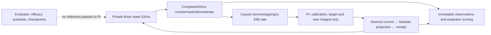
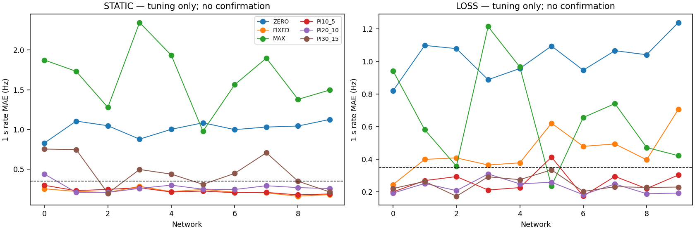

# Mission005A — Causal closed-loop foundation

**Mission execution PARTIAL; stationary and recovery scientific qualification NOT ESTABLISHED; M005B HOLD.** Controller component tests and audited tuning trajectories pass technical checks, but the absolute-wall acquisition budget was exceeded and confirmation was not run. Entirely simulated dynamics. This report will distinguish the corrected execution, stationary regulation, loss recovery and M005B readiness. It makes no adaptive-MPC, biological, plasticity or hardware claim.

## Preservation and scientific scope

Exact starting clean revision `0131bca9adb4020dbe3bccb0e877a3b2c75ee62d`, branch `research/m004-online-identification`. Requested review branch `research/m005a-closed-loop-foundation`. All3888 historical tracked paths are covered by [SHA inventory](evidence/m005a/preservation.json). Prior V0.1+4Hz failure, V0.2 prospective calibration failure and ARX/state-interaction non-superiority retain their original interpretation. FIR remains the supported intervention-response reference; ARX remains a conditional-rate reference. Neither is used to generate this mission's PI actions.

Audit included architecture/contracts, numerical protocols/recommendations, all mission reports and their evidence manifests, original Brian equations/scheduler/OU streams/checkpoint/observation/stimulation code, identification/control-boundary patterns and historical tests. Old scientific acquisitions were not rerun wholesale; immutable numerical evidence was preserved, and the92 historical regression tests were executed.

This mission tests one new **constant1Hz-above-calibration-baseline setpoint**, not arbitrary trajectories, a1Hz two-target span, below-baseline suppression, full-state controllability or the historical V0.1/V0.2 hypotheses. The target was fixed before new outcomes, motivated by earlier finite-bank positive authority1.29–1.88Hz at reduced efficacy and standalone1s SD approximately.16–.38Hz. Its explicit noise/authority/error gates prevent calling a near-zero correction a success. It remains a simpler/slower task than those historical protocols.

## Frozen design and causal interfaces

[Protocol009](../docs/research/009_M005A_CONTROL_PROTOCOL.md) committed `c00d0c8`; source/scoring frozen `2de1365`; independent verification/export corrections `f4b79cb`; strict representable-slew repair and engineering amendment `d17017b`. Before acquisition an editorial total-branchcount270→280 was corrected; all schedules/durations/cohorts and10490scientificseconds were already correct.

Unchanged Brian2 2.10.1 recurrent E/I substrate:1000neurons,100usintegration, original conductance-free current-based LIF/OU/synapses/delays/topology, four50E stimulation groups,20virtualrecordingchannels with80unstimulated recordedE, original20ms bins and100ms causalfilter. No neuron/plasticity/recording/budget changes.

Boundary records use integer microseconds, pA and Hz. Stimulation remains four held nonnegative commands,≤120pA/channel,≤240pAtotal,≤30pA/channel/20ms. Feedback computes pooled E80 raw-count means over50completedbins=1s. Original20ms recordings/filter are retained; the1s aggregate is an added causal controller statistic. It neither replaces nor future-smooths observations. Hardware timing/physiological fidelity are not implied.

At51s, first command uses only the completed calibration prefix. At52s, the[51,52) aggregate updates PI and affects commands starting52s. Gain loss occurs at67s; the command already chosen from observations through67s cannot anticipate it. General `feedback_step` advances exactly20ms then consumes its completed observation to prepare the next action. The scientific optimized runner precommits50legal held/ramped commands and only updates after that full1s. A deterministic fixture checks tick-versus-batched neural equality. This optimized path requires complete coverage and aborts unexpected gaps; it does not promise immediate within-batch dropout handling. The general tick API implements tested safe dropout handling.

Controller inputs are only immutable calibration summaries from permitted observations/receipts, completed observations, target, clock and its own state. `Policy` imports no Brian API and receives no engine/config/true-gain/connectivity/sham/reference outcome. Private evaluator code alone sets gain and restores states between independent branches. This is a verified software information boundary, not an adversarial Python security sandbox.

### Calibration and equations

Common51s prefix: zero0–15s, b from[7,15); alternating4s zero/4s C02holds q30/60/90/120, ending47s, then4s zero. C02=(q,0,q,0). h(q)=last3s hold mean−last3s preceding-zero mean. Through-origin a=Σq h(q)/Σq², qff=1/a, targetr=b+1Hz. No paired sham or truegain enters calibration. Validity: b1–30Hz,a>0, qff0–120pA, maximum fitted-dose residual≤.5Hz, adjacent reversal no worse than−.3Hz, finite values. Failed maps retain the unchanged target and labeled zero fallback; no target clipping or network exclusion. This is a new preregistered finite-noise linear map, not retrospective repair of M002.3's failed strict interpolation.

PI initially delivers qff. Every completed second e=r−y; trial I'=clip(I+Ki eΔt,−120,120). Reject that integration increment when the combined qff+Kp e+I' lies beyond an actuator bound and error drives further outward. Deliver q=clip(qff+Kp e+I,0,120), followed by per20ms feasible projection. Conditional anti-windup prevents sustained integral growth into scalar saturation. At this qualified1s cadence every admissible scalar dose transition can finish within80ms; no integral update occurs during that short ramp. Arbitrary-channel projection is tested independently; multi-channel PI is not implemented.

General projector minimizes Euclidean distance to desired current over the intersection of per-channel current/slew boxes and sum≤240, using a bounded one-dimensional multiplier solve. Requested intent, projected legal command and actual delivery remain separate. Invalid/nonfinite requests use labeled bounded ramp-to-zero; invalid prior actuator state rejects. Missing/late/incomplete observations clear aggregation, freeze integral and request safe zero; after four fresh complete bins the policy rearms and gathers a new aggregate. Future/duplicate/cross-trial timestamps reject. Base scientific fallback prevents qualification.

## Engineering failure and preregistered recovery

The first acquisition attempt encountered an exact floating-point slew violation: computed box endpoints can round so that subtracting the previous value exceeds30 by a few ulps. Brian atomically rejected the command before neural advance. A new5000-transition opposite-corner fixture reproduced it without scientific scores. Old tests had checked computed box membership without testing the backend's exact subtraction. Repair moves an endpoint inward only when necessary; the strict original limit/tolerance is unchanged.

[Amendment001](evidence/m005a/AMENDMENT_001_NUMERICAL_PREFLIGHT.md) was committed before restart or scientific scoring. One complete corrected attempt uses the SAME networks/noise40; no unfavorable seeds are replaced, no thresholds/model/gains change, no initial partial outcomes are pooled. Original attempt remains FAIL. A fixture-generation rounding problem (previous vector scaled a fraction above240) was separately caught/fixed with its failed log retained.

All19 valid numerical archives from first attempt, failure messages, source/provenance and process-stop records are preserved underfailed_attempt01. They cover at least635simulatedseconds. In-flight buffers from terminated workers were not flushed; exact missing duration/activity is unknown. Seeds/oldsource and complete files survive, but this is an acquisition-durability limitation, not complete first-attempt evidence. Completed corrected cohorts are the only qualification dataset. The deviation/restart is disclosed rather than presented as flawless first-pass execution.

## Preregistered experimental and statistical rules

Only development networks0–9. Noise40 TUNE: six policies ZERO,FIXED,MAX,PI(Kp,Ki)=(10,5),(20,10),(30,15), each STATIC/LOSS32s, shared51s prefix;4350simseconds. Confirmation noise41,42: ZERO,FIXED,MAX and one globally selected PI, both conditions;6140simseconds. Thirty prefixes,280branches,10490scientificsimseconds. No networks10–14/100–119 or opportunistic extra probing.

The planned, unexecuted selection would minimize across ten tuning networks the average stationaryMAE[8,32) and LOSSMAE[20,32); ties favor smallerKp/Ki. No PI was selected or selection committed; confirmation remains unopened. ZERO shares the common calibration history but has zero online current. FIXED is target-aware empirical feedforward, not an arbitrary weak dose. MAX is an authority reference, not an optimal tracking policy. All policies receive equal calibration and limits. LOSSg1→.6 at relative16s, unknown to policy. Restores occur between branches only; each32s feedback trajectory is uninterrupted and policy memory starts fresh. OU innovations use original role4/network/noise/absolute-second blocks independent of spike execution; matched comparisons have identical exogenous streams.

Primary actual-output error is MAE of completed1s raw rates versus fixedtarget. Stationary scores last24s; loss recovery last12s after a frozen4s grace. Full/pre/immediate windows and signed bias/RMSE remain reported. PI-vs-FIXED superiority is not required in stationarity. Principal unit is network, averaging two noise replicates first. Network bootstrap10000draws PCG64seed20261025 supplies paired percentile95%intervals. Bins/noise repeats are not independent networks; previously studied networks and smallreplicatecount limit generalization/precision.

Stationary qualification:≥8/10 jointly pass bothcalibrations/baseline/no-fallback,1Hz≥2×baseline1s RMSnoise, STATIC MAX−ZERO meanauthority≥1.2Hz, PI MAE≤.35Hz, |bias|≤.2Hz, ≥30%MAEbenefitvsZERO; cohort lower95%pairedbenefit>0. Recovery applies same joint criteria underLOSS, plus PI-vs-FIXED meanpairedrelativebenefit≥20%, meanabsolute≥.1Hz, lower95%absolute>0 and≥8positive networks. Relativeerror denominatorfloor.1Hz. These are newengineering gates, not universal control guarantees or amendments to V0.1/V0.2. Readiness requires bothregimes and valid correctedexecution.

## Resource gate and actual execution decision

Corrected TUNE completed10prefixes and120branches (**4350simulatedseconds,217500recorded20msbins**). The internal elapsed-clock summary reports **2491.556s (41.526min)**, but original start/end artifact timestamps span **5089.590s (84.826min)**, exceeding the frozen3600s absolute-wall limit. The independent downstream guard expired and ran no primary scoring/selection/confirmation. When a later stop inspection enumerated the acquisition process, it had already exited. The recorded9189.352s inspection interval includes idle time after acquisition and is **not an acquisition benchmark**.

The discrepancy includes a large artifact-write gap; its cause was not independently established. It cannot be resolved by choosing the favorable clock. The acquisition timeout and downstream absolute-wall guard were inconsistent. [Clock evidence](evidence/m005a/acquisition_clock_evidence.json) stores original epochs and source-file hashes so fresh checkouts do not rely on changed filesystem timestamps. [Deviation](evidence/m005a/RESOURCE_LIMIT_DEVIATION.md) records the decision. The original raw `status=complete` means all submitted jobs finished; it does not mean budget/scientific qualification passed.

**No global PI selection, no primary confirmation gates, no confirmation noise41/42, no new-network/locked-cohort evaluation.** The required20confirmationprefixes/160branches/6140simseconds were not acquired. Complete tuning records are retained and independently audited as descriptive development evidence; they cannot replace the preregistered confirmation stage.

After acquisition, the runner was repaired to check an explicit absolute epoch deadline in both parent polling and workers before each held1s block, with terminal checks and a resource-stop record. The clock-gap unit test passes. This repair was **not used for the acquired trajectories and was not exercised by a new scientific run**. Original acquisition source is commitd17017b13fa55ed7173500044b5ce57da5dd3b2d; numerical controller/substrate code is unchanged. No further scientific restart occurred.

## Complete descriptive tuning outcomes

All numbers in this section are **one noise40 trial per development network, not reserved qualification**. There are10valid calibration maps, zero fallback decisions, and zero delivered constraint/timing/nonfinite-state failures in the corrected acquisition. First-attempt technical failures remain separately preserved. No fitted controller family is promoted as the selected or preferred qualified controller.

Mean MAE uses the frozen stationary[8,32)s and post-loss[20,32)s windows. Nominal charge includes51s calibration plus the full32s online phase. ZERO therefore has nonzero calibration cost. Values are rounded here; every trial/window/error/bias/cost is in [metrics.csv](evidence/m005a/results/descriptive/metrics.csv).

| Policy | Stationary MAE Hz | Post-loss MAE Hz | Stationary bias Hz | Post-loss bias Hz | Loss total nominal charge nC |
|---|---:|---:|---:|---:|---:|
| ZERO | 1.014687 | 1.022917 | -1.014687 | -1.022917 | 120.000 |
| FIXED | 0.217422 | 0.448698 | -0.006406 | -0.424063 | 264.316 |
| MAX | 1.648802 | 0.658568 | 1.648802 | 0.641354 | 503.640 |
| PI10_5 | 0.224766 | 0.259818 | -0.005677 | -0.190833 | 284.122 |
| PI20_10 | 0.271432 | 0.227448 | -0.003646 | -0.104688 | 294.024 |
| PI30_15 | 0.465221 | 0.244349 | 0.044792 | -0.056979 | 304.221 |

Calibrated FIXED has lower stationary error than all three PI settings in these tuning means. The largest PI gains have substantially worse stationary error. All PI settings have lower post-loss mean error than FIXED, at increased nominal exposure. This is a variance/recovery/cost tradeoff, not adaptive-model superiority or proof that any PI passes the frozen joint gates. The unperformed confirmation cannot be inferred from these results.

### Every network and policy

Stationary MAE Hz, one tuning replicate:

| Network | ZERO | FIXED | MAX | PI10_5 | PI20_10 | PI30_15 |
|---|---:|---:|---:|---:|---:|---:|
| 0 | 0.829688 | 0.253125 | 1.875000 | 0.296354 | 0.437500 | 0.753125 |
| 1 | 1.105729 | 0.219010 | 1.732813 | 0.229167 | 0.207552 | 0.746745 |
| 2 | 1.047396 | 0.206771 | 1.278125 | 0.245573 | 0.207422 | 0.196354 |
| 3 | 0.878125 | 0.283724 | 2.347917 | 0.266276 | 0.257943 | 0.495964 |
| 4 | 1.002083 | 0.216927 | 1.935938 | 0.211979 | 0.298437 | 0.437370 |
| 5 | 1.084375 | 0.244792 | 0.977604 | 0.223958 | 0.247396 | 0.308333 |
| 6 | 0.998438 | 0.209245 | 1.564062 | 0.202995 | 0.243490 | 0.446615 |
| 7 | 1.030729 | 0.201823 | 1.899479 | 0.207552 | 0.291146 | 0.706771 |
| 8 | 1.043750 | 0.158854 | 1.379687 | 0.175781 | 0.267839 | 0.348307 |
| 9 | 1.126562 | 0.179948 | 1.497396 | 0.188021 | 0.255599 | 0.212630 |

Post-loss MAE Hz, last12s:

| Network | ZERO | FIXED | MAX | PI10_5 | PI20_10 | PI30_15 |
|---|---:|---:|---:|---:|---:|---:|
| 0 | 0.819792 | 0.243750 | 0.942708 | 0.198958 | 0.191667 | 0.219792 |
| 1 | 1.098437 | 0.398698 | 0.580729 | 0.268490 | 0.251042 | 0.263281 |
| 2 | 1.078646 | 0.407813 | 0.356771 | 0.292969 | 0.206771 | 0.172396 |
| 3 | 0.888021 | 0.364323 | 1.214062 | 0.210677 | 0.309115 | 0.291667 |
| 4 | 0.956771 | 0.377344 | 0.966146 | 0.225521 | 0.248437 | 0.274219 |
| 5 | 1.094792 | 0.620833 | 0.235417 | 0.412500 | 0.258333 | 0.334375 |
| 6 | 0.946354 | 0.478906 | 0.655729 | 0.173177 | 0.182031 | 0.201823 |
| 7 | 1.066146 | 0.493229 | 0.741146 | 0.294010 | 0.247656 | 0.230729 |
| 8 | 1.041146 | 0.396354 | 0.471615 | 0.219271 | 0.188021 | 0.226562 |
| 9 | 1.239062 | 0.705729 | 0.421354 | 0.302604 | 0.191406 | 0.228646 |

All calibration targets are b+1Hz, fixed before control. Authority is the evaluator-only paired MAX−ZERO late response. It is a finite tested-policy contrast, not a full reachable set or online signal.

| Network | b Hz | Baseline1s SD Hz | qff pA/channel | MAX−ZERO stationary Hz | MAX−ZERO loss Hz |
|---|---:|---:|---:|---:|---:|
| 0 | 12.618750 | 0.240442 | 44.090631 | 2.746875 | 1.762500 |
| 1 | 14.757812 | 0.227068 | 44.344077 | 2.760417 | 1.679167 |
| 2 | 11.923438 | 0.313850 | 53.293856 | 2.414583 | 1.435417 |
| 3 | 14.557813 | 0.233657 | 36.847492 | 3.184375 | 2.102083 |
| 4 | 14.832812 | 0.312817 | 38.961039 | 2.880208 | 1.922917 |
| 5 | 12.512500 | 0.308366 | 51.575931 | 2.103125 | 1.173958 |
| 6 | 13.860938 | 0.309985 | 44.135676 | 2.572917 | 1.602083 |
| 7 | 13.070312 | 0.317772 | 38.598999 | 2.926042 | 1.807292 |
| 8 | 12.620313 | 0.244305 | 54.531684 | 2.422917 | 1.496875 |
| 9 | 11.389062 | 0.198930 | 44.701987 | 2.688542 | 1.660417 |

Network5's reduced-efficacy point authority1.173958Hz is below the frozen1.2Hz headroom criterion in this single tuning replicate. It is retained, not excluded or rounded into a pass. Baseline1s SD is.198930–.317772Hz; every1Hz offset exceeds twice its estimated baseline SD here. These descriptive observations do not establish joint confirmation qualification or mathematical unreachability. With only one tuning noise sample/network, independent-noise variability is not estimated. No selected-model confirmatory confidence interval is available; bins are not substituted as independent replicates.

### Stimulation and persistent excitation

Each policy incurs2400pA*s nominal calibration exposure=120nC aggregate model charge across stimulated cells. Online nominal charge for FIXED averages144.316nC; after LOSS it is164.122/174.024/184.221nC for PI10_5/20_10/30_15, respectively. Thus recovery improvements use more input. Current/current²/full-prefix costs and every20ms desired/projected/delivered action are preserved. These are intracellular-equivalent model quantities, not extracellular charge or biological safety measurements. Nominal cost is distinct from gain-weighted effective input; the controller never receives the hidden gain.

The last16s LOSS design has rank1/41 for ZERO/FIXED/MAX and rank11/41 for every PI. Median scalar q SD is6.306/9.861/13.576pA for the three PI settings; positive-singular-value median condition is61.968/38.173/38.129. Full four-channel design condition is infinite because C02 inputs are duplicated and two channels are zero. PI generates scalar dose variation but does **not** independently excite four channels; feedback endogeneity also prevents treating numerical rank as proof of unbiased identification. No extra probing was injected. Complete spectra/conditions/diversity are in [excitation.json](evidence/m005a/results/descriptive/excitation.json).

[All ten loss time courses](evidence/m005a/results/descriptive/tuning_loss_rates.png) and [desired actions/costs](evidence/m005a/results/descriptive/tuning_actions_costs.png). Rate points are interval midpoints for display; observations become available only at interval end. Desired-current plots do not replace actual slew-limited delivery records.

## Executed verification and actual resources

Final full regression: **103passed,25existing warnings,33.95s**, [text](evidence/m005a/final_tests.txt), [JUnit](evidence/m005a/final_tests.xml). All92historicaltests unchanged. New tests cover causal aggregation/timestamps/future access, arbitrary-vector convex projection/KKT, strict floating slew, anti-windup/saturation/release, missing/delayed/rearm/invalid data, exact calibration math, independent memory, actual tick/batch neural replay, network-level statistics and absolute clock-gap handling. Earlier102-test pass and deliberately failed/then-corrected projector fixtures remain in evidence. `pip check` and compilation pass. No remote CI or cross-platform test.

Independent numerical audit passes **10prefixes,120branches,217500observationbins and600metricrows**: event-to-count conservation, original100msfilter, observation-only calibration, all PI decisions reconstructed from completed counts, desired/projected/delivered histories and costs, first17pre-informed decisions identical acrossgainconditions, exact full ZERO equality, shared OU hashes, sampled innovation-block reconstruction, unchanged parameter hashes/disjoint memberships and3888historicalfilehashes. It separately confirms the budget discrepancy and nonqualification. This is independent numerical formulation within this session, not an external investigator/simulator replication.

Public-only controller replay exactly reproduces1600commands and32decisionstates. Synthetic future mutation leaves500earliercommands and11earlierdecisions unchanged; changing completed earlier observations changes later actions. A synthetic missing-bin test confirms next-tick safe ramp and four-fresh-bin rearm. These are software fixtures, not additional scientific outcomes. Cold83s neural replay of n0/noise40/LOSS/PI20_10 matches **25arrays exactly**, including prefix/branch spikes/counts/filter/commands/decisionstates;116.130s internalelapsed. PI20_10 is a fixed middle-grid technical fixture, **not a selected controller or new statistical replicate**. No confirmation identity was opened.

Deterministic reanalysis reproduces numerical tables/JSON and sixPNG/SVG figures (only measured analysiswalltime excluded). Every failed/complete original archive is retained and byte-identical curated copies are committed. [Command ledger](evidence/m005a/commands.md), [technical audit](evidence/m005a/descriptive_verification.json), [cold replay](evidence/m005a/results/replay_fixture/verification.json), [mutation checks](evidence/m005a/causality_verification.json), [resource deviation](evidence/m005a/RESOURCE_LIMIT_DEVIATION.md).

| Measurement | Actual result |
|---|---:|
| Corrected scientific simulation |4350s (planned10490s; confirmation not run)|
| Internal acquisition elapsed counter |2491.556s|
| Original artifact absolute-wall interval |5089.590s; exceeds3600s cap|
| Per-network internal duration min/median/max |601.871/627.494/673.442s|
| Network initialization min/median/max |.025747/.027387/.045288s|
| Maximum worker lifetime RSS |1345945600bytes (~1.254GiB)|
| PI10_5 planning+aggregation median/p95/max |.999688/1.481165/3.903208ms|
| PI20_10 planning+aggregation median/p95/max |.978875/1.428542/3.361959ms|
| PI30_15 planning+aggregation median/p95/max |.989021/1.661277/129.608333ms|
| Independent full tuning audit |22.295s internalelapsed|
| Cold83s duplicate replay |116.130s internalelapsed|

Planning+aggregation includes50projections/observation consumptions per1s update; it excludes neural integration. Worker RSS is process-lifetime high-water, not incremental or aggregate memory. These measurements include concurrent local work; there is no hard real-time qualification. The large129.6ms outlier is disclosed. Environment:Python3.12.15,Brian2 2.10.1,NumPy2.5.4,macOS26.5.2arm64,AppleM5/16GiB. Accelerate threadlimits requested1, actualthreadbehavior unverified. The41.526min elapsed counter is not substituted for84.826min absolute-wall compliance.

## Scope and remaining scientific limits

Finite32s, one constant positive offset and one efficacy-loss time/magnitude do not qualify general trajectory tracking, unseen networks, biological control or state controllability. Gain loss is actuator perturbation, not neural plasticity. Feedback may succeed by increasing mean current; no optimal-cost or adaptive-MPC advantage is implied. FIXED is a calibrated stationary reference, not the best possible robust open-loop policy. Paired evaluator MAX−ZERO effects are unavailable online and do not set targets/actions. No extra excitation is injected; fixedC02 structurally cannot identify four independent channel responses. Closed-loop input variation alone is not identification consistency because it depends on observed noise.

General20ms dropout/fallback handling is fixture-qualified; the complete-coverage scientific1s optimization is not a tested hardware fault handler. No hard real-time operation, cross-platform bitwise equality, biological safety or independent external replication. Cold neural replay and separate numerical equations within this session are technical independent checks, not a second research group/simulator. Interrupted in-flight durability remains limited as disclosed.

## Decision and next falsifiable experiment

**Engineering components: PASS on executed tests/audited tuning/duplicate replay. Mission execution: PARTIAL. Scientific stationary qualification: NOT ESTABLISHED. Scientific recovery qualification: NOT ESTABLISHED. M005B: HOLD.** Full mission execution cannot pass because its resource gate failed and required reserved confirmation was not run. This is not evidence that the unchanged substrate is incapable of the objective, nor a reason to alter currents/neurons/targets. No chosen-controller confidence claim, original-V0 rehabilitation or adaptive-MPC superiority follows.

Next falsifiable experiment, proposed only: a new reviewed protocol may explicitly reuse these records as development, freeze the originally defined global PI selection, then evaluate untouchednoise41/42 with the same nontrivial objective/gates under verified absolute-resource accounting and durable chunk recording. Any such reuse must be prospectively declared; it cannot retroactively turn this mission into PASS. Failure of the same stationary/recovery criteria would retainHOLD and diagnose authority, calibration or feedback tradeoffs before model-based comparisons. No MPC/RLS/RL/plasticity/hardware/locked-test work or follow-on experiment was started.

## Revision closure

Exact starting revision is recorded above. Acquisition source is d17017b13fa55ed7173500044b5ce57da5dd3b2d; all later resource-guard changes are explicitly post-acquisition and not claimed scientifically exercised. The verified complete evidence commit and final publication child are recorded at closure/final response. A report cannot embed its own Git commit hash. Review branch remains unmerged; all historical source/evidence stays byte-identical.
