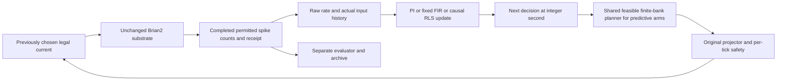

# M005B.0 — adaptive closed-loop control research design

**Design qualification PASS for the bounded synthetic numerical contract. Scientific adaptive-control qualification NOT RUN. Neural acquisition remains HOLD pending a separately authorized implementation/verification milestone.** No adaptive neural control experiment, validation run or locked-network evaluation was executed. M005A.5 remains FAIL; M005A.7 remains PASS only for its qualified extended horizon.

## Revisions and preservation

Started clean at `f394b686f769e67912dfcf7c3547143d146c4d6d` on `research/m005a-7-extended-recovery`. Created `research/m005b-0-control-design`. The complete [protocol](../docs/research/011_M005B_CONTROL_PROTOCOL.md) was frozen at **`f13b13786ad1a17a76f2cf9c6ac6412df51b2191`**, before computational feasibility checks. No scientific numerical rule changed after those checks. Final revision is the commit containing this report, supplied exactly in the mission response. No merge.

All **13,641** starting tracked files remain hash-identical, including architecture, earlier protocols, model coefficients, raw evidence, failed control-authority/model-superiority findings and all supervisor stop decisions. `evidence/m005b_0/preservation.json` and the independent verifier retain hashes. No existing package module, test, dependency or historical evidence was modified. New executable material lives only under `reports/evidence/m005b_0`: it is a design prototype, not a deployed controller or scientific experiment runner.

## Audit findings and architectural decision

| Evidence | Verified implication for this design |
|---|---|
| M003 | Stimulation-aware prediction beat stimulation-blind prediction; this did not establish controller benefit. |
| M003.1 | Selected FIR(q10, lambda .1) matched ARX on 1 s intervention contrasts. ARX superiority failed. |
| M003.2 | Scalar observed-state interactions failed to improve intervention-effect prediction. No general biological state-independence claim follows. |
| M004 | RLS999 improved prospective filtered absolute-rate prediction under continued prescribed excitation. Validation causal-effect improvement was inconclusive; intervals and sustained recovery were weak. Intercept adaptation may explain part of the gain. |
| M005A–A.5 | Resource failures and short-horizon loss-bias failure are immutable; qualified PI gains remain Kp=10, Ki=5. |
| M005A.6 | MAX headroom and lack of PI saturation supported a slow-correction hypothesis, not a proof of target reachability in arbitrary states. |
| M005A.7 | New 64 s horizon qualified PI late recovery on 10/10 development networks and stationary regulation on 9/10; it did not qualify rapid recovery or adaptive MPC. |
| Supervisor/clock audit | Existing POSIX process groups, shared boot-scoped Mach continuous deadline, cleanup reserve and atomic artifact contracts remain authoritative. Physical sleep-at-expiry is not a controlled qualification. |

The M004 implementation cannot simply be wrapped in a planner unchanged. Its runner uses filtered sector rates and a 39 s model clock; qualified PI uses raw one-second E80 counts after 51 s calibration. The new design retains the selected FIR **form**, refits raw 20 ms sector labels from the common original calibration and explicitly adapts the start clock. No old coefficient is silently applied to a new statistic. RLS algebra and rho=.999 remain unchanged and analytically verified.

Original calibration excites only C02=(q,0,q,0). Independent channel coefficients are unidentifiable. Keep this allocation for ALL deployable methods, retain the original four-input/four-output ridge representation, and check rank in its identifiable scalar subspace. Do not invoke arbitrary four-channel optimization on a rank-deficient calibration. A historical input-only audit of n0/r45's original prefix gave reduced rank **11/11**, standardized condition **175.955084**. No new response outcomes were opened for that audit.

With only .18 s of input memory and 1 s action holds, most of the FIR forecast becomes a dose mapping. Accordingly this study can test adaptive predictive regulation; it cannot establish that long-horizon dynamical optimization or hidden neural-state estimation is necessary. A finite enumeration avoids adding an unqualified nonlinear optimizer or external solver dependency.

## Frozen comparison and information budgets

Future primary arms: unchanged PI10/5, fixed-model predictive control, RLS999 predictive control, frozen calibrated open loop, and ZERO. Add mandatory BIAS-only predictive adaptation as a mechanism diagnostic, plus LOSS MAX as an authority reference. The predictive arms share exactly their initial coefficients, two-second planner, action grid, costs and observation/calibration access; their parameter-update policy differs. PI retains its qualified gains/feedforward/anti-windup. No controller receives true gain, private neural state, future observations or counterfactual sham outcomes.

Every arm pays for the identical original 51 s calibration and gets its completed permitted observations/receipts. Target remains original baseline+1 Hz throughout 64 s of control. Hidden loss remains at relative16 s, absolute67 s, gain1 to .6. No extra identification probes or outcome-based target changes. PI/FIXED use their original continuous scalar commands; predictive actions use a 5 pA grid. Identical physical bounds do not imply identical actual expenditure; current costs are measured and guarded.



The evaluator alone schedules efficacy loss. Model updates follow completed observations; prediction precedes its own outcome. Neural integration is 100 us; legal input/observation ticks are20 ms; normal control decisions are1 s; planning horizon is2 s; wall budget uses Mach continuous time. These are distinct clocks. Planned second-half inputs are discarded at replanning, never treated as actual observations/deliveries.

## Mathematical contract

For raw sector rate y_k, delivered u_k and ten input lags,

\[
 x_k=[u_k^T,\ldots,u_{k-9}^T]^T,\quad z_k=[1,(x_k-\mu)/s],\quad
 \hat y_k=\bar y+z_k\Theta.
\]

Initialization uses only bins800..2349, [16,47) s, of the original prefix, fit-only SD floor1 pA and unpenalized intercept:

\[
 A_0=Z^TZ+n(0.1)\operatorname{diag}(0,1,\ldots,1),\quad
 \Theta_0=A_0^{-1}Z^T(Y-\bar y),\quad P_0=A_0^{-1}.
\]

Parameters164; covariance41x41. Restrict control to C02; reduced lag design must have rank11 and condition<=1e6, penalized information<=1e12. Ridge does not make independent channels identifiable.

RLS updates every completed valid20 ms record, using delivered inputs, fixed normalization and rho=.999:

\[
 K=Pz/(.999+z^TPz),\quad
 \Theta^+=\Theta+K[(y-\bar y)-z^T\Theta],\quad
 P^+=(P-Kz^TP)/.999.
\]

Symmetry/information/finite checks follow M004; covariance failure must not commit a bad state. FIXED holds Theta0. BIAS freezes the input kernel and updates only intercepts with scalar discounted least squares. Similar RLS/BIAS performance would undermine a claim that input-kernel adaptation is necessary.

Each origin enumerates **625** pairs of1 s requested holds, q0,q1 in {0,5,...,120} pA. Construct100 legal20 ms delivered inputs from actual prior current; prepend nine actual input-history rows. Forecast four sector rates and score two scalar1 s means:

\[
 J=\sum_{h=0}^1(\hat r_h-r)^2
 +.02\sum_{k=0}^{99}.02(q_k/120)^2
 +.01\sum_{h=0}^1[(q_h-q_{h-1})/120]^2.
\]

Current-cost q_k is delivered; switching q_h is requested; q_−1 is actual prior current. Ties within1e−12 favor lower exposure, then smaller q0,q1. Apply only first second with per-tick safety. This is a finite-bank optimum, not continuous optimality or neural optimality. Original limits remain120 pA/channel,240 pA total,30 pA/channel/tick. Nonfinite/history/forecast failure or planning over250 ms rejects the decision and safe-ramps; model/planner failure latches rather than silently switching to PI. No forecast clipping to manufacture validity. Valid but wrong models can produce poor tracking; current safety is not a stability theorem.

Production missing/delayed-observation handling and original PI replay are specified in the protocol but not implemented as a new scientific runner in this mission. A future runner must interrupt a planned hold at the next legal tick on missing data, preserve/freeze PI state as specified, discard stale arrivals and rearm after four fresh bins. Executing a full precomputed second without per-tick safety would fail implementation qualification.

## Frozen scientific hypotheses and gates

Primary IAE is the integral of absolute raw1 s error over **all48 s after loss**, [16,64), units Hz*s. No favorable late-window substitution.

| Claim/guard | Prospective rule |
|---|---|
| H1a RLS-MPC versus PI | Mean paired relative IAE benefit>=10%, absolute>=1.2 Hz*s, paired95% lower benefit bound>0, positive>=8/10 development and>=4/5 confirmation. |
| H1b update value versus fixed MPC | >=5%, >=.6 Hz*s, positive lower paired95% bound, same positive-network counts. Required for an adaptive-superiority claim. |
| H2 recovery delay, separate secondary | Restricted mean sustained-settling delay reduction>=4 s, positive paired95% lower bound and same positive-network counts. Misses censored48 s; never dropped. |
| H3 late target realization | Copy extended-task bias±.2 Hz, MAE<=.35 Hz and both8 s persistence blocks within48–64; baseline/noise/calibration valid, LOSS MAX margin>=.2 Hz. >=80% networks and cohort biasCI inside±.2, separately STATIC/LOSS. |
| H4 stimulation cost | RLS/PI dose ratio mean<=1.10, upper95%<=1.15; LOSS post48 s, STATIC entire64 s. Include calibration exposure in total reporting. |
| H5 stationary/pre-loss harm | Stationary IAE harm mean<=5%, upper95%<=10%; same pre-loss guard on[0,16). |
| Safety/validity | Zero unexpected primary constraint/causal failures, missing bins, model failures or fallbacks. No replacement/exclusion. |

Full future adaptive scientific PASS requires H1a+H1b+H3–H5 and valid execution in BOTH cohorts. H2 is independently reported, not an alternate route to primary success. Point/count passing with CI alone insufficient gives HOLD; otherwise a failed scientific gate is FAIL. Execution validity and scientific success remain separate. Thresholds were new engineering choices frozen before neural outcomes, not inherited claims. The absolute floor1.2 Hz*s is a .025 Hz mean-error gain over48 s; relative and absolute floors jointly protect against negligible benefits.

Average two repeats within each network before inference. Independently sampled network is the unit; 10,000 paired whole-network bootstrap draws, PCG64seed20261105,95% percentile intervals. Ratios are formed per network with .01 Hz*s denominator floor and counted activations. Five confirmation networks have limited precision. No bin/pulse/repeat pseudo-replication, no pooled15-network gate, no optional stopping or future tuning. H2 uses the frozen M005A.7 retrospective persistence definition, not a single crossing or proof of asymptotic convergence.

## Future acquisition plan — not executed

| Stage | Identities and interventions | Simulated duration |
|---|---|---:|
| Development primary | Networks0–9, fresh noise47/48;51 s prefix plus STATIC/LOSS x six deployable policies, then LOSS MAX, all64 s |17,660 s|
| Development secondary faults | Networks0–2, noise49; PI/RLS x STATIC/LOSS x DELAY/DROP, eight64 s arms plus51 s prefix |1,689 s|
| Confirmation | Networks10–14, noise49/50; same primary comparison, only after valid development primary gates/frozen source |8,830 s|
| Locked100–119 | Unopened; no acquisition authorized by this protocol |0 executed|

The complete branch order, noise/SeedSequence roles and failure rules are in the preregistration. Confirmation networks were seen historically in identification work, but not this control task; this is new controller confirmation, not a never-observed model-family cohort. No seed replacement. Future locked evaluation requires separate authorization and prospective power/resource review.

Weak excitation is measured without new privileged probes: shadow predictors on the already planned FIXED and ZERO arms. Constant input has reduced online feature rank1, so model shifts alone cannot identify an actuator gain. Shadow predictions are not counterfactual realized controller outcomes. Report lag-design rank/conditioning, input variation, coefficient/intercept changes and adaptation sample count; no claim spontaneous PI exploration must be sufficient. Input-shuffled shadow fit and baseline-only ablation limit causal interpretation. Closed-loop regressor endogeneity remains an unresolved scientific issue.

Secondary DELAY/DROP affects relative[24,25) s only. Delayed observations arrive20 ms late and are discarded as stale after due-tick fallback; DROP never arrives. These are prospective development-only fault stresses, cannot rescue primary science or tune settings. No biological or physical real-time claim.

## Executed engineering checks and measurements

No new scientific neural trajectory was acquired. Synthetic checks used known linear records; historical public prefix input arrays were read only for design rank. Full regression tests ran existing bounded neural replay/software fixtures; these are not new study subjects or outcomes.

- **Eight new synthetic tests passed in3.06 s.** Covered raw initialization/scaling/rank, all625 candidate ramps at three prior currents against the original projector, multistep predictions against original40-feature equations, finite-bank/tie behavior, fixed/adaptive initial equality, RLS versus discounted batch equations, skipped invalid/delayed observations, timestamp rejection, deadline discard/safe ramp, invalid history/model and finite wrong-sign model current safety.
- **157 historical tests passed**,25 existing warnings,45.26 s. A second157-test run was deliberately made to resolve a missing RSS measurement from the first run, not to replace any failed or unfavorable outcome:37.38 s test time,37.67 s measured wall. Both complete records retained.
- Independent code reconstructed **250,000 sector-bin forecasts and625 complete plan objectives**, checked cost components/minimum/ties and future-plan mutation causality. No production collapsed-kernel predictor was used for that reconstruction. Historical13,641-file preservation passed.
- **100 timed synthetic planner decisions**: median4.5675 ms, p95=8.6016 ms, max12.8323 ms; zero timeouts or invalid decisions against250 ms. Benchmark worker peakRSS67,469,312 bytes. These are local measurements, not hard realtime guarantees or neural tracking results.
- Measured full-regression process high-waterRSS1,607,942,144 bytes (<2 GiB); reported peak footprint1,653,835,456 bytes. This is not simultaneous descendant aggregate memory. Physical suspend was not deliberately tested. Requested VECLIB/OPENBLAS/OMP thread limits1; actual BLAS threading unverified.

Actual first supervised stage49.5471 s; independent reconstruction/resource repeat inherited the SAME original900 s deadline. All workers reaped, terminal states complete, no deadline restart or resource-failure rescue. Synthetic wrong-model checks establish bounded actions/rejection only; they do not demonstrate robustness of neural feedback or accuracy under gain loss.

Commands actually executed (full argv, return codes, clocks and output directories in supervisor records):

```sh
VECLIB_MAXIMUM_THREADS=1 OPENBLAS_NUM_THREADS=1 OMP_NUM_THREADS=1 \
  /tmp/neuromancer-m004-venv/bin/python reports/evidence/m005b_0/run_checks.py
# Child commands:
python -m pytest -q reports/evidence/m005b_0/test_design.py --basetemp=... --junitxml=...
python -m pytest -q --basetemp=... --junitxml=...
python reports/evidence/m005b_0/benchmark.py
# Same original deadline, additional supervised verification:
python reports/evidence/m005b_0/independent_checks.py
python reports/evidence/m005b_0/measure_regressions.py
```

The second regression uses `/usr/bin/time -l`. Logs/JUnit, native-clock IDs, source hashes, synthetic inputs, benchmark records, preservation and independent verification are retained. In-session independent equations are not an external investigator, alternate simulator or biological replication.

## Resource feasibility and implementation gates

Measured M005A.7 ratio:7,420 simulated s /2,187.637 actual wall s across at most3workers. Using that ratio only as a scheduling estimate, development plus faults needs about5,704.7 neural wall s, validation2,603.3 s. Conservative serial planner additions from measured p95 are72.7 s and33.0 s respectively. These estimates are below prospective caps10,800 s and5,400 s; I/O, per-tick orchestration, RLS and scheduling uncertainty remain and must be measured before acquisition. No claim of standardized throughput or guaranteed completion.

Future preflight1,200 s and analysis/verification2,400 s per cohort have separate prospective stage caps; nested operations never reset a stage deadline. WorkerRSS<2 GiB, at most3workers, measured live aggregate plus completed high-water, new study evidence<=750 MiB, combined M005A/B<=1.2 GiB. New limits are explicit prospective budgets, not retrospective extensions of failed studies. Design evidence cap50 MiB and original900 s checking deadline apply to this mission. Resource monitor cadence is nominal plus measured overhead, never an unqualified hard polling-time claim.

The smallest next implementation milestone, requiring separate authorization, is a thin public-data controller adapter: raw-prefix initialization at51 s, original PI unchanged, shared finite-bank planner, receipt-based histories and transactional RLS/BIAS updates, per-tick fallback. Before neural acquisition it must pass full64 s original PI normal-path replay; raw-bin versus1 s aggregation/timestamp tests; all selected-plan receipts; future-observation/gain nonaccess; delayed/missing recovery; failed-model latch; independent weighted-batch checks; repeated planner latency and actual runner memory/I/O profiling. Commit complete source and frozen protocol/selection manifest before any reserved controller outcome. Do not add a universal solver/plugin framework.

## Decision, risks and next falsifiable experiment

**Design PASS.** The comparison is fully specified, has competitive frozen PI/fixed predictive/open-loop/ZERO references, matched information/physical constraints, an independently verified finite optimizer and locally feasible bounded cost. This qualifies a design/prototype, not a production controller or neural scientific result. **M005B acquisition remains HOLD until a separately authorized implementation gate passes.** No automatic scientific acquisition, merge, validation or locked evaluation.

Risks ranked:
1. Insufficient feedback excitation and endogenous regressors can make full RLS unstable or adapt the baseline rather than the stimulation kernel. BIAS and shadow weak-input diagnostics are essential; do not infer physical gain recovery.
2. Raw-rate labels differ from M004's filtered target; its positive prediction result is not a guarantee of closed-loop accuracy. The short FIR may be effectively static at this cadence.
3. The small finite action grid/horizon and fixed cost may disadvantage predictive methods. Preserve failure rather than tune on confirmation or weaken PI.
4. Instantaneous current constraints do not prove neural stability or target feasibility; MAX/noise and sustained tracking guards remain mandatory.
5. Five historically seen confirmation networks, only two repeats and finite bootstrap intervals limit generalization. No unmeasured locked-cohort or biological claim.
6. Synthetic latency and active-machine/suspend-aware accounting do not establish hardware realtime behavior or reliable physical wake at expiry. Process groups contain trusted descendants only.

Next falsifiable scientific proposal, after implementation qualification: run the frozen development comparison and test whether full RLS predictive regulation improves all-postloss IAE over BOTH frozen PI and fixed-model predictive control without excess dose, stationary harm or late bias failure. If it only matches BIAS, interpret any gain as baseline compensation unless further evidence separates mechanisms. If it fails the frozen gates, retain PI or fixed prediction as supported; do not shrink targets, retune the substrate or automatically begin another controller study.
