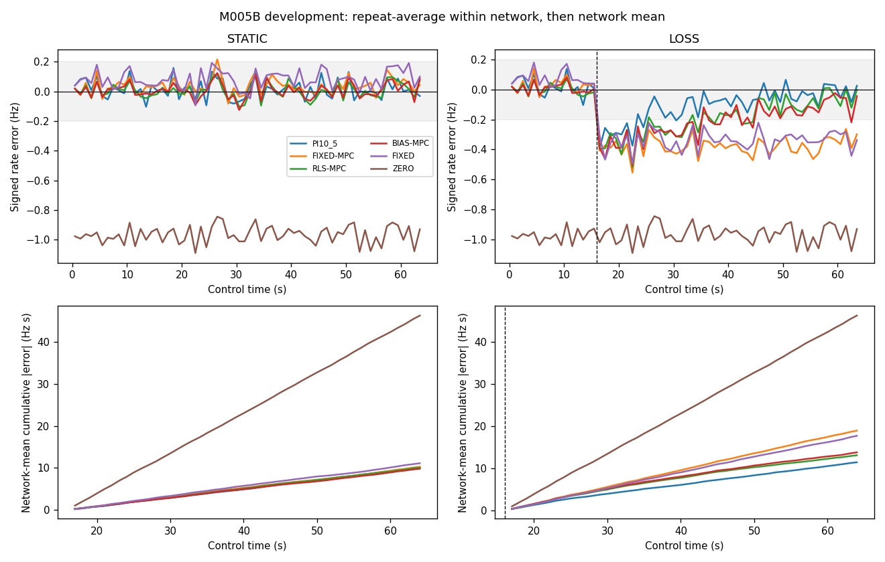
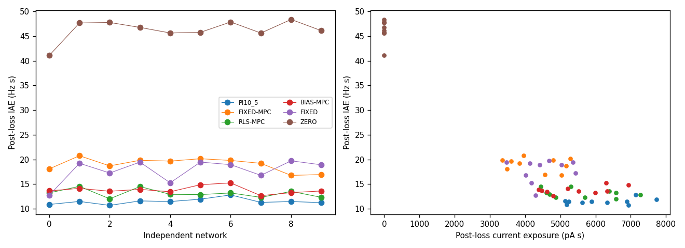

# M005B adaptive-control evaluation — Operation V1 Finish

Development execution PASS; development adaptive scientific FAIL. Validation not opened: development mandatory scientific gates failed. Locked100–119 remain unopened.

## Source, preservation and design

Starting Operation V1 revision fa8f0a71c29b15678bc6cb872d88eda49ab5c81a. Review branch codex/v1-finish. Neural acquisition source 457491390e8d3f25ad79b5cbe44bed03975805f6. Reporting source before final evidence commit 0a9b34e4145f4b42274c1e2b4966b772b2f791b9; final handoff supplies the exact containing revision. Historical M005B.2 readiness HOLD, M005A.5 FAIL and all earlier outcomes remain unchanged. No merge, tag or publication.

Protocol011 is unchanged:20development trials, networks0–9, noise47/48,13matched64s branches/trial after51s calibration. STATIC and LOSS×sixmethods, plus LOSS_MAX. Secondary faults: networks0–2/noise49,8branches/trial. PI10/5 remains frozen. No hyperparameter selection. Raw1s E80 rate is scored; loss at16s; primary error includes all48post-loss seconds. Three workers; original10800s development cap includes faults.

## Primary paired inference

Each entry is network-mean effect [paired whole-network95%interval]. Repeats average within network first;10000PCG64seed20261105resamples. Relative effect is mean within-network ratio, not ratio of cohort means.

| Comparison | Absolute IAE reduction (Hz s) | Relative reduction | Positive networks | Gate |
|---|---:|---:|---:|---|
| RLS versus PI | -1.6605 [-2.1952, -1.1480] | -0.1463 [-0.1937, -0.1009] | 0/10 | FAIL |
| RLS versus fixed MPC | 5.8486 [5.0431, 6.5566] | 0.3060 [0.2719, 0.3362] | 10/10 | PASS |

Required H1a floors:10%,1.2Hz s,positiveCIand8/10. H1b:5%,.6Hz s,positiveCIand8/10. Both are mandatory.

| Regime/controller | Post-loss-window IAE (Hz s) | Late bias (Hz) | Late MAE (Hz) | Calibration+control exposure (pA s) |
|---|---:|---:|---:|---:|
| STATIC/PI10_5 | 10.1555 [9.6173, 10.7159] | 0.0127 [-0.0071, 0.0304] | 0.2184 [0.2007, 0.2383] | 8051.9785 [7542.5699, 8583.6816] |
| STATIC/FIXED-MPC | 10.2820 [9.8319, 10.8037] | 0.0493 [0.0126, 0.0872] | 0.2142 [0.1967, 0.2293] | 8145.3500 [7554.0080, 8721.1800] |
| STATIC/RLS-MPC | 10.0408 [9.5442, 10.5231] | 0.0203 [0.0000, 0.0382] | 0.2069 [0.1899, 0.2251] | 8024.3500 [7484.5143, 8581.1800] |
| STATIC/BIAS-MPC | 9.8000 [9.2516, 10.3289] | 0.0195 [-0.0052, 0.0391] | 0.2076 [0.1895, 0.2278] | 8027.3500 [7484.0148, 8581.7048] |
| STATIC/FIXED | 11.1073 [10.3480, 11.9555] | 0.0931 [0.0582, 0.1346] | 0.2255 [0.2082, 0.2461] | 8400.9738 [7927.1616, 8888.0963] |
| STATIC/ZERO | 46.2837 [44.9068, 47.3488] | -0.9655 [-1.0003, -0.9321] | 0.9655 [0.9321, 1.0003] | 2400.0000 [2400.0000, 2400.0000] |
| LOSS/PI10_5 | 11.4687 [11.1526, 11.8397] | -0.0224 [-0.0423, -0.0034] | 0.2221 [0.2061, 0.2379] | 10060.2848 [9406.1375, 10738.4553] |
| LOSS/FIXED-MPC | 18.9778 [18.1426, 19.7402] | -0.3642 [-0.3955, -0.3379] | 0.3848 [0.3588, 0.4144] | 8145.3500 [7554.0080, 8721.1800] |
| LOSS/RLS-MPC | 13.1292 [12.6414, 13.6455] | -0.0730 [-0.0951, -0.0459] | 0.2026 [0.1806, 0.2215] | 9466.8500 [8751.0473, 10203.7243] |
| LOSS/BIAS-MPC | 13.8206 [13.4008, 14.2952] | -0.1128 [-0.1416, -0.0875] | 0.2285 [0.2100, 0.2464] | 9282.3500 [8623.0350, 9954.6820] |
| LOSS/FIXED | 17.7628 [16.3208, 18.9814] | -0.3271 [-0.3593, -0.2925] | 0.3533 [0.3228, 0.3805] | 8400.9738 [7927.1616, 8888.0963] |
| LOSS/ZERO | 46.2837 [44.9068, 47.3488] | -0.9655 [-1.0003, -0.9321] | 0.9655 [0.9321, 1.0003] | 2400.0000 [2400.0000, 2400.0000] |

STATIC column uses the same16–64s descriptive window; its stationary guard uses the full0–64s.

## All development networks

| Network | PI loss IAE | Fixed MPC loss IAE | RLS loss IAE | Bias MPC loss IAE | RLS late loss bias | RLS post-loss exposure |
|---|---:|---:|---:|---:|---:|---:|
| 0 | 10.8547 | 18.0703 | 13.2094 | 13.6141 | -0.0664 | 4605.0000 |
| 1 | 11.4688 | 20.7438 | 14.5297 | 14.1203 | -0.0953 | 5300.0000 |
| 2 | 10.6719 | 18.6828 | 12.0016 | 13.5375 | -0.1117 | 6575.0000 |
| 3 | 11.5766 | 19.8172 | 14.4844 | 13.9188 | -0.0668 | 4445.0000 |
| 4 | 11.4500 | 19.6594 | 12.9062 | 13.4359 | -0.1273 | 4690.0000 |
| 5 | 11.9250 | 20.1375 | 12.8625 | 14.8625 | -0.0762 | 7270.0000 |
| 6 | 12.7875 | 19.7922 | 13.1891 | 15.2281 | 0.0301 | 6585.0000 |
| 7 | 11.2781 | 19.1969 | 12.2953 | 12.6344 | -0.0828 | 4870.0000 |
| 8 | 11.4438 | 16.7531 | 13.5141 | 13.2609 | -0.0668 | 6390.0000 |
| 9 | 11.2312 | 16.9250 | 12.3000 | 13.5937 | -0.0672 | 5690.0000 |

Every replicate/branch is retained in analysis_primary/trial_metrics.csv and every1s outcome in timecourses.csv. No network exclusion or seed replacement.

## Guardrails and secondary outcomes

| Gate | Result | Detail |
|---|---|---|
| H2 persistent recovery benefit | False | -11.0500 [-14.7012, -7.6000] s; 0/10 positive |
| H3 STATIC/PI10_5 | True | 10/10 qualified; bias 0.0127 [-0.0071, 0.0304] Hz |
| H3 STATIC/FIXED-MPC | True | 10/10 qualified; bias 0.0493 [0.0126, 0.0872] Hz |
| H3 STATIC/RLS-MPC | True | 10/10 qualified; bias 0.0203 [0.0000, 0.0382] Hz |
| H4 dose STATIC | True | 0.9940 [0.9841, 1.0043] |
| H5 STATIC | True | relative harm -0.0300 [-0.0738, 0.0147] |
| H3 LOSS/PI10_5 | True | 10/10 qualified; bias -0.0224 [-0.0423, -0.0034] Hz |
| H3 LOSS/FIXED-MPC | False | 0/10 qualified; bias -0.3642 [-0.3955, -0.3379] Hz |
| H3 LOSS/RLS-MPC | True | 10/10 qualified; bias -0.0730 [-0.0951, -0.0459] Hz |
| H4 dose LOSS | True | 0.9054 [0.8888, 0.9220] |
| H5 LOSS | True | relative harm -0.0919 [-0.1663, -0.0177] |
| Safety | True | All constraints, model/fallback events retained |

H3 requires substantive1Hz/noise/headroom/late-bias/MAE conditions. H4/H5 prevent buying benefit with excessive dose or stationary harm. Detailed calibration, block windows, MAX headroom, saturation and per-network failure components are in the qualification table. H2 is finite-horizon retrospective persistence, not mathematical stability or an online detector.

## Independent verification

Raw verifier: 20trials,260branches,832000bins,384000model hashes,4800000candidate scores; violations=0,fallback_bins=0. Independent raw-target/statistical checks=6240; primary gates exactly reproduced. Independent weighted batch normal equations and scalar PI recurrence supplement exact codec replay. Secondary fault verification and shadow models are separate and cannot rescue gates.

## Costs and computation

Primary wall 5639.339s; secondary fault wall 509.778s. Both share the original development deadline. Forecast including15%margin 10434.058s; forecast is not an observed benchmark. Native-clock/resource samples retain actual polling cadence and peakRSS. No physical-sleep test or hard real-time claim.

| Controller | Decision command p50/p95/p99/max (ms) | Update p50/p95/p99/max (ms) | Planner p50/p95/p99/max (ms) | Safe bins |
|---|---|---|---|---:|
| PI10_5 | 0.023/0.049/0.079/16.256 | 0.011/0.024/0.041/40.482 | n/a | 0 |
| FIXED-MPC | 0.042/0.098/5.229/109.999 | 0.015/0.032/0.052/6.917 | 5.161/9.727/16.329/109.633 | 0 |
| RLS-MPC | 0.034/0.081/5.199/84.394 | 0.055/0.125/0.227/50.080 | 5.132/9.138/15.670/83.998 | 0 |
| BIAS-MPC | 0.034/0.081/5.211/66.835 | 0.037/0.080/0.119/34.547 | 5.144/9.775/18.374/66.749 | 0 |
| FIXED | 0.023/0.048/0.078/13.724 | 0.011/0.022/0.039/29.981 | n/a | 0 |
| ZERO | 0.022/0.048/0.075/28.121 | 0.011/0.023/0.039/4.280 | n/a | 0 |
| MAX | 0.022/0.048/0.078/21.863 | 0.011/0.023/0.040/12.951 | n/a | 0 |

Prediction accuracy and frozen-on-same-input comparisons are in model_diagnostics.json. Weak-excitation FIXED/ZERO shadows and shuffled-fit control are in shadows/summary.json; they do not establish alternative realized control. BIAS-MPC is the required intercept-only mechanism ablation. Coefficient changes are not physical gain identification.

## Figures

## Interpretation and next falsifiable step

Adaptive scientific success requires the conjunction, not a favorable isolated metric. If any mandatory gate fails, preserve frozen PI/fixed-model results and do not retune on these outcomes. Closed-loop weak excitation, baseline compensation, surrogate error and actuator limits are distinct explanations; these data alone do not identify their causal contributions. No biological, plasticity or intelligence claim follows.

Before a new adaptive study, prospectively test whether an explicitly budgeted identification intervention produces transferable held-out response prediction under closed-loop excitation, with stationary cost guards and competitive intercept-only/reference models. Any controller redesign requires a new frozen protocol; locked testing is not authorized by this report.

## Reproduction

See docs/V1_REPRODUCIBILITY.md, the committed analysis scripts and all launch/supervision records. Exact commands and deadline identities are retained in those records. Scientific source/configuration/SeedSequence roles and immutable historical hash manifest are preserved.

## Closing regression and procedural record

The complete final suite passed183tests,0failures/errors/skips,40.571s. All16,417historical tracked files remain unchanged. Final integrity verification passed parameter/noise regeneration, channel separation, worker reaping, exact pre-loss parity and full zero-input observed spike replay. The original statistics-publication Path error and its PARTIAL record remain preserved; the output-only repair was committed before faults, independently verified, and both original deadlines were retained. No neural trial was rerun or replaced.

Secondary faults completed24branches in509.778s; all action constraints and model checks passed. Expected fallback durations were53PI bins and100RLS bins. These do not count as unexpected primary failures. DELAY/DROP represent the same online absence after stale discard, not an asynchronous transport implementation. Hosted CI for these local commits remains unrun. See the V1 research report for complete measured resource/latency and qualification scope.
