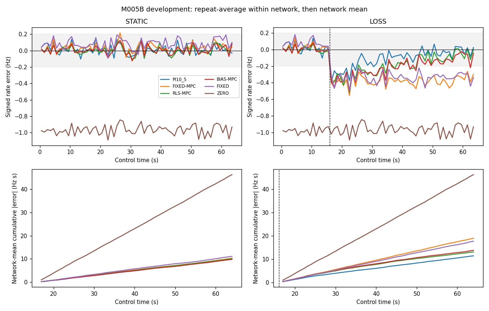
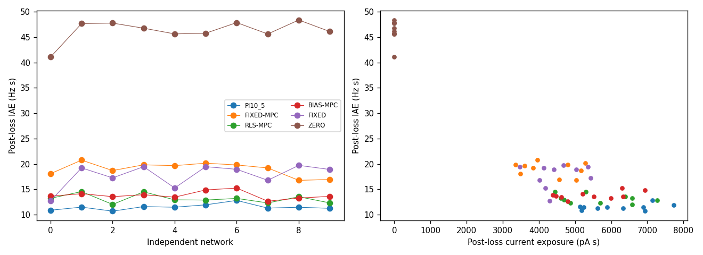

# NEUROMANCER V1 — research release candidate

**Primary scientific decision: adaptive superiority FAIL. Final release-candidate engineering decision: PASS; ready for final review. M006 HOLD. No merge, tag or publication.**

The completed development comparison supports frozen PI as the tracking reference for this simulated task. RLS adaptation improves control over fixed predictive control, but loses to PI on the preregistered cumulative post-loss endpoint in every development network. Lower dose and better final-window MAE do not overturn that result. Validation remains closed under protocol011. This is a useful negative finding, not evidence that adaptive control universally fails.

## Revisions and preserved history

Operation started from clean `fa8f0a71c29b15678bc6cb872d88eda49ab5c81a`, branch `research/m005b-2-scientific-evaluation`. Work is on `codex/v1-finish`. Scientific acquisition source is `457491390e8d3f25ad79b5cbe44bed03975805f6`; the output-publication repair and primary-decision freeze are at `a629e78daa356e073a72fcbc1a04f1b7fb5abfc0`. The final containing commit is supplied in the handoff and can be resolved with `git log -1 --format=%H -- reports/NEUROMANCER_V1_RESEARCH_REPORT.md`.

Historical V0.1/V0.2 failures, M003 model-necessity negatives, M004 limitations, M005A.5 FAIL, M005A.7 extended-horizon PI PASS and original M005B.2 readiness HOLD remain unchanged. The original [M005B.2 report](M005B_2_ADAPTIVE_CONTROL.md) is preserved; this operation's detailed comparison is in [the continuation report](M005B_V1_ADAPTIVE_CONTROL.md). Final reconciliation verified all 16,417historical tracked files hash-identical; no historical result was overwritten.

## Qualified environment and implementation scope

Local environment: CPython 3.12.15, macOS 26.5.2 arm64, Apple M5,10 CPUs,16 GiB memory. A new project-local `.venv` uses the original `requirements-m002.txt` pins; the incompatible Python3.14 environment was preserved under `venv/m001-python314-preserved`. `requirements-v1.txt` adds verification-only SciPy 1.18.0, matching the pre-existing local installation; no original pin was upgraded. NumPy 2.5.4, Brian2 2.10.1, SciPy 1.18.0 and pytest 9.1.1 import successfully; all project modules and `pip check` passed.

The scientific substrate, PI10/5, FIR/RLS equations, planner, target and protocol011 remain unchanged. A scheduling-only Brian callback completes each20ms observation/update before delivering the next command, while preparing one1s neural run at a time. Exact old/new comparisons cover public spike events/counts/actions, model/controller states, faults, an engineering gain step, failure handling and terminal neural fields where captured. This changes orchestration, not neural integration or control mathematics.

The lossless audit codec stores initial coefficients/information, actual input/output/validity streams, a SHA256 after every20ms model update, dense1s snapshots and every candidate score. Alternate forecasts are reconstructible from the saved origin model/history. Cache pruning was independently checked against the original retained-cache implementation. No neural parameter, action set or solver candidate was removed.

## Resource qualification and execution

The earlier11,278 s forecast exceeding10,800 s remains a historical HOLD. Bounded non-confirmatory checks found three workers faster than four; three were retained. Original and optimized two-second engineering branches took approximately7.50–9.21 s and2.80–3.52 s respectively, with exact numerical agreement. These small probes are not full-study benchmarks or standardized BLAS measurements.

The new role-weighted development forecast was9,073.09 s, or10,434.06 s with15%margin, below the unchanged10,800 s cap including secondary faults. Conditional validation forecast with margin was4,756.36 s against5,400 s. No enlarged scientific wall budget was used. The qualified boot-scoped `mach_continuous_time` deadline is shared by workers and cleanup; analysis has its separate original2,400 s deadline. Idle sleep is inhibited during neural execution. No physical sleep/resume test or hard real-time claim is made.

Actual primary acquisition completed20 trials and260 branches in **5,639.339 s**, representing17,660simulated seconds including prefixes. All prescribed neural data were retained. Secondary faults completed3 trials and24 branches in509.778 s. Development through the final fault closure, including the intervening verification/repair, consumed6,308.982 s of the original10,800 s contract. All workers were reaped with verified cleanup and no post-deadline cleanup. No neural trial was replaced or repeated.

Storage/monitoring disclosure: explicit storage-projection arithmetic was persisted during acquisition from already committed pre-acquisition engineering artifacts; it is not represented as a separately persisted pre-launch forecast. The original750MiB new-study and1.2 GiB combined limits remained enforced. Nominal1s monitoring includes filesystem/process-query overhead; measured cadence is reported below, not described as exact1s or hard real time. BLAS thread limits were requested, not independently proven to be the operating thread count.

## Frozen experiment

Networks0–9, noise47/48, original51s calibration and64s control. STATIC efficacy1; LOSS changes privately from1 to.6 at relative16s. C02 current(q,0,q,0),0–120 pA/channel,240 pA total,30 pA/channel/20 ms slew. Target is the original observation-derived baseline+1 Hz; no target clipping, future efficacy, private neural state or sham outcome enters a controller.

STATIC and LOSS each compare ZERO, calibrated FIXED, PI10/5, FIXED-MPC, RLS-MPC and BIAS-MPC, plus a LOSS MAX authority reference. Models share calibration, FIR form,625-candidate/two-second planner and initial parameters. Only the permitted update policy differs. No tuning or selection was authorized or performed. Calibration exposure is counted for every arm despite computational checkpoint reuse.

Primary IAE is all48post-loss seconds, using raw1s observed E80 rates. Noise repeats average within network first. Uncertainty is10,000 paired whole-network percentile-bootstrap draws, PCG64 seed20261105. Bins and repeats are not independent neural networks. Validation10–14/noise49–50 is forbidden after a failed development primary gate; it was not opened. Locked100–119 remain unopened.

## Primary numerical conclusion

Positive benefit below means reference IAE minus RLS IAE. Relative effects are means of within-network ratios.

| Required comparison | Absolute benefit, Hz s [95%CI] | Relative benefit [95%CI] | Positive networks | Decision |
|---|---:|---:|---:|---|
| RLS versus PI | −1.66047 [−2.19516,−1.14796] | −14.6306% [−19.3659%,−10.0940%] |0/10| FAIL |
| RLS versus fixed MPC |5.84859 [5.04307,6.55656]|30.5980% [27.1896%,33.6208%]|10/10| PASS |

H1a required at least10%,1.2 Hz s, positive paired confidence bound and8/10 positive networks. H1b independently required5%,.6 Hz s and the same confidence/count rule. **Both were mandatory. H1a fails decisively.** No denominator floor was activated in either primary comparison.

| LOSS method | Post-loss IAE, Hz s | Post-loss MAE, Hz | Late bias, Hz | Late MAE, Hz | Restricted recovery delay, s |
|---|---:|---:|---:|---:|---:|
| PI10/5 |11.46875|.23893|−.02242|.22215|29.45|
| FIXED-MPC |18.97781|.39537|−.36422|.38479|48.00|
| RLS-MPC |13.12922|.27353|−.07305|.20258|40.50|
| BIAS-MPC |13.82063|.28793|−.11281|.22853|42.65|
| Calibrated FIXED |17.76281|.37006|−.32715|.35333|48.00|
| ZERO |46.28375|.96424|−.96551|.96551|48.00|

Recovery uses the frozen persistent16s-window definition and48s right censor. PI had0/20censored repeats; RLS1/20, BIAS5/20, fixed MPC/FIXED/ZERO20/20. Adaptive recovery benefit versus PI was **−11.05 s [−14.70125,−7.60]**,0/10 positive networks: secondary H2 FAIL. This is finite-horizon evidence, not an asymptotic stability proof.

## Feasibility, cost and stationary guards

PI and RLS each qualified10/10 networks in both STATIC and LOSS under the frozen H3 late-bias/noise/headroom/MAE conditions. Fixed MPC qualified10/10STATIC and0/10LOSS. RLS late LOSS bias95%CI was[−.09512,−.04593]Hz; PI[−.04227,−.00340]Hz. Network-mean MAX headroom ranged .28828–1.05 Hz. None of the six compared primary policies reached120pA saturation; the prescribed MAX authority reference is excluded from that statement. These observations support attainable targets in this regime; they do not prove the full reachable set or exclude every authority limitation.

RLS/PI nominal current-exposure ratio was **.90542 [.88881,.92197]** post-loss and **.99399 [.98406,1.00435]** in STATIC: H4 PASS. RLS's lower dose is a real trade-off, not evidence of superior tracking. All arms include2,400 pA s calibration exposure; model charge is50 cells/channel times the current integral, not a hardware-electrode safety measurement.

H5 relative IAE harm was−3.0007% [−7.3818%,1.4717%] for full STATIC and−9.1854% [−16.6253%,−1.7682%] before loss: both PASS. Passing these guardrails does not rescue H1a. The complete per-network/repeat tables, block windows, dose, saturation and failures remain in machine-readable evidence.

## Prediction, excitation and interpretation

On the same actual RLS input histories, raw20ms four-sector prediction MSE fell from24.72359 Hz² for the frozen model to24.52763 Hz² for the adaptive model. That predictive improvement did **not** produce better cumulative control than PI. Prospective first-second four-sector forecast MSE on each controller's own trajectory was .35924for fixed MPC,.25587for RLS and.26094for BIAS; those between-arm values are descriptive on different trajectories, not a matched causal prediction comparison.

The terminal RLS kernel-scale projection averaged .90649, not the physical multiplier.6. It is not an identifiable gain estimate. Late reduced-feature windows included ranks1,10and11, with severe conditioning in some windows. Weak excitation and intercept/kernel confounding are therefore credible limitations, but these observational diagnostics do not prove a unique causal explanation for the recovery deficit. The fixed forgetting policy, surrogate model and planner objective may also contribute. No ablation or retuning was executed to rescue them.

BIAS-MPC's13.82063 Hz s versus RLS13.12922 Hz s is the required descriptive mechanism ablation. It does not establish universal kernel-adaptation necessity. PI's superior cumulative tracking and faster recovery support retaining it as the V1 default for this task. RLS remains an experimental comparator, not a qualified superiority claim.

## Verification and actual commands

Initial environment qualification ran the original173 tests successfully. The acquisition-source regression suite passed181 tests; analytical PASS/FAIL and confidence-only HOLD fixtures were added afterward. The closing full suite passed **183 tests,0 failures,0 errors,0 skips in40.571 s**. Final source/seed reconciliation PASS; exact pre-loss observations/actions/model states, full zero-input observed spike timing and gain-blind frozen-reference actions matched. Parameter/channel hashes and the fixed loss-boundary OU block67 were regenerated for all23 trials; common-noise hashes were checked across branches. No hidden neuron trajectory was newly acquired for these checks.

Independent primary reconstruction passed20 trials,260 branches,832,000 bins,384,000exact model-state digests and4,800,000 candidate scores. Zero constraint violations, fallback bins or invalid models. A second raw-count implementation reconstructed calibration and6,240metric calculations and reproduced every primary/statistical gate.

The first statistics publication attempt failed after all assertions because a CLI string output was not converted to Path. Its PARTIAL marker/log is preserved. The repair changed only output-path conversion in two analysis scripts, with both analytical gate fixtures rerun. No neural trajectory was repeated; neither original deadline was reset. See `ANALYSIS_PUBLICATION_REPAIR.md` and separate recovery supervision.

Executed principal commands, with requested thread limits1 and a writable Matplotlib cache:

```sh
.venv/bin/python -m pip check
.venv/bin/python -m pytest -q --junitxml=reports/evidence/v1_finish/frozen_source_tests.xml
.venv/bin/python -m neuromancer.m005b_study acquire --phase primary --output reports/evidence/v1_finish/m005b/primary
.venv/bin/python reports/evidence/v1_finish/finish_development.py
.venv/bin/python reports/evidence/v1_finish/recover_analysis.py
.venv/bin/python reports/evidence/v1_finish/final_qualification.py
```

Exact command arrays, output paths, clock domains and source hashes are retained in launch/supervision records; the abbreviated regression command above omits only its recorded fixture-directory option.

## Closing fault, runtime and evidence qualification

Secondary verification passed3 trials,24 branches,76,800 bins,38,400 model-state digests and472,500 candidate scores. Deliberate faults produced53 safe bins per PI branch and100per RLS branch, zero constraint violations and zero model failures. Full-trial descriptive MAE was .22344 Hz STATIC/.26221 Hz LOSS for PI, and.23986 Hz/.28045 Hz for RLS. These three-network, single-repeat diagnostics are descriptive and cannot rescue primary science. DELAY is represented by unavailable on-time bins and stale-data discard; its online absence is equivalent to DROP here. No asynchronous transport-stack or hardware-delay fidelity is claimed.

| Measured resource | Primary | Secondary faults |
|---|---:|---:|
| Neural acquisition wall s |5639.339|509.778|
| Peak live aggregate worker RSS, GiB |2.9913|2.9732|
| Peak individual worker RSS, GiB |1.1233|.9929|
| Poll cadence p50/p95/max, s |1.5532/1.7209/2.6746|1.6121/1.7560/2.0299|
| Poll intervals exceeding2s |19|1|

The nominal1s cadence deviation is explicit; this is not a hard-real-time monitor. Post-closing evidence accounting measured563,548,160bytes new evidence and999,387,136bytes combined evidence, below786,432,000and1,288,490,188byte caps. Additional final documentation/manifest allocation is reconciled at release closure.

| Predictive controller | Planner p50/p95/p99/max, ms | Update p50/p95/p99/max, ms | Planner deadline misses |
|---|---|---|---:|
| Fixed |5.161/9.727/16.329/109.633|.015/.032/.052/6.917|0|
| RLS |5.132/9.138/15.670/83.998|.055/.125/.227/50.080|0|
| Bias-only |5.144/9.775/18.374/66.749|.037/.080/.119/34.547|0|

There were7,680 primary plans, each evaluating all625 candidates. The250ms cap applied to planner construction/validation/release. Separate causal-cycle computation statistics in cycle_latency.json add the preceding completed-observation update to the next command at1s origins; they exclude neural waiting and observation/archival work. Measurements are local OS timings, not standardized BLAS or hard-real-time qualification.



Curves are network means after repeat aggregation. The gray band marks±.2 Hz, not a confidence interval. Cumulative cost averages absolute per-repeat error before network aggregation; it is not the absolute value of a mean signed-error curve.



The second figure retains every network. PI improves tracking while using more current than RLS; it is not claimed to dominate every cost/error trade-off. The frozen primary objective still favors PI.

Measured complete causal-cycle p50/p95/p99/max were .058/.101/.173/2.738 ms for PI,5.240/9.889/16.472/110.000 ms for fixed MPC, and5.417/9.579/16.961/84.656 ms for RLS. These use the documented controller-only sum, not end-to-end hardware latency.


## Release candidate and scope

The installable, unpublished wheel is `neuromancer-0.2.0-py3-none-any.whl`, SHA256 `3b5161cd74fe9ab4eadd8af45b42830fa235c3b958c200b00df73284b45cd936`. It was built, installed into a separate target directory and all package modules imported from that installed target. “V1” denotes the research candidate here; no1.0version/tag/release was published. The reproducible CLI is `python -m neuromancer.m005b_study`; fresh output roots avoid overwriting evidence.

A V1 CI workflow is prepared for pinned imports, dependency checks, full regressions, a non-confirmatory smoke and wheel build on Linux/macOS. No hosted CI PASS is claimed for these unpushed review commits. The connector's starting-revision query returned no PR-triggered workflow runs; that query is not an exhaustive history of all CI.

Supported V1 scope is a reproducible causal simulation instrument with transparent baseline comparisons and a preserved negative adaptive-control qualification. It does not establish living-neuron control, biological intelligence, neural plasticity, arbitrary target controllability, physical gain identification or hard real-time hardware compatibility. Numerical recomputation by separate algorithms is not an external laboratory replication.

## Evidence and next step

- [Reproduction instructions](../docs/V1_REPRODUCIBILITY.md)
- [Model methods and limitations](../docs/V1_METHODS_AND_LIMITATIONS.md)
- [Evidence schema](../docs/V1_EVIDENCE_SCHEMA.md)
- [Historical negative-result index](../docs/V1_NEGATIVE_RESULT_INDEX.md)
- [Frozen protocol011](../docs/research/011_M005B_CONTROL_PROTOCOL.md)
- Primary numerical evidence: `reports/evidence/v1_finish/m005b/primary` and `analysis_primary`.
- Independent verification, figures, faults and closing integrity records share that evidence root.

**M006 HOLD.** No locked evaluation plan is promoted after this failed primary gate, and no locked outcome was opened. A separately authorized prospective replication or budget-matched identification-information study would be the next falsifiable step; it must preserve this result and cannot retune against these outcomes. All authorized development acquisition, secondary diagnostics and closing verification are complete. The research candidate is ready for final review; publication, merging and tagging remain unperformed.


