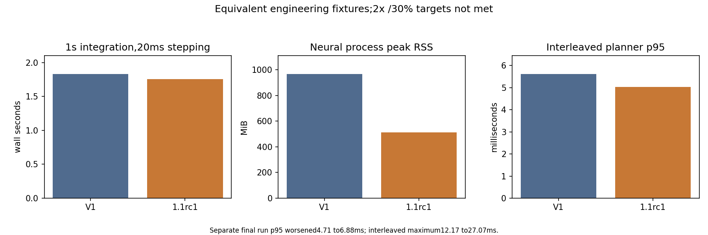

# V1 versus V1.1 candidate — measured comparison

2026-11-04. **Correctness qualification PASS on executed fixtures. Performance target
qualification PARTIAL:2x workflow/neural and30% p95 goals NOT MET. V1.1 publication HOLD.**
No scientific claim changed. No controller study, validation/locked-network acquisition,
backend replacement, retuning, merge, tag or release was performed.

## Revisions and release status

Actual initial checkout: `release/v1-audit`, `a504c0c7fc8e69aff003202f2a30dc6fadd2a537`, clean.
Fetched expected release source `abd811a053e10ad7ee5126efbc95fefd73e55c8d`.
V1 publication-review head: `7d63b1f52edbf69a95b76659aef4f478bdfac349`, PR#1 OPEN/MERGEABLE,
all six reported push/PR Linux/macOS/legacy checks SUCCESS. Main remains original011c3ce1;
no tags/releases existed. No protection/required-check policy was inferred from successful checks.
V1 MIT/version/source/evidence and wheel gates verified; ready for final maintainer authorization.
Release-only finalization report lives on that branch. No performance changes entered PR#1.

Performance baseline: branch performance/v1-1-baseline, `37f14c32` (P0 code/measurements only).
Candidate source freeze `57cba07e687e969f75972e0dddf0b1b04cc009c3`; hosted qualified
`39400fc41a74c9eac78a165ab2aef9840752b69a`, same package/test/workflow bytes.
Version1.1.0rc1. Final documentation/evidence commit is identified exactly in the handoff.
Scientific roadmap branch research/v1-1-proposals: `14d8fadd`.

## Environment and method

Apple M5,10logical CPUs,16GiB RAM; macOS26.5.2/arm64,Python3.12.15.
Brian2 2.10.1,NumPy2.5.4,SciPy1.18.0,pytest9.1.1 unchanged. Reused isolated M007
pinned environment; pip check passed. No added scientific dependencies. NumPy build/runtime
metadata retained; threadpoolctl/PyYAML unavailable for extra diagnostics. Actual BLAS thread
counts remain NOT VERIFIED; requested thread environment=1 is not a measured thread count.

Fixed manifest precedes production changes. Network0/noise0/root20261018,100us dt,1s neural
runs,3repeats per block/20ms mode;100planner calls,625candidates,100future bins;3fixed noise
blocks. Same engine reset and exact spike/observation hashes. First process run is cold for
Python modules, not cold disk cache. Profiling is separate from uninstrumented timings;
initial instrumented run retained and excluded from the designated uninstrumented comparison.
P0 corrected harness is preserved at37f14c32. Later inherited-deadline support does not change
its timed operations. No reserved scientific outcomes used for optimization selection.

Final matrix nests under one900s suspend-inclusive supervisor budget with tests, workflow,
evidence replay/figures and wheel build: COMPLETED in162.389s,737.611s remaining. No deadline
extension or cleanup failure. Additional fixed latency/retention/wheel probes each have
bounded qualified supervision; no unbounded search. RSS gates are completion high-water
checks, not OS allocation limits. Physical sleep not tested. Actual simulated seconds/wall
seconds are fixture throughput, not a forecasted full-study benchmark.

## Before/after table

| Component | Baseline | Candidate | Unit | Baseline/candidate |
|---|---:|---:|---|---:|
| 1s block |0.729837|0.729312|s|1.001|
| 1s stepped20ms |1.83207|1.75667|s|1.043|
| representative workflow |2.06153|2.03454|s|1.013|
| noise generation |0.131536|0.140962|s|0.933|
| planner bank p95 |0.613245|0.212498|ms|2.886|
| planner final-matrix p95 |4.71142|6.87516|ms|0.685|
| planner interleaved p95 |5.61722|5.02974|ms|1.117|
| planner interleaved maximum |12.1687|27.0716|ms|0.450|
| neural peak RSS |1.01392e+09|5.38083e+08|bytes|1.884|
| noise traced peak |4.80003e+08|2.40068e+08|bytes|1.999|

Baseline/candidate>1 means faster/smaller, except size ratios are not time speedups.
Neural1s block throughput:1.370 versus1.371 simulated seconds/wall second.
20ms-stepped throughput:0.546 versus0.569. Representative workflow includes construction,
causal PI stimulation/observation,serialization and reload:1.013x, not2x. It uses a declared
synthetic calibration and100ms feedback, so is an engineering fixture, not a reproduction of
scientific1s feedback qualification. Prediction-controller workflow separately uses500synthetic
20ms observations with10planning decisions; no tracking endpoint is scored.

### Latency, including regressions

The separate final matrix regressed planner p95 from4.711 to6.875ms and maximum from5.439
to40.415ms. These samples are NOT removed. To resolve variation, four fixed100-case
interleaved reference/candidate repeats were executed with alternating order, identical
inputs and no exclusions. Reference/candidate p50=4.585/4.007ms,p95=5.617/5.030ms,
p99=6.421/6.671ms,max=12.169/27.072ms. This supports modest median/p95 improvement in that
paired fixture and explicitly does not establish a tail-latency guarantee. The30% target
fails in both comparisons. All observed planner calls stayed below250ms; no hard real-time
claim follows. Forecast computation remains dominant after bank projection is reduced.

Complete synthetic command latency (500bins,only10planning decisions): reference/candidate
all-bin p50=.02150/.021125ms,p95=.025898/.026417ms,p99=4.70759/4.11913ms,
max=5.02817/4.45425ms. Planning-only p95=4.97732/4.35559ms. Ten decisions provide poor tail
precision; do not pool cheap non-planning bins to imply a planner guarantee. RLS accept/update
p95=.037633/.037962ms,max=.192/.21025ms. No model failures/fallbacks in this fixture.
All raw per-call wall/CPU times retained. No RLS/PI mathematical change was made.

### Memory and storage

Neural process peak RSS1,013,923,840 to538,083,328bytes:46.9% reduction in this fixture.
Noise peak traced allocation480,002,508 to240,067,874bytes:50.0% reduction.
Representative workflow process RSS947,683,328 to475,348,992bytes. These are process
high-water values, not steady-state memory or universal full-study limits. IPC parent CPU/RSS
excludes the nested neural child; aggregate child memory was not independently measured.

Three-repeat retention holds produce the same observations/population counts in every case.
Retained all-population event payload230,232bytes versus zero retained event arrays;
monitor counters still exist. Median1s hold timings (no-retention/retention):V1 .79945/.70521s,
candidate .74445/.72585s. This order-sensitive short sample does not establish that retaining
spikes is faster. Full monitoring/integration still occurs; no recording semantics changed.

V1 exact tracked Git payload1,218,982,248bytes:NPZ934,680,760;JSON225,015,689;
CSV32,638,997;PNG12,209,143;SVG7,161,152. Duplicate byte-payload potential242,193,894bytes
is an inventory estimate, not an implemented saving. No archive moved/deleted. Synthetic
integer NPZ compressed/uncompressed write/read/size measurements are retained, not a
claim of typical neural-data compressibility. Streaming/mmap/content-addressing require
manifest-preserving migration/recovery qualification; deferred.

### Scheduling/startup

Two identical independent1s IPC jobs took6.483s with one worker and3.804s with two workers
in baseline (1.704x bank speedup, startup included). Final measurements remain in final/workers*.json.
No scheduler default changed; this does not identify optimal scientific-study concurrency.
Initial construction .024397s versus .024515s, checkpoint .000293/.000317s,
restore .000109/.000113s. First code generation and all repeated-run setup are attributed
in cProfile; no C++ compilation occurs with explicit NumpyCodeObject. Cold-process combined
NumPy/Brian/SciPy/package imports were .503/.632/.513s versus .512/.515/.564s; disk caches
not flushed. No import speedup claimed.

## Independent correctness and scientific reproduction

Release source:183tests,25warnings,41.46s. P1:189tests,39.61s;P2:191tests,40.00s;
P3:199tests,40.17s;final:199tests,25warnings,41.74s. No skips/expected failures or warning
suppression. Historical suite covers causal bins,exact replay,checkpoints,seeds,isolation,
controllers,missing/delayed data,current/slew bounds,deadline escalation and descendant cleanup.
New tests cover original digest payloads,noise operation order,all625banks at floating-boundary
previous currents,full candidate forecasts/scores/actions and tie cases. Original source
snapshots preserve unchanged historical digests; optimized source hashes are explicitly new.

Every fixture's spike/observation signature,all100micro-plan/model coefficient signatures,
noise identities and400paired plan outputs matched exactly (timing excluded). Final causally
closed workflow actions/observations/PI state/FIR-RLS state matched original source exactly.
No hidden-state/controller API boundary changed. Statistical equivalence for a new backend
was NOT claimed or attempted.

Evidence-only reproduction executed original analyzer, independent model and metric verification,
and figure generation. All four tables/summary and all four PNG/SVG outputs are byte-identical.
No new scientific trajectories acquired. Frozen development20trials/260branches result remains:
PI11.46875,RLS13.12921875,fixedMPC18.9778125Hz*s. RLS benefit vsPI −1.66046875Hz*s,
95%CI[−2.19515625,−1.14796484];vsfixed +5.84859375,[5.04307422,6.5565625].
Adaptive-superiority FAIL unchanged; no validation/locked networks opened. Earlier negative
findings remain unchanged. No stronger biological,plasticity,hardware-safe or generalization claim.

Full35558-file baseline manifest checked:35553unchanged,zero missing. Five authorized evolving
paths:README,pyproject,_brian,planner,provenance test. Original README/simulator/planner bytes
archived; all scientific protocols,raw numerical archives and historical reports unchanged.

## Wheel and CI

Both wheels were built/installed (not editable) into the reused isolated pinned environment,
imported from site-packages outside checkout,pip check passed,and installed CLI smoke executed.
V1wheel83,611bytes SHA256809253b5676b3e3b76181cf50db811716e515a53ba89b548e71a4fb9d071c86f;
candidate83,849bytes SHA256836d68bb336a18ca5790bb3dd11e55754637faa7b526c677a07247b79f1cc09f.
Both embed MIT LICENSE and exclude scientific archives. Publication must use its actual built
artifact checksum; ZIP timestamps can vary across builds.

[V1 exact-head CI](https://github.com/adithyakupad/neuromancer/actions/runs/41785663644):PASS.
[Candidate CI at39400fc4](https://github.com/adithyakupad/neuromancer/actions/runs/41786670643):
Linux199passed/25warnings/72.80s;macOS199passed/25warnings/91.94s. Wheel/install/pip-check/smoke
and legacy CI PASS. Later changes are audit/benchmark/documentation only; final-head CI status
is supplied in the handoff, not inferred. No performance benchmark was run on hosted hardware,
so cross-platform performance is NOT VERIFIED. Full Linux scientific acquisition remains unqualified.

## Decisions and next work

| Gate | Decision |
|---|---|
| V1 publication preparation |PASS, awaiting explicit maintainer merge/tag/publish authorization|
| Executed numerical/source preservation |PASS with separately versioned source changes disclosed|
| Local/hosted software qualification |PASS on recorded source; final-head status visible separately|
| Memory reduction |PASS on measured fixtures|
|2x workflow /2x neural goals |FAIL|
|30% p95 latency goal |FAIL; tail regressions visible|
| V1.1 review candidate |PARTIAL; HOLD publication/performance-success claim|
| New scientific superiority/biological claim |NOT ESTABLISHED|

Largest remaining cost:Brian before_run/code generation and forced GC under frequent run(),
then neural code execution. Do not monkeypatch Brian lifecycle/GC or replace closed-loop
feedback with predeclared batching to manufacture speed. Investigate a supported compiled
runtime as a separately qualified backend; first require exact timing/noise/replay contracts
or label trajectory changes explicitly. Preserve transparent FIR/PI baselines.

Scientific roadmap is committed separately at research/v1-1-proposals: first audit multistep
forecast bias/uncertainty; then prospectively separate disturbance rejection,planner objective
and excitation mechanisms. No future experiment is authorized by this optimization audit.
